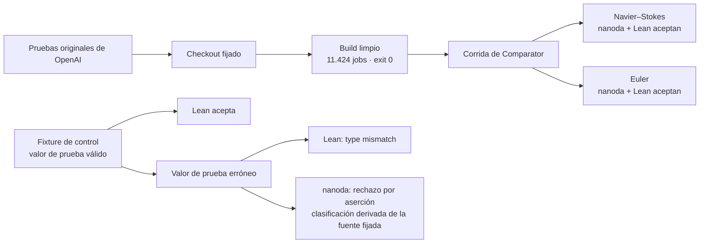
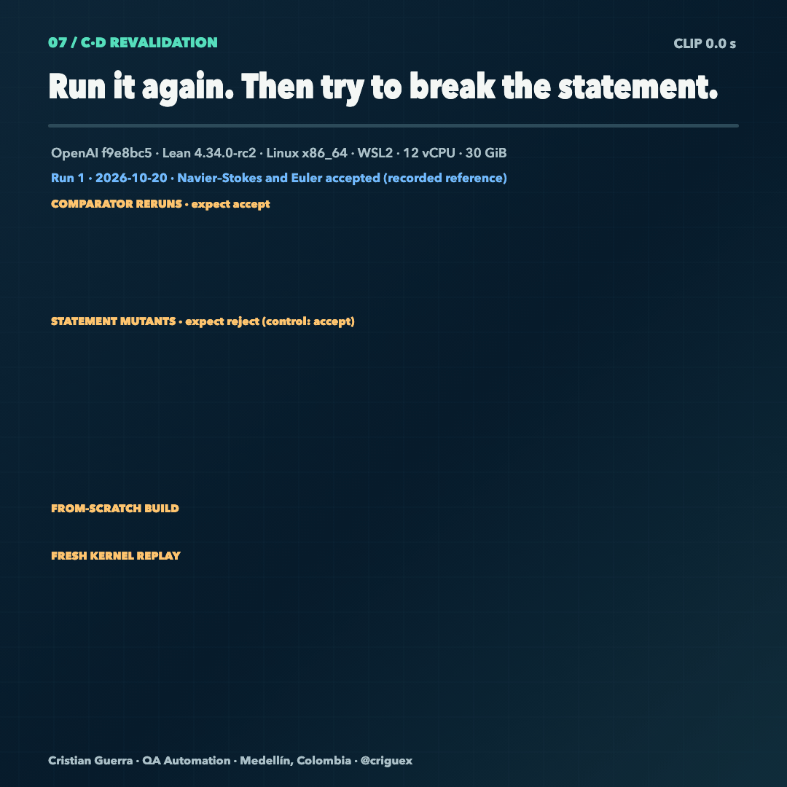
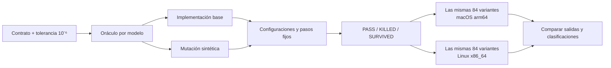

# Scientific QA Evidence

**Reproducción independiente, con enfoque de QA, de las pruebas en Lean de OpenAI sobre explosión en tiempo finito para Navier–Stokes y Euler, más una campaña de pruebas de mutación sobre nueve modelos numéricos.**

Por **Cristian Guerra**, QA Automation, Medellín, Colombia ([@criguex](https://github.com/criguex)) · [Read in English](README.md)

> **Lee esto primero.** Las pruebas son de OpenAI ([openai/NavierStokesAndEuler](https://github.com/openai/NavierStokesAndEuler)). Este repositorio no demuestra nada nuevo, no reclama ningún resultado del Premio del Milenio y no es una revisión matemática. Es un ejercicio de QA de software: reconstruir los artefactos publicados desde fuentes fijadas, volver a verificarlos con dos verificadores de pruebas independientes, confirmar que un verificador rechaza una prueba deliberadamente errónea y publicar cada resultado con hashes para que cualquiera pueda auditarlo.

## Por qué existe

En septiembre de 2026 OpenAI publicó formalizaciones en Lean 4 de las alternativas (C) y (D) del problema de Navier–Stokes del Instituto Clay (ruptura con fuerza externa en ℝ³ y en el toro periódico), y un resultado aparte de singularidad en tiempo finito para la ecuación de Euler en 3D ([anuncio](https://openai.com/index/navier-stokes-solution/)). Una prueba verificada por máquina solo es tan confiable como el build, el enunciado y el verificador que la respaldan. Esas son preguntas de pruebas de software:

1. ¿Compila desde un checkout limpio y fijado?
2. ¿Los kernels independientes la aceptan frente al enunciado oficial del desafío?
3. ¿Los verificadores notarían si una prueba estuviera mal?
4. ¿El método de pruebas detecta errores? Esa es la campaña de mutación numérica.

## Resultados en resumen

| Pregunta | Qué se hizo | Resultado |
| --- | --- | --- |
| ¿Compila desde la fuente fijada? | `lake --no-cache build` sobre el commit `f9e8bc5` de OpenAI, Lean 4.34.0-rc2 | Exit 0, 11.424 jobs. Se reutilizaron cachés de dependencias, así que no es un bootstrap completo. |
| ¿Lo aceptan verificadores independientes? | [Comparator](https://github.com/leanprover/comparator) con el kernel de Lean y [nanoda](https://github.com/ammkrn/nanoda_lib) sobre los desafíos configurados | Navier–Stokes y Euler: ambos kernels aceptan (`Your solution is okay!`, exit 0) |
| ¿El enunciado coincide con el texto de Clay? | Tabla cláusula por cláusula contra el PDF de Clay y el enunciado de [Formal Conjectures](https://github.com/google-deepmind/formal-conjectures) de Google DeepMind en `8bf45ed` | Correspondencia mapeada y brechas abiertas listadas. Es documental, no una prueba experta de equivalencia. |
| ¿Comparator revisa el enunciado exacto? | Mutantes del enunciado en el archivo del desafío, sin tocar la prueba de OpenAI, más un control que solo agrega un comentario ([revalidación](evidence/formal/cd-validation/README.md)) | 6 de 6 mutantes rechazados por enunciado distinto; el control que solo agrega un comentario fue aceptado |
| ¿Los verificadores rechazan una prueba errónea? | Un fixture cuyo valor de prueba es incorrecto pero conserva el tipo declarado | Lean reporta *type mismatch*; nanoda se detiene con un rechazo por aserción |
| ¿Las pruebas numéricas detectan errores? | 9 modelos sintéticos × 3 configuraciones, cada línea base más mutaciones conocidas: 84 variantes | 27 PASS · 54 KILLED · 3 SURVIVED por máquina |
| ¿Es reproducible entre máquinas? | Las mismas 84 variantes en macOS arm64 y Linux x86_64 | Clasificaciones idénticas; diferencia escalada máxima de 1,11 × 10⁻¹⁶ |

## Verifícalo tú mismo

Solo Python 3, sin dependencias, alrededor de un minuto:

```sh
git clone https://github.com/criguex/scientific-qa-evidence.git
cd scientific-qa-evidence
shasum -a 256 -c evidence/SHA256SUMS.txt     # en Linux: sha256sum -c
python3 evidence/verify_numerical.py
python3 -m unittest discover -s animations -p 'test_*.py'
```

El verificador numérico debe imprimir:

```text
PASS: 2 summaries, 168 case records, 2 x 756 observation rows, 738 finite pairs, 18 null pairs; max scaled delta 1.1102230246251565e-16.
```

Esos comandos comprueban la integridad y la consistencia de la evidencia guardada; no la recalculan. Para recalcular toda la campaña numérica desde cero (menos de un segundo), pasa un directorio de salida que todavía no exista:

```sh
cd evidence/numerical/source
python3 runner.py --out /tmp/sqe-rerun
```

Debe reportar 84 variantes con `KILLED: 54, PASS: 27, SURVIVED: 3`. Reconstruir el proyecto Lean y volver a correr Comparator requiere el repositorio de OpenAI y una toolchain de Lean; las versiones fijadas y el procedimiento registrado están en [`evidence/formal/clean-build/`](evidence/formal/clean-build/README.md).

## Pista 1: reproducción formal y controles



Comparator comprueba que la solución enviada demuestre exactamente el teorema enunciado en el archivo del desafío, usando solo los axiomas permitidos (`propext`, `Quot.sound`, `Classical.choice`). Cada desafío se corrió una vez después del build. Las transcripciones depuradas, los tiempos y los hashes de los originales están en [`evidence/formal/comparator/`](evidence/formal/comparator/README.md). El fixture de prueba errónea y sus clasificaciones están en [`evidence/formal/kernel-mutation/`](evidence/formal/kernel-mutation/). La tabla de correspondencia con Clay está en [`evidence/formal/clay-lean-fidelity.md`](evidence/formal/clay-lean-fidelity.md).


### Revalidación de (C) y (D), 2026-10-21 · en curso

<a href="animations/validation.html"></a>

Se hizo una segunda pasada para cerrar las brechas de [Limitaciones conocidas](#limitaciones-conocidas): volver a correr Comparator, intentar romper el enunciado del desafío, revisar de nuevo cada declaración en un kernel con entorno vacío y compilar desde cero sin cachés. Hallazgos hasta ahora:

- **El resultado se repite.** Comparator volvió a aceptar Navier–Stokes (C y D) y Euler sobre el mismo build. Aceptaron tanto nanoda como el kernel de Lean, en 7,0 y 11,2 minutos.
- **Comparator compara el enunciado exacto.** Cada mutante edita solo el archivo del desafío y no toca la prueba de OpenAI. Los seis mutantes fueron rechazados con `Challenge and solution theorem statement do not match`: `f = 0` agregado a (C) y a (D) (versiones sin fuerza), los datos con decaimiento en ℝ³ cambiados por datos periódicos, `nu > 0` debilitado a `nu ≥ 0`, la negación quitada en (D) y el `T* ≤ 1` de Euler endurecido a `T* ≤ 1/2`. Un control que solo agrega un comentario sí fue aceptado, así que los rechazos vienen del enunciado cambiado y no de editar el archivo.
- **Una revisión del kernel desde cero coincide.** `leanchecker --fresh` volvió a cargar cada declaración, Mathlib incluido, en un entorno vacío y aceptó las dos soluciones: Navier–Stokes en 19,6 minutos y Euler en 22,5 minutos, ambas con exit 0 y sin errores. Usa el mismo kernel de Lean que Comparator, así que confirma que el build guardado se puede revisar desde cero; no es una tercera implementación de kernel.
- **Lo que los mutantes no muestran.** Que un mutante sea rechazado no dice si el enunciado mutado es verdadero o falso. Los mutantes con `f = 0` no son evidencia sobre las alternativas sin fuerza (A) y (B), que siguen abiertas.
- **Todavía corriendo:** el build desde cero con una tercera corrida de Comparator y un intento con `lean4lean`.

La tabla en vivo, los veredictos, los logs depurados y el diff de cada mutante están en [`evidence/formal/cd-validation/`](evidence/formal/cd-validation/README.md) (en inglés).

## Pista 2: pruebas de mutación numéricas



Las pruebas de mutación preguntan si una suite nota cuando el código se rompe a propósito. El contrato y su tolerancia se congelaron antes de cualquier corrida ([`CONTRACT.md`](evidence/numerical/source/CONTRACT.md), en inglés). Cada modelo tiene un oráculo independiente que no comparte código de solver con la implementación bajo prueba. Los nueve modelos son: circuito RC, enfriamiento de Newton, cinética química de segundo orden, atenuación de Beer–Lambert, respuesta logística, refracción de Snell, lente delgada, interfaz acústica y respuesta de Fechner.

Cada máquina registró **27 PASS, 54 KILLED y 3 SURVIVED** sobre las mismas **84 variantes pareadas**, no 168 distintas. La comparación cubrió 738 valores finitos y 18 no finitos (guardados como null). Los tres sobrevivientes son la mutación RC deliberadamente diminuta, que se deja visible a propósito. Todos los modelos y entradas son sintéticos; nada de esto es una medición empírica.

## Animaciones

Abre la [galería offline](animations/index.html) o lee la [guía de animaciones](animations/README.md) (en inglés) con ecuaciones, parámetros, resultados y trazas de fuente.

| Modelos numéricos | Campaña y controles formales |
| --- | --- |
| <a href="animations/rc.html">RC · constante de tiempo duplicada</a><br> | <a href="animations/campaign.html">Campaña · clasificaciones pareadas</a><br> |
| <a href="animations/chemistry.html">Química · tasa de reacción duplicada</a><br> | <a href="animations/formal.html">Formal · control de tipado del valor de prueba</a><br> |
| <a href="animations/cooling.html">Enfriamiento · constante a la mitad</a><br> | <a href="animations/snell.html">Snell · índices de refracción intercambiados</a><br> |
| | <a href="animations/validation.html">Revalidación C/D · reejecuciones y mutantes del enunciado</a><br> |


El clip de flujo 3D es solo contexto visual. No es dato de la campaña, ni evidencia de explosión, ni una construcción formal; su procedencia está en [SOURCE_PROVENANCE.md](evidence/SOURCE_PROVENANCE.md).

## Limitaciones conocidas

Un informe de QA solo sirve si dice lo que no probó.

- **No es un bootstrap completo.** El build reutilizó cachés de dependencias y de toolchain.
- **Corridas repetidas, una sola máquina.** Comparator ya corrió dos veces por desafío sobre el mismo build (2026-10-20 y 2026-10-21); una tercera corrida sobre un build desde cero está en curso. Todas las corridas usaron una sola máquina Linux. Las transcripciones originales no se distribuyen; sí las copias depuradas y los hashes de los originales.
- **Dos implementaciones de kernel.** Hasta ahora solo el kernel de Lean y nanoda han aceptado las pruebas. `leanchecker --fresh` revisó las dos soluciones desde un entorno vacío sin errores; usa el mismo kernel de Lean, así que es una revisión desde cero y no una tercera implementación. [lean4lean](https://github.com/digama0/lean4lean) está fijado a Lean v4.33 en su repositorio y solo se intenta como prueba adicional.
- **Comparator standalone.** La corrida usó la herramienta independiente fijada en `19e111e`. Comparator ya se integró al núcleo de Lean como `lake comparator` y `lake check` (Lean v4.35.0); el resultado no se ha repetido con esas herramientas.
- **Un solo fixture de prueba errónea.** El control formal muestra que los verificadores rechazan un valor de prueba erróneo. No es una campaña de mutación sobre las pruebas de OpenAI. Los mutantes del enunciado del 2026-10-21 prueban el lado del desafío: muestran que Comparator rechaza un enunciado cambiado, no que la prueba fallaría si estuviera rota.
- **La tabla de Clay es documental.** Lista las cláusulas y las brechas pendientes; no la ha revisado un matemático.
- **54 KILLED cuenta casos, no comportamientos distintos.** En el modelo acústico, `pressure_boundary_sign` e `impedance_swap` producen salidas idénticas en las tres configuraciones, así que hay 51 comportamientos eliminados distintos.
- **Las mutaciones son gruesas.** La mutación eliminada más pequeña tiene un error normalizado de 0,12, unas 120.000 veces la tolerancia de 10⁻⁶. La única mutación cercana al umbral (RC `tau_tiny`, un cambio relativo de 5 × 10⁻⁸) sobrevive entre 56 y 68 veces por debajo de la tolerancia. No se muestrearon tamaños intermedios, así que la campaña no ubica dónde empieza la detección.
- **Modelos y oráculos sintéticos.** Aquí no se valida ningún dato de laboratorio, sistema real ni resultado científico.
- **El verificador es un chequeo de integridad.** `verify_numerical.py` compara los registros guardados contra sus hashes originales y entre máquinas; el recálculo es el paso aparte con `runner.py`.

Cada afirmación, su redacción exacta y su archivo de evidencia están mapeados en [CLAIMS.md](CLAIMS.md) (en inglés).

## Cómo se usó la IA

El trabajo fue asistido por IA y dirigido por una persona. OpenAI Codex fue el agente principal de código: bajo la dirección del autor preparó código, corrió builds y renders y redactó borradores. Claude Code, de Anthropic, hizo los cambios posteriores de documentación y limpieza. Cada commit nombra al agente que participó en un trailer `Co-Authored-By`. Otros asistentes de IA ayudaron con análisis, traducción y revisión. Cristian Guerra eligió las preguntas, congeló el contrato, decidió qué cuenta como evidencia, volvió a correr los verificadores y responde por cada afirmación. Los detalles están en [AUTHORSHIP.md](AUTHORSHIP.md).

## Mapa del repositorio

```text
evidence/
  formal/              build limpio, logs de Comparator, fixture de prueba errónea, tabla Clay–Lean
  numerical/           contrato congelado, fuente, corridas de 84 casos en macOS y Linux
  verify_numerical.py  chequeo de integridad y entre máquinas de las corridas guardadas
  SHA256SUMS.txt       checksums de cada archivo curado
animations/            seis escenas HTML offline, script de build y tests
docs/assets/           GIFs de vista previa usados en este README
CLAIMS.md              afirmación → alcance → evidencia
AUTHORSHIP.md          autoría y declaración de uso de IA
CONTRIBUTING.md        reglas para modificar la evidencia
```

## Créditos, derechos y estado

- **Pruebas originales:** sus autores en OpenAI. **Enunciado del desafío:** Formal Conjectures de Google DeepMind. **Herramientas:** Lean 4, mathlib, Comparator, nanoda.
- **Este estudio de QA:** Cristian Guerra. Para citarlo, usa [CITATION.cff](CITATION.cff).
- **Derechos:** la publicación está autorizada, pero no se otorga licencia de código abierto. Ver [LICENSE_STATUS.md](LICENSE_STATUS.md).
- **Estado:** en [X](https://x.com/criguex/status/2112679712157753441) está publicado un hilo introductorio con vistas previas de las animaciones.

No se reclama descubrimiento de teoremas, certificación científica, validación empírica ni prueba sobre un sistema del mundo real.
