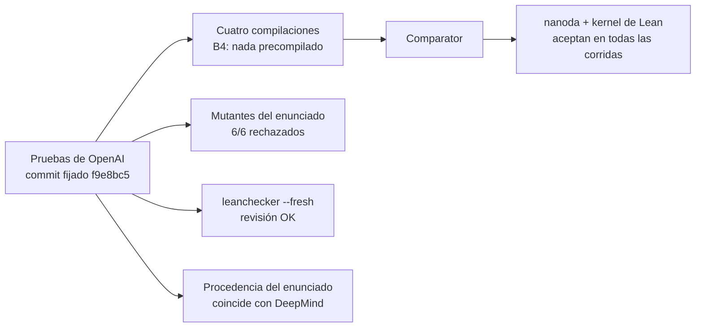

# Scientific QA Evidence

**Una auditoría de QA independiente de las pruebas en Lean de OpenAI sobre la explosión en tiempo finito para Navier–Stokes y Euler, más una campaña de pruebas de mutación sobre nueve modelos numéricos.**

Por **Cristian Guerra**, QA Automation, Medellín, Colombia ([@criguex](https://github.com/criguex)) · [Read in English](README.md) · [Resumen en PDF de cinco páginas](docs/report/scientific-qa-evidence-report-v1.2.0.pdf) (en inglés)

> **Lee esto primero.** Las pruebas son de OpenAI ([openai/NavierStokesAndEuler](https://github.com/openai/NavierStokesAndEuler)). Este repositorio no demuestra nada nuevo, no reclama ningún resultado del Premio del Milenio y no es una revisión matemática. Es un estudio de QA de software: recompilar los artefactos publicados, volver a verificarlos con verificadores independientes, comprobar si la propia cadena de verificación detecta errores y publicar cada paso con hashes para que cualquiera lo pueda auditar.

## Conclusiones

1. **Las pruebas de OpenAI para (C), (D) y Euler verifican, de forma repetida y desde cero.** Comparator, con nanoda y el kernel de Lean, aceptó los dos desafíos sobre cuatro compilaciones distintas, la última compilada entera desde la fuente sin nada precompilado. Una revisión nueva con `leanchecker` coincidió, y el kernel usado incluye todas las correcciones de solidez conocidas de 2026.
2. **Comparator revisa el enunciado exacto.** Rechazó los seis cambios de un símbolo al desafío y aceptó un control de solo comentario. Las 18 declaraciones del desafío coinciden con el enunciado público de DeepMind tras normalización textual (la resolución de nombres no se verificó).
3. **Lo que esto no resuelve.** Si el enunciado formal dice exactamente lo mismo que el texto de Clay sigue abierto: una revisión de lectura deja un punto, la presión periódica en (D), que necesita un matemático, y el trabajo formal de puentes apenas empieza (Parte D). Si la prueba en Lean sigue el artículo de OpenAI está fuera de alcance y lo disputa [arXiv:2610.08144](https://arxiv.org/abs/2610.08144).
4. **Lo que aporta el protocolo.** En este caso mostró evidencia que el procedimiento documentado no produce ([FINDINGS.md](FINDINGS.md)), y en un benchmark prerregistrado sus checks marcaron cuatro clases de fallo sembradas que el procedimiento base deja pasar ([resultados](experiments/blind-faults/RESULTS.md)). Cuatro rondas de revisión encontraron 17 problemas en ese mismo experimento, todos corregidos y conservados en el registro.
5. **Lo que no se afirma.** Novedad metodológica ([RELATED_WORK.md](RELATED_WORK.md)), una tasa de detección en el mundo real, ni ninguna parte de la prueba matemática, que pertenece a OpenAI.

## Resultados en resumen

| Pregunta | Resultado | Registro |
| --- | --- | --- |
| ¿Compila desde la fuente? | Sí. Cuatro compilaciones; la última (B4, `lake --no-cache build`) exit 0, 11.424 jobs, 1 h 29 min, todas las dependencias compiladas localmente. | [compilaciones](evidence/formal/cd-validation/README.md#builds-used-by-each-run) |
| ¿La aceptan kernels independientes? | Sí. Comparator con nanoda y el kernel de Lean aceptó Navier–Stokes (C, D) y Euler en las cuatro corridas, una por compilación. | [revalidación](evidence/formal/cd-validation/README.md) |
| ¿Comparator revisa el enunciado exacto? | Sí. 6 de 6 mutantes del enunciado rechazados; control de solo comentario aceptado. | [mutantes](evidence/formal/cd-validation/mutants/) |
| ¿El desafío es el enunciado público? | Las 18 declaraciones coinciden tras normalización textual; la resolución de nombres no se verificó. | [procedencia](evidence/formal/statement-provenance/README.md) |
| ¿Los verificadores están al día? | El código del kernel incluye todas las correcciones de solidez de 2026; nanoda es posterior a su corrección. | [vigencia del kernel](evidence/formal/kernel-currency.md) |
| ¿Rechazan una prueba errónea? | Sí. Lean reporta un error de tipos; nanoda se detiene con un rechazo por aserción. | [mutación del kernel](evidence/formal/kernel-mutation/) |
| ¿El enunciado formal coincide con el texto de Clay? | Abierto. De 16 cláusulas, 6 coinciden directamente, 9 por hechos estándar y 1 necesita una decisión humana. | [revisión de riesgos](evidence/formal/clay-lean-risk.md) |
| ¿Las pruebas numéricas detectan errores? | 27 PASS · 54 KILLED · 3 SURVIVED por máquina, idénticos en macOS arm64 y Linux x86_64. | [numérica](evidence/README.md) |
| ¿El protocolo detecta lo que el procedimiento base deja pasar? | Con fallos sembrados, sí: cuatro clases de fallo que el protocolo marca y el procedimiento base deja pasar. | [benchmark](experiments/blind-faults/v2/README.md) |

Cada afirmación con su evidencia, resultado y limitación está en [CLAIMS.md](CLAIMS.md) (en inglés).

## Verifícalo tú mismo

Python 3.9 o más reciente, sin dependencias, alrededor de un minuto:

```sh
git clone https://github.com/criguex/scientific-qa-evidence.git
cd scientific-qa-evidence
shasum -a 256 -c evidence/SHA256SUMS.txt                           # cada archivo curado es el publicado
python3 evidence/verify_numerical.py                               # corridas guardadas intactas e idénticas entre máquinas
(cd evidence/numerical/source && python3 -m unittest test_runner)  # vuelve a correr las 84 variantes numéricas
python3 evidence/test_consistency.py                               # README, CLAIMS y registros coinciden
```

Las mismas comprobaciones, y los tests de todos los demás scripts, corren en [GitHub Actions](.github/workflows/verify.yml) en Ubuntu y macOS en cada push. [REPRODUCE.md](REPRODUCE.md) (en inglés) da las versiones, los pasos desde un checkout limpio y qué resultados se recalculan y cuáles solo se verifican por hash. Las compilaciones de Lean necesitan el repositorio de OpenAI y una máquina Linux; aquí sus registros se verifican por hash.

## Parte A · Auditoría formal de (C), (D) y Euler



Comparator comprueba que la solución prueba exactamente el teorema del archivo de desafío, usando solo los axiomas permitidos (`propext`, `Quot.sound`, `Classical.choice`). La primera corrida (2026-10-20) está en [`evidence/formal/comparator/`](evidence/formal/comparator/README.md). La revalidación del 2026-10-21 añadió tres corridas más, mutantes del enunciado y una revisión desde cero. Terminaron las 18 pruebas: ninguna dio un resultado inesperado y una no pudo correr.

| Animación | Qué muestra |
| --- | --- |
| <a href="animations/rerun.html"></a><br><a href="docs/media/rerun.mp4">▶ MP4 1080p</a> | **Recompilar y volver a verificar.** Cuatro compilaciones: el registro del 2026-10-20 (B1), una de auditoría cuyo Mathlib vino de la caché precompilada (B2), una nueva (B3) y una completa con `lake --no-cache build` (B4), con todas las dependencias compiladas localmente. Comparator aceptó los dos desafíos en cada una. B3 había recibido en silencio 7 dependencias pequeñas como archivos precompilados de [Reservoir](https://reservoir.lean-lang.org); por eso existe B4. Se reutilizaron la toolchain de Lean y los binarios de los verificadores. |
| <a href="animations/mutants.html"></a><br><a href="docs/media/mutants.mp4">▶ MP4 1080p</a> | **Cambiar el enunciado: debe ser rechazado.** La prueba de OpenAI nunca se toca. Seis cambios de un símbolo al desafío fueron rechazados con `Challenge and solution theorem statement do not match`; un control de solo comentario fue aceptado. Que un mutante sea rechazado no dice si el enunciado mutado es verdadero, y los mutantes con `f = 0` no dicen nada sobre (A) o (B). |
| <a href="animations/replay.html"></a><br><a href="docs/media/replay.mp4">▶ MP4 1080p</a> | **Revisar cada paso desde un entorno vacío.** `leanchecker --fresh` aceptó las dos soluciones. Usa el kernel de Lean, así que no es una tercera implementación. `lean4lean` no compiló para Lean 4.34 y nunca revisó las pruebas. |
| <a href="animations/provenance.html"></a><br><a href="docs/media/provenance.mp4">▶ MP4 1080p</a> | **De dónde viene el enunciado.** Las 18 declaraciones coinciden tras normalización textual; la resolución de nombres no se verificó. Las diferencias restantes con el archivo de Formal Conjectures de Google DeepMind son el import, el namespace, notación copiada con la misma definición y (A)/(B) excluidos. |

**Frente al texto de Clay.** (C) y (D) dicen "existen datos para los que no existe solución", así que la versión formal solo podría ser más fácil si permitiera datos que Clay prohíbe o si exigiera a las soluciones más que Clay. De 16 cláusulas, 6 coinciden directamente, 9 por hechos estándar de análisis y 1 necesita una decisión humana: la errata de Clay pide presión periódica "en la Ec. (8)", la lista de datos, mientras que la formalización la exige a las soluciones en (D). Ver la [revisión de riesgos](evidence/formal/clay-lean-risk.md) y la Parte D.

## Parte B · Pruebas de mutación numéricas

Las pruebas de mutación preguntan si una suite nota cuando el código se rompe a propósito. El contrato y su tolerancia (10⁻⁶) se congelaron antes de cualquier corrida ([`CONTRACT.md`](evidence/numerical/source/CONTRACT.md), en inglés), y cada modelo tiene un oráculo independiente que no comparte código de solver con la implementación bajo prueba. Los nueve modelos son: circuito RC, enfriamiento de Newton, cinética química de segundo orden, atenuación de Beer–Lambert, respuesta logística, refracción de Snell, lente delgada, interfaz acústica y respuesta de Fechner.

Cada máquina registró **27 PASS, 54 KILLED y 3 SURVIVED** sobre las mismas **84 variantes pareadas**, no 168 distintas; la diferencia escalada máxima entre máquinas es 1,11 × 10⁻¹⁶. Los 54 KILLED cuentan casos, no comportamientos: dos mutantes acústicos dan salidas idénticas, lo que deja 51 comportamientos eliminados distintos. Los tres sobrevivientes son un cambio de RC deliberadamente diminuto, que se deja visible a propósito. Todos los modelos y entradas son sintéticos; nada de esto es una medición empírica.

## Parte C · Qué aporta el protocolo

**Pregunta de investigación.** ¿Pueden las técnicas habituales de QA de software (un contrato congelado, un oráculo independiente, mutaciones deliberadas y corridas repetidas) darle a un lector externo una confianza verificable en una prueba verificada por máquina y en código científico, sin confiar en el montaje de los autores originales?

| Elemento | Código numérico | Cadena de verificación formal |
| --- | --- | --- |
| Contrato, congelado primero | [`CONTRACT.md`](evidence/numerical/source/CONTRACT.md), tolerancia 10⁻⁶ | El enunciado oficial del desafío y los axiomas permitidos |
| Oráculo independiente | Una solución programada aparte para cada modelo | Comparator con dos kernels, más una revisión con `leanchecker --fresh` |
| Mutación deliberada | Dos errores conocidos por modelo y un cambio cerca del umbral | Un valor de prueba erróneo y seis mutantes del enunciado con un control |
| Repetición | Las mismas 84 variantes en dos máquinas | Comparator sobre cuatro compilaciones |
| Revisión de la especificación | El propio contrato | Procedencia del enunciado y revisión de riesgos frente a Clay |

**Hallazgos en este caso.** Frente al procedimiento de verificación del README de OpenAI, el protocolo produjo ocho hallazgos que ese procedimiento no muestra, tres de ellos defectos corregidos de este mismo estudio ([FINDINGS.md](FINDINGS.md), en inglés).

**Benchmark.** Un experimento prerregistrado sembró fallos en casos controlados, asignados con una semilla comprometida. Con el evaluador corregido, los checks del protocolo marcan cuatro clases de fallo que el procedimiento base deja pasar, los dos marcan el control positivo y el caso limpio pasa los dos. La primera corrida se conserva con fe de erratas, y cuatro rondas de revisión encontraron 17 problemas en el propio experimento ([resultados y erratas](experiments/blind-faults/RESULTS.md), [benchmark corregido](experiments/blind-faults/v2/README.md), en inglés).

<a href="animations/experiment.html"></a><br><a href="docs/media/experiment.mp4">▶ MP4 1080p</a>

**Trabajos previos.** Análisis de mutación (DeMillo, Lipton y Sayward, 1978), mutación de especificaciones (1985, 2000), análisis de mutación de proyectos de verificación en Coq (mCoq, 2019), análisis de mutación de verificadores de benchmarks (2026), el criterio de De Bruijn, [Comparator](https://github.com/leanprover/comparator) y [Formal Conjectures](https://github.com/google-deepmind/formal-conjectures) de Google DeepMind. El aporte es la combinación y su aplicación a la propia cadena de verificación; no se afirma novedad metodológica ([RELATED_WORK.md](RELATED_WORK.md), en inglés).

## Parte D · Trabajo abierto: equivalencia con el texto de Clay

Para concluir que la (C) y la (D) formales implican las de Clay basta una dirección por cláusula: los datos formales implican los de Clay, y las soluciones de Clay implican las formales. El plan está en [clay-lean-bridges.md](evidence/formal/clay-lean-bridges.md) (en inglés), como una tabla de afirmación → lema → prueba → revisión → pendiente.

- Las ecuaciones (1)–(11), (C), (D) y la errata de Clay están escritas literalmente en Lean en [`bridges/ClayLiteral.lean`](bridges/ClayLiteral.lean), con un estilo independiente del de DeepMind, y compilan contra el mismo Lean y Mathlib de la auditoría. Falta revisarlas contra el PDF.
- **5 de las 18 afirmaciones puente están probadas en Lean**, y **K1, la implicación completa desde el teorema probado de OpenAI hasta la (C) y la (D) de Clay tal como están en `ClayLiteral`, está probada de forma condicional**: cada puente sin probar es una hipótesis explícita ([`bridges/`](bridges/README.md)). El resultado sigue siendo condicional hasta probarlas. **Ninguna la ha revisado un matemático.**
- La lectura elegida de C^∞ en un conjunto cerrado traslada el trabajo de extensión a D4: la fuerza de OpenAI debe extenderse de forma suave a todo ℝ³ × ℝ, con un teorema de extensión o comprobando las fuerzas concretas de la prueba de OpenAI.
- Dos puntos necesitan una decisión humana: qué significa C^∞ en un conjunto cerrado (S4) y la presión periódica en (D) (S7). El 2026-10-21 se envió una pregunta sobre S7 al Clay Mathematics Institute; las respuestas se registrarán aquí.

## Animaciones

Once escenas offline, cada una como página HTML interactiva, GIF de vista previa y MP4 en 1080p. Abre la [galería](animations/index.html) o lee la [guía de animaciones](animations/README.md) (en inglés) con ecuaciones, parámetros y trazas de fuente.

| Modelos numéricos | Verificaciones formales |
| --- | --- |
| <a href="animations/rc.html">RC · constante de tiempo duplicada</a> · <a href="docs/media/rc.mp4">▶ MP4</a><br> | <a href="animations/formal.html">Formal · control de tipado del valor de prueba</a> · <a href="docs/media/formal.mp4">▶ MP4</a><br> |
| <a href="animations/chemistry.html">Química · tasa de reacción duplicada</a> · <a href="docs/media/chemistry.mp4">▶ MP4</a><br> | <a href="animations/rerun.html">C/D · recompilar y verificar</a> · <a href="docs/media/rerun.mp4">▶ MP4</a><br> |
| <a href="animations/cooling.html">Enfriamiento · constante a la mitad</a> · <a href="docs/media/cooling.mp4">▶ MP4</a><br> | <a href="animations/mutants.html">C/D · mutantes del enunciado</a> · <a href="docs/media/mutants.mp4">▶ MP4</a><br> |
| <a href="animations/snell.html">Snell · índices de refracción intercambiados</a> · <a href="docs/media/snell.mp4">▶ MP4</a><br> | <a href="animations/replay.html">C/D · revisión del kernel desde cero</a> · <a href="docs/media/replay.mp4">▶ MP4</a><br> |
| <a href="animations/campaign.html">Campaña · clasificaciones pareadas</a> · <a href="docs/media/campaign.mp4">▶ MP4</a><br> | <a href="animations/provenance.html">Procedencia del enunciado · OpenAI vs DeepMind</a> · <a href="docs/media/provenance.mp4">▶ MP4</a><br> |
| | <a href="animations/experiment.html">Benchmark de fallos a ciegas</a> · <a href="docs/media/experiment.mp4">▶ MP4</a><br> |


El clip de flujo 3D es solo contexto visual, no dato de la campaña, ni evidencia de explosión, ni una construcción formal; su procedencia está en [SOURCE_PROVENANCE.md](evidence/SOURCE_PROVENANCE.md).

## Limitaciones conocidas

Un informe de QA solo sirve si dice lo que no probó.

- **Una sola máquina, herramientas reutilizadas.** Todas las corridas formales usaron una sola máquina Linux. Todas las compilaciones reutilizaron la toolchain de Lean instalada y los binarios de Comparator, lean4export, nanoda y landrun, cuyos hashes están [registrados](evidence/formal/cd-validation/README.md#reused-tools).
- **Dos implementaciones de kernel.** Solo el kernel de Lean y nanoda han revisado las pruebas. `leanchecker` usa el kernel de Lean, y `lean4lean` no compiló para Lean 4.34.
- **Solo bugs de kernel conocidos.** Los verificadores están al día con las correcciones conocidas de 2026, pero en julio de 2026 un bug de Lean y otro distinto de nanoda dejaron pasar la misma prueba falsa, así que el acuerdo entre dos kernels no dice nada sobre bugs desconocidos.
- **Comparator independiente.** Las corridas usaron la herramienta fijada en `19e111e`, no el posterior `lake check` de Lean v4.35.0.
- **No se prueba la correspondencia con el artículo.** Si la prueba en Lean sigue el artículo de OpenAI está fuera de alcance; [arXiv:2610.08144](https://arxiv.org/abs/2610.08144) sostiene que no, sin afirmar que algún teorema de Lean sea falso.
- **La comparación con Clay está abierta.** La revisión de riesgos es de lectura, los puentes están mayormente sin probar y ningún matemático los ha revisado.
- **Los mutantes del enunciado prueban la igualdad del enunciado**, no que la prueba fallaría si estuviera mal. Hay un solo fixture de prueba errónea, no una campaña de mutación sobre las pruebas de OpenAI.
- **Límites numéricos.** Los 54 KILLED cuentan casos, no los 51 comportamientos eliminados distintos; los mutantes son gruesos, así que no se mide el umbral de detección; todos los modelos son sintéticos.
- **El benchmark usa fallos sembrados** sobre artefactos grabados, no Lean en vivo, y no da una tasa de detección en el mundo real.

## Cómo se usó la IA

El trabajo fue asistido por IA y dirigido por una persona. OpenAI Codex fue al principio el agente principal de código, y Claude Code de Anthropic hizo los cambios posteriores de auditoría, documentación y experimento. Cada commit nombra al agente en un trailer `Co-Authored-By`. Cristian Guerra eligió las preguntas, congeló los contratos, decidió qué cuenta como evidencia y responde por cada afirmación. Los detalles, incluido un cambio a mitad de sesión del modelo reportado del asistente, están en [AUTHORSHIP.md](AUTHORSHIP.md).

## Mapa del repositorio

```text
README.md, README.es.md   esta presentación, en inglés y en español
CLAIMS.md                 cada afirmación → evidencia → resultado → limitación
FINDINGS.md               qué encontró el protocolo que el procedimiento documentado no muestra
RELATED_WORK.md           trabajos previos y evaluación de novedad
REPRODUCE.md              versiones, pasos, qué se recalcula y qué se verifica por hash
AUTHORSHIP.md             autoría y declaración de uso de IA
evidence/
  formal/                 compilaciones, corridas de Comparator, mutantes, revisiones, procedencia,
                          vigencia del kernel, revisión frente a Clay y plan de puentes
                          (cd-validation/ guarda los registros del 2026-10-21)
  numerical/              contrato congelado, fuente y tests, corridas de 84 casos en macOS y Linux
  SHA256SUMS.txt          checksums de cada archivo curado
experiments/blind-faults/ benchmark prerregistrado: semilla, diseño congelado, casos, resultados, erratas, evaluador v2
bridges/                  el texto de Clay en Lean y los primeros lemas puente
animations/               once escenas offline, scripts de build y exportación, tests
docs/                     GIF, videos MP4 y resumen en PDF
.github/workflows/        CI que corre todas las comprobaciones en cada push
```

## Créditos, derechos y estado

- **Pruebas originales:** sus autores de OpenAI. **Enunciado del desafío:** Formal Conjectures de Google DeepMind. **Herramientas:** Lean 4, Mathlib, Comparator, nanoda.
- **Este estudio de QA:** Cristian Guerra. Para citarlo, usa [CITATION.cff](CITATION.cff).
- **Derechos:** la publicación está autorizada, pero no se concede ninguna licencia de código abierto. Ver [LICENSE_STATUS.md](LICENSE_STATUS.md).
- **Estado:** última versión [v1.2.0](https://github.com/criguex/scientific-qa-evidence/releases/tag/v1.2.0); el trabajo semántico de la Parte D sigue en `main`.

No se afirma ningún descubrimiento de teoremas, certificación científica, validación empírica ni prueba sobre un sistema del mundo real.
