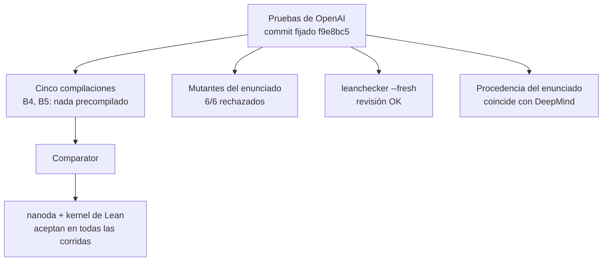
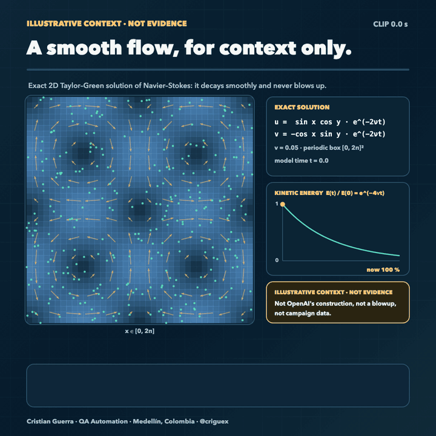

# Scientific QA Evidence

Este repositorio contiene una auditoría de QA independiente de las formalizaciones en Lean 4 de [openai/NavierStokesAndEuler](https://github.com/openai/NavierStokesAndEuler), que acompañan a “[Finite time blowup for Navier–Stokes](https://cdn.openai.com/pdf/32d9f210-8b73-45e0-91bc-82a30aef8a9a/navier-stokes.pdf)” y “[Finite time blowup for the Euler equation](https://cdn.openai.com/pdf/315b36cd-ec98-4023-8342-93345194ece1/euler.pdf)” de OpenAI, más una campaña de pruebas de mutación sobre nueve modelos numéricos. Las pruebas son de OpenAI. Este repositorio no demuestra nada nuevo, no reclama ningún resultado del Premio del Milenio y no es una revisión matemática: recompila los artefactos publicados, los vuelve a verificar con verificadores independientes, comprueba si la cadena de verificación detecta errores y publica cada paso con hashes.

- [Leer el resumen de siete páginas (PDF, en inglés)](docs/report/scientific-qa-evidence-report-v1.3.1.pdf)
- [Leer cada afirmación con su evidencia y sus límites](CLAIMS.md) (en inglés)
- [Ver las escenas de evidencia](animations/index.html)
- [Ayudar a revisar la transcripción del texto de Clay](bridges/K0_REVIEW.md) (en inglés)
- [Read in English](README.md)

Por **Cristian Guerra**, QA Automation, Medellín, Colombia ([@criguex](https://github.com/criguex)).

## En un minuto

OpenAI publicó pruebas en Lean de que, para las ecuaciones de Navier–Stokes, hay datos iniciales y fuerzas suaves para los que no existe solución suave global, y de una singularidad en tiempo finito para las ecuaciones de Euler. Este repositorio revisa esas pruebas como un ingeniero de QA revisaría cualquier entrega importante: recompilarlas desde la fuente, volver a verificarlas con herramientas independientes, intentar que las verificaciones fallen a propósito y dejar cada paso reproducible.

Destacan dos resultados:

1. **Las pruebas de OpenAI verifican siempre y desde cero,** en cinco compilaciones, dos de ellas hechas enteramente desde la fuente, con dos verificadores de pruebas independientes.
2. **Una prueba en Lean de que los teoremas de OpenAI implican la redacción del propio Instituto Clay** de los dos problemas de Navier–Stokes (C) y (D), con esa redacción transcrita literalmente a Lean. Esto vale solo si la transcripción es fiel, y **ninguna persona independiente lo ha comprobado todavía.** Esa es la única revisión que pide este proyecto.

Ninguno de los dos es matemática nueva, y nada aquí reclama un resultado del Premio del Milenio.

## Lo que encontramos

**Sobre las pruebas de OpenAI**

- Compilan desde la fuente fijada de OpenAI y pasan Comparator, la herramienta de Lean que comprueba una prueba frente a un enunciado de desafío fijo, con dos verificadores de pruebas independientes (el kernel de Lean y nanoda), en cinco compilaciones; las dos últimas se compilaron desde la fuente sin nada precompilado. Una revisión de cada paso de la prueba desde un entorno vacío coincidió.
- El enunciado verificado es exactamente el desafío publicado: al cambiar un símbolo de seis formas distintas Comparator lo rechazó siempre, y un cambio solo en un comentario fue aceptado. El texto del desafío coincide con el enunciado formal público de Google DeepMind.
- Los verificadores usados incluyen todas las correcciones de solidez del kernel de Lean conocidas en 2026, y una prueba deliberadamente errónea se rechaza.
- Una compilación que parecía limpia había recibido en silencio siete dependencias precompiladas; su log no lo mostraba, y solo comparar las fechas de los archivos con el inicio de la compilación lo reveló. Una compilación posterior sin caché confirmó una compilación totalmente local.
- No se revisa aquí: si la prueba en Lean sigue el artículo escrito de OpenAI, algo que [arXiv:2610.08144](https://arxiv.org/abs/2610.08144) disputa.

**Sobre la redacción del Instituto Clay**

- Los teoremas de OpenAI están escritos en el estilo formal de DeepMind, no con las palabras de Clay. Transcribimos a Lean, cláusula por cláusula, las ecuaciones de Clay y los dos problemas, y probamos en Lean que los teoremas de OpenAI los implican, para toda viscosidad, usando solo los axiomas estándar de Lean.
- El "suave hasta el tiempo cero" de Clay puede leerse de dos maneras; la implicación vale en ambas.
- Un control muestra que la transcripción no es vacía: el flujo nulo cumple todas sus condiciones con datos nulos, así que "no existe solución" es una afirmación real.
- Abierto: si la transcripción es fiel al PDF de Clay y, solo para el problema periódico (D), si la errata de Clay sobre la presión periódica se aplica a las soluciones. Ante la pregunta sobre la errata, el presidente del Instituto Clay dijo solo que los problemas periódicos se plantean en el toro.

**Sobre las herramientas de verificación**

- Comparator compara los enunciados por su forma exacta: rechazó una reformulación que Lean considera idéntica por definición. Así que un rechazo solo significa "el enunciado cambió". Distinguir cambios equivalentes, más débiles y falsos exigió una prueba aparte en cada caso, mostrado con tres teoremas que Mathlib ya prueba.
- El procedimiento publicado por OpenAI no comprueba que sus logs coincidan con el registro de lo que se corrió; un log sustituido dejó su salida sin cambios, mientras que una comprobación contra hashes registrados al correr lo detectó. Es práctica estándar en la seguridad de la cadena de suministro de software ([in-toto](https://in-toto.io/), [SLSA](https://slsa.dev/provenance/v1)); aquí es un estudio de caso, no una técnica nueva.

**Sobre los modelos numéricos**

- En nueve modelos sintéticos, las pruebas marcaron las 54 variantes rotas a propósito (51 comportamientos distintos, porque dos variantes rotas dan la misma salida), aprobaron las 27 correctas y dejaron pasar 3 cambios deliberadamente diminutos, igual en macOS y en Linux.

**Nuestros propios errores, encontrados y corregidos en público**

- Una afirmación publicada de "cero descargas de caché" era falsa (siete dependencias precompiladas), dos corridas se etiquetaron mal como la misma compilación y el runner numérico daba por válida una referencia que había fallado.
- La primera versión del experimento de fallos sembrados tenía defectos en su evaluador; cuatro rondas de revisión encontraron 17 problemas, todos corregidos y conservados con erratas.
- Un verificador de resultados no detectaba el aviso real de `sorry` de Lean y aceptaba logs sin código de salida; una versión se publicó primero sobre un CI en rojo. Cada caso se corrigió, se probó y quedó registrado.

## La única revisión que pedimos

Si conoces Lean o el problema de Navier–Stokes: **¿es [`bridges/ClayLiteral.lean`](bridges/ClayLiteral.lean) una transcripción fiel del enunciado oficial de Clay?** La [hoja de revisión](bridges/K0_REVIEW.md) (en inglés) lista los 14 puntos a comparar con el PDF, empezando por la suavidad en el tiempo cero. Las respuestas se registrarán ahí, con tu nombre si quieres.

## El método: QA con rigor científico

El método de prueba usado aquí sigue el método científico, y cada elemento tiene su registro en este repositorio:

| Elemento del método científico | Cómo lo aplica este estudio |
| --- | --- |
| Hipótesis que pueden fallar | Antes de cada experimento se escribió el resultado esperado, por ejemplo "Comparator debe rechazar estos seis cambios" |
| Registro previo | El benchmark de fallos sembrados, los controles con Mathlib y la comprobación de recibos se publicaron con su resultado esperado antes de correr ([benchmark](experiments/blind-faults/SEED_COMMITMENT.md), [Mathlib](experiments/mathlib-controls/DESIGN.md), [recibos](experiments/receipt-check/DESIGN.md)) |
| Controles | Un control limpio, un control de solo comentario, un control positivo con `sorry`, una prueba tramposa a propósito para la guarda de dependencias |
| Intentos de refutación | Mutantes del enunciado, fallos sembrados, código numérico roto a propósito: cambios que deberían hacer fallar las verificaciones |
| Reproducibilidad | Comandos, versiones, hashes y códigos de salida de cada paso; repetido desde un clon nuevo ([FROM_ZERO](evidence/FROM_ZERO.md)) y en una quinta compilación completa ([B5](evidence/formal/b5/README.md)) |
| Reportar lo que falla | Dónde la propia comprobación de este estudio no detecta un fallo ([caso 2](experiments/receipt-check/RESULTS2.md)), erratas conservadas, correcciones hechas en público |
| Revisión externa | Cuatro rondas de revisión del benchmark, correcciones de un revisor externo aplicadas, revisión de la transcripción de Clay solicitada ([hoja](bridges/K0_REVIEW.md)) |

**Cómo complementa a Lean.** Lean comprueba que cada paso de la demostración es válido. No comprueba cómo se compiló la prueba, si el enunciado verificado es el que se pretendía, si coincide con el problema tal como lo escribió Clay, ni si la evidencia publicada es la que realmente se produjo. Este método cubre eso: recompila desde la fuente, prueba que la verificación del enunciado reacciona a los cambios, conecta el enunciado formal con el texto de Clay y ata la evidencia registrada a lo que realmente se ejecutó. Con este complemento, la afirmación "las pruebas en Lean de OpenAI verifican y responden a las preguntas (C) y (D) de Clay" puede validarla cualquiera a partir de registros públicos, salvo el único punto que aún necesita un experto: la fidelidad de la transcripción de Clay.

**Qué se puede afirmar.** Un método de QA aplicado con rigor científico (hipótesis registradas, controles, intentos de refutación, reproducibilidad completa) a la auditoría de un resultado matemático de alto perfil. **Lo que aún no se puede afirmar** es que el método detecte más que otros métodos en general. Para eso harían falta casos preparados por otra persona, una comparación justa con herramientas establecidas como in-toto y SLSA sobre los mismos fallos, más de un proyecto y una réplica independiente.

## Resultados en resumen

| Pregunta | Resultado | Registro |
| --- | --- | --- |
| ¿Compila desde la fuente? | Sí. Cinco compilaciones; las dos últimas (B4 y B5, `lake --no-cache build`) exit 0, 11.424 jobs, 1 h 29 min y 1 h 16 min, todas las dependencias compiladas localmente. | [compilaciones](evidence/formal/cd-validation/README.md#builds-used-by-each-run), [B5](evidence/formal/b5/README.md) |
| ¿La aceptan kernels independientes? | Sí. Comparator con nanoda y el kernel de Lean aceptó Navier–Stokes (C, D) y Euler en las cinco corridas, una por compilación. | [revalidación](evidence/formal/cd-validation/README.md) |
| ¿Comparator revisa el enunciado exacto? | Sí. 6 de 6 mutantes del enunciado rechazados; control de solo comentario aceptado. | [mutantes](evidence/formal/cd-validation/mutants/) |
| ¿El desafío es el enunciado público? | Las 18 declaraciones coinciden tras normalización textual; la resolución de nombres no se verificó. | [procedencia](evidence/formal/statement-provenance/README.md) |
| ¿Los verificadores están al día? | El código del kernel incluye todas las correcciones de solidez de 2026; nanoda es posterior a su corrección. | [vigencia del kernel](evidence/formal/kernel-currency.md) |
| ¿Rechazan una prueba errónea? | Sí. Lean reporta un error de tipos; nanoda se detiene con una aserción interna, clasificada como rechazo a partir de su código fijado (su estado bruto sigue pendiente). | [mutación del kernel](evidence/formal/kernel-mutation/) |
| ¿El enunciado formal coincide con el texto de Clay? | De 16 cláusulas, 6 coinciden directamente, 9 por hechos estándar y 1 necesita una decisión humana. En Lean, los teoremas de OpenAI implican una transcripción literal de la (C) y la (D) de Clay; esa transcripción aún no tiene revisión independiente. | [revisión de riesgos](evidence/formal/clay-lean-risk.md), [puentes](bridges/README.md) |
| ¿Las pruebas numéricas detectan errores? | 27 PASS · 54 KILLED · 3 SURVIVED por máquina, idénticos en macOS arm64 y Linux x86_64. | [numérica](evidence/README.md) |
| ¿El protocolo detecta lo que el procedimiento base deja pasar? | Con fallos sembrados en un benchmark determinista, sí: cuatro clases de fallo que el protocolo marca y un procedimiento base simulado deja pasar. | [benchmark](experiments/blind-faults/v2/README.md) |
| ¿Un rechazo significa que el teorema es falso? | No. Con tres teoremas de Mathlib, Comparator rechazó los 8 enunciados cambiados, incluidos 4 equivalentes (uno definicionalmente igual); una vía aparte en Lean clasificó cada uno como equivalente, más débil o falso, todo según lo registrado de antemano. | [controles Mathlib](experiments/mathlib-controls/RESULTS.md) |
| ¿El procedimiento publicado comprueba su propia evidencia? | No. Sobre los mismos archivos auténticos, un recibo que nombra un log ausente y un log viejo con el nombre correcto dejaron su resultado sin cambios (exit 0, `Your solution is okay!`); P6 detectó el primero y solo una comprobación por hash detectó ambos; herramientas como in-toto ya registran y comprueban esos hashes. | [comprobación de recibos](experiments/receipt-check/RESULTS.md), [caso 2](experiments/receipt-check/RESULTS2.md) |

Cada afirmación con su evidencia, resultado y limitación está en [CLAIMS.md](CLAIMS.md) (en inglés).

## Verifícalo tú mismo

Python 3.9 o más reciente, sin dependencias, alrededor de un minuto:

```sh
git clone https://github.com/criguex/scientific-qa-evidence.git
cd scientific-qa-evidence
shasum -a 256 -c evidence/SHA256SUMS.txt                           # cada archivo curado es el publicado
python3 evidence/verify_numerical.py                               # corridas guardadas intactas e idénticas entre máquinas
(cd evidence/numerical/source && python3 -m unittest test_runner)  # vuelve a correr las 84 variantes numéricas
python3 evidence/test_consistency.py                               # README, CLAIMS y registros coinciden
python3 experiments/mathlib-controls/verify.py                     # comprueba recibos de los controles Mathlib y recalcula clases
(cd experiments/receipt-check && python3 -m unittest test_results)  # recalcula las comprobaciones de recibos sobre los paquetes publicados
```

Las mismas comprobaciones, y los tests de todos los demás scripts, corren en [GitHub Actions](.github/workflows/verify.yml) en Ubuntu y macOS en cada push. [REPRODUCE.md](REPRODUCE.md) (en inglés) da las versiones, los pasos desde un checkout limpio y qué resultados se recalculan y cuáles solo se verifican por hash. Las compilaciones de Lean necesitan el repositorio de OpenAI y una máquina Linux; aquí sus registros se verifican por hash. Una corrida desde un clon nuevo de las comprobaciones de Python, los puentes en Lean y los pasos de los controles Mathlib (no de la compilación de OpenAI) está registrada en [FROM_ZERO.md](evidence/FROM_ZERO.md) (en inglés).

## Parte A · Auditoría formal de (C), (D) y Euler



Comparator comprueba que la solución prueba exactamente el teorema del archivo de desafío, usando solo los axiomas permitidos (`propext`, `Quot.sound`, `Classical.choice`). La primera corrida (2026-10-20) está en [`evidence/formal/comparator/`](evidence/formal/comparator/README.md). La revalidación del 2026-10-21 añadió tres corridas más, mutantes del enunciado y una revisión desde cero. Terminaron las 18 pruebas: ninguna dio un resultado inesperado y una no pudo correr. Una quinta compilación, B5, repitió la compilación completa desde la fuente para la versión v1.3.0, y Comparator volvió a aceptar los dos desafíos ([registro de B5](evidence/formal/b5/README.md), en inglés).

<table>
<tr><td valign="top"><a href="animations/rerun.html"><b>Recompilar y volver a verificar</b></a> · <a href="docs/media/rerun.mp4">▶ MP4</a><br><a href="animations/rerun.html"></a></td><td valign="top"><a href="animations/mutants.html"><b>Cambiar el enunciado: debe ser rechazado</b></a> · <a href="docs/media/mutants.mp4">▶ MP4</a><br><a href="animations/mutants.html"></a></td></tr>
<tr><td valign="top"><a href="animations/replay.html"><b>Revisar cada paso desde un entorno vacío</b></a> · <a href="docs/media/replay.mp4">▶ MP4</a><br><a href="animations/replay.html"></a></td><td valign="top"><a href="animations/provenance.html"><b>De dónde viene el enunciado</b></a> · <a href="docs/media/provenance.mp4">▶ MP4</a><br><a href="animations/provenance.html"></a></td></tr>
</table>

- **Recompilar y volver a verificar.** Cuatro compilaciones: el registro del 2026-10-20 (B1), una de auditoría cuyo Mathlib vino de la caché precompilada (B2), una nueva (B3) y una completa con `lake --no-cache build` (B4), con todas las dependencias compiladas localmente. Comparator aceptó los dos desafíos en cada una; una quinta compilación, B5, vino después y no está en esta escena. B3 había recibido en silencio 7 dependencias pequeñas como archivos precompilados de [Reservoir](https://reservoir.lean-lang.org); por eso existe B4. Se reutilizaron la toolchain de Lean y los binarios de los verificadores.
- **Cambiar el enunciado: debe ser rechazado.** La prueba de OpenAI nunca se toca. Seis cambios de un símbolo al desafío fueron rechazados con `Challenge and solution theorem statement do not match`; un control de solo comentario fue aceptado. Que un mutante sea rechazado no dice si el enunciado mutado es verdadero, y los mutantes con `f = 0` no dicen nada sobre (A) o (B).
- **Revisar cada paso desde un entorno vacío.** `leanchecker --fresh` aceptó las dos soluciones. Usa el kernel de Lean, así que no es una tercera implementación. `lean4lean` no compiló para Lean 4.34 y nunca revisó las pruebas.
- **De dónde viene el enunciado.** Las 18 declaraciones coinciden tras normalización textual; la resolución de nombres no se verificó. Las diferencias restantes con el archivo de Formal Conjectures de Google DeepMind son el import, el namespace, notación copiada con la misma definición y (A)/(B) excluidos.

**Frente al texto de Clay.** (C) y (D) dicen "existen datos para los que no existe solución", así que la versión formal solo podría ser más fácil si permitiera datos que Clay prohíbe o si exigiera a las soluciones más que Clay. De 16 cláusulas, 6 coinciden directamente, 9 por hechos estándar de análisis y 1 necesita una decisión humana: la errata de Clay pide presión periódica "en la Ec. (8)", la lista de datos, mientras que la formalización la exige a las soluciones en (D). Ver la [revisión de riesgos](evidence/formal/clay-lean-risk.md) y la Parte D.

## Parte B · Pruebas de mutación numéricas

Las pruebas de mutación preguntan si una suite nota cuando el código se rompe a propósito. El contrato y su tolerancia (10⁻⁶) se congelaron antes de cualquier corrida ([`CONTRACT.md`](evidence/numerical/source/CONTRACT.md), en inglés), y cada modelo tiene un oráculo independiente que no comparte código de solver con la implementación bajo prueba. Los nueve modelos son: circuito RC, enfriamiento de Newton, cinética química de segundo orden, atenuación de Beer–Lambert, respuesta logística, refracción de Snell, lente delgada, interfaz acústica y respuesta de Fechner.

Cada máquina registró **27 PASS, 54 KILLED y 3 SURVIVED** sobre las mismas **84 variantes pareadas**, no 168 distintas; la diferencia escalada máxima entre máquinas es 1,11 × 10⁻¹⁶. Los 54 KILLED cuentan casos, no comportamientos: dos mutantes acústicos dan salidas idénticas, lo que deja 51 comportamientos eliminados distintos. Los tres sobrevivientes son un cambio de RC deliberadamente diminuto, que se deja visible a propósito. Todos los modelos y entradas son sintéticos; nada de esto es una medición empírica.

## Parte C · Qué aporta el protocolo

**Pregunta de investigación.** ¿Pueden las técnicas habituales de QA de software (un contrato congelado, un oráculo independiente, mutaciones deliberadas y corridas repetidas) darle a un lector externo una confianza verificable en una prueba verificada por máquina y en código científico, sin confiar en el montaje de los autores originales?

| Elemento | Código numérico | Cadena de verificación formal |
| --- | --- | --- |
| Contrato, congelado primero | [`CONTRACT.md`](evidence/numerical/source/CONTRACT.md), tolerancia 10⁻⁶ | El enunciado oficial del desafío y los axiomas permitidos |
| Oráculo independiente | Una solución programada aparte para cada modelo | Comparator con dos kernels, más una revisión con `leanchecker --fresh` |
| Mutación deliberada | Dos errores conocidos por modelo y un cambio cerca del umbral | Un valor de prueba erróneo y seis mutantes del enunciado con un control |
| Repetición | Las mismas 84 variantes en dos máquinas | Comparator sobre cinco compilaciones |
| Revisión de la especificación | El propio contrato | Procedencia del enunciado, revisión de riesgos frente a Clay y los puentes en Lean (Parte D) |

### Hallazgos en este caso

Frente al procedimiento de verificación del README de OpenAI, el protocolo produjo ocho hallazgos que ese procedimiento no muestra, tres de ellos defectos corregidos de este mismo estudio ([FINDINGS.md](FINDINGS.md), en inglés).

### Benchmark de fallos a ciegas

Un experimento sembró fallos en casos controlados, asignados con una semilla comprometida y prerregistrados (v1). Tras la revisión se presenta como benchmark de regresión determinista: con el evaluador v2 corregido, escrito después de esa revisión, los checks del protocolo marcan cuatro clases de fallo que un procedimiento base simulado deja pasar, los dos marcan el control positivo y el caso limpio pasa los dos. La primera corrida se conserva con fe de erratas, y cuatro rondas de revisión encontraron 17 problemas en el propio experimento ([resultados y erratas](experiments/blind-faults/RESULTS.md), [benchmark corregido](experiments/blind-faults/v2/README.md), en inglés).

<a href="animations/experiment.html"></a><br><a href="docs/media/experiment.mp4">▶ MP4 1080p</a>

### Estudio de caso: controles de integridad con registros auténticos

El caso C/F5 del benchmark pasó de registros sintéticos a registros reales. Sobre una copia de un árbol compilado desde la fuente se registró paso a paso el procedimiento publicado por OpenAI (`lake exe cache get`, `lake build`, `lake exe comparator ComparatorChallenges/NavierStokes.json`), y luego se corrió otra vez sobre un paquete limpio y sobre uno cuyo recibo nombra un log que no existe.

| Variante | Procedimiento publicado de OpenAI | Comprobación P6 |
| --- | --- | --- |
| Limpia | exit 0, `Your solution is okay!` | exit 0, sin marcas |
| El recibo nombra `comparator-run.log` | exit 0, salida idéntica byte a byte a la corrida limpia | exit 1, `P6:receipt-log-missing-comparator-run.log` |
| Log viejo de otra corrida con el nombre correcto (caso 2) | exit 0, salida idéntica byte a byte a la del log ausente | **pasa: P6 solo comprueba que el log exista**; una comprobación contra el hash registrado al correr el paso lo marca |

**En este experimento, P6 detecta una inconsistencia de trazabilidad que no cambia el resultado de Comparator:** el procedimiento publicado, corrido sobre los mismos archivos, salió con 0 y la misma salida, porque no comprueba por sí mismo que un recibo corresponda al log que referencia. «Idéntica byte a byte» significa: en el caso 1, entre la corrida limpia y la del log ausente; en el caso 2, entre la del log ausente y la del log viejo, que además coinciden con el caso 1. La corrida limpia del caso 2 tiene 13 líneas `Built …` de más, porque su primera llamada a Comparator en una copia nueva también compiló el ejecutable. No significa que Comparator aceptara una demostración falsa, porque la prueba era la misma y fue aceptada en ambas variantes. **Límite de la comprobación por hash:** detecta un cambio respecto de un valor de referencia confiable, aquí el hash registrado al correr el paso; no autentica el origen de un log si alguien puede sustituir tanto el archivo como ese valor registrado. El caso 2 muestra el límite de P6: un log viejo con el nombre correcto lo pasa, y solo atar cada recibo al hash registrado al correr el paso lo detecta. Los dos casos se registraron de antemano, con comandos, versiones, salidas y códigos de retorno ([caso 1](experiments/receipt-check/RESULTS.md), [caso 2](experiments/receipt-check/RESULTS2.md), [estado y enmiendas](experiments/receipt-check/STATUS.md), en inglés).

**No es una técnica nueva.** Atar el comando, las entradas y las salidas de cada paso a hashes registrados es práctica establecida en la seguridad de la cadena de suministro de software: [in-toto](https://in-toto.io/) registra en cada paso el comando, los hashes de sus archivos de entrada y salida, su código de retorno y su salida estándar y de error, los firma y los verifica contra un esquema, y la [procedencia SLSA](https://slsa.dev/provenance/v1) registra cómo se hizo una compilación y con qué dependencias, cada una con su hash. Los dos fallos probados aquí son del tipo que in-toto ya detecta. Esto es, por tanto, un **estudio de caso de controles de integridad para evidencias de Lean**; no se ha hecho una comparación justa con in-toto o SLSA, y un posible aporte en integración, diagnósticos específicos de Lean o facilidad de uso aún tendría que demostrarse.

### Controles con Mathlib: «el enunciado cambió» no es «el teorema es falso»

Un verificador de enunciados responde una sola pregunta: ¿el teorema entregado es exactamente el del desafío? Para ver qué significan sus respuestas, a tres teoremas que Mathlib ya prueba se les dio el enunciado correcto, reformulaciones equivalentes y errores deliberados, con el resultado esperado registrado antes de correr nada. Cada caso rechazado recibió luego una **segunda vía** en Lean: una prueba de equivalencia, una prueba de que es más débil (en las dos direcciones) o una refutación.

| Teorema | Enunciado probado | Comparator | Segunda vía en Lean | Clase |
| --- | --- | --- | --- | --- |
| Primos | `∀ n, ∃ p, n < p ∧ p.Prime` | ✅ aceptado | — | aceptado por el verificador |
| | `n + 1 ≤ p` en vez de `n < p` | ❌ rechazado | `Iff.rfl`: la misma definición | equivalente |
| | `n ≤ p` en vez de `n < p` | ❌ rechazado | equivalencia para todo predicado `P`, no solo primos | equivalente |
| | `∀ n ≤ 100, …` (comprobar ejemplos) | ❌ rechazado | completo ⇒ acotado; acotado ⇏ completo (con `P p := p = 101`) | más débil |
| | `∃ p, ∀ n, n < p ∧ p.Prime` (cuantificadores invertidos) | ❌ rechazado | refutado: tomar n = p | falso |
| Cauchy–Schwarz | `abs ⟪x, y⟫ ≤ ‖x‖ * ‖y‖` | ✅ aceptado | — | aceptado por el verificador |
| | `⟪x, y⟫ ^ 2 ≤ ‖x‖ ^ 2 * ‖y‖ ^ 2` | ❌ rechazado | `abs a ≤ bc ↔ a² ≤ b²c²` si b, c ≥ 0 | equivalente |
| | `<` en vez de `≤` | ❌ rechazado | refutado con x = y = 1 | falso |
| Convergencia dominada | hipótesis de Mathlib | ✅ aceptado | — | aceptado por el verificador |
| | `Integrable bound` como «medible y ∫⁻ ofReal bound < ∞» | ❌ rechazado | equivalente solo porque la dominación obliga a bound ≥ 0 | equivalente |
| | sin dominación | ❌ rechazado | refutado: (n+1) en (0, 1/(n+1)) tiende a 0 y cada integral vale 1 | falso |

**Qué muestra.** Un rechazo solo significa «el enunciado cambió»: Comparator rechazó los ocho cambios, incluso `n + 1 ≤ p`, que para Lean es por definición lo mismo que `n < p`. Una aceptación es igualdad tal como la comprueba Comparator, no la prueba de nada más. Distinguir equivalente, más débil y falso exigió una prueba aparte en cada caso.

**La guarda.** Dos enunciados verdaderos cualesquiera son trivialmente «equivalentes», así que una equivalencia solo cuenta si su prueba no usa el teorema bajo prueba. Un comando de Lean recorre todas las dependencias transitivas de la prueba:

```text
guard: QAControls.SecondRoute.primes_reform_equiv uses none of the theorems under test (1485 constants checked)
error: guard: QAControls.SecondRoute.primes_reform_equiv_cheat depends on Nat.exists_infinite_primes
```

<a href="animations/controls.html"></a><br><a href="docs/media/controls.mp4">▶ MP4 1080p</a>

La segunda línea es una prueba tramposa a propósito, rechazada según lo registrado. Los 11 casos y los dos controles salieron según lo registrado de antemano. Cada paso tiene un recibo (comando, hashes de entrada y de salida, código de retorno), y `python3 experiments/mathlib-controls/verify.py` comprueba los registros contra ellos y recalcula cada clase; eso comprueba los registros, no vuelve a ejecutar Lean ([diseño](experiments/mathlib-controls/DESIGN.md), [resultados](experiments/mathlib-controls/RESULTS.md), en inglés). Faltan casos preparados por otra persona ([cómo contribuir](experiments/mathlib-controls/HOLDOUT.md)).

### Trabajos previos

Análisis de mutación (DeMillo, Lipton y Sayward, 1978), mutación de especificaciones (1985, 2000), análisis de mutación de proyectos de verificación en Coq (mCoq, 2019), análisis de mutación de verificadores de benchmarks (2026), el criterio de De Bruijn, [Comparator](https://github.com/leanprover/comparator) y [Formal Conjectures](https://github.com/google-deepmind/formal-conjectures) de Google DeepMind. El aporte es la combinación y su aplicación a la propia cadena de verificación; no se afirma novedad metodológica ([RELATED_WORK.md](RELATED_WORK.md), en inglés).

## Parte D · Del teorema de OpenAI al texto de Clay

### En palabras simples

El problema (C) de Clay pide esto: mostrar que, para alguna velocidad inicial y alguna fuerza suaves y que decaen rápido, las ecuaciones de Navier–Stokes no tienen solución suave con energía acotada para todo tiempo. El teorema de OpenAI en Lean dice lo mismo en el lenguaje formal de DeepMind. Los dos textos podrían diferir en detalles, y una diferencia en la dirección equivocada haría la versión de OpenAI más fácil que la de Clay.

Por eso, para cada condición del texto de Clay, probamos en Lean una dirección: los datos que usa OpenAI cumplen las condiciones de Clay, y todo lo que Clay aceptaría como solución también es solución en el sentido de OpenAI. Entonces el argumento se cierra: si el problema de Clay tuviera solución para los datos de OpenAI, sería una solución del problema de OpenAI, y el teorema de OpenAI lo descarta. Lean comprueba cada paso. Lo que Lean no puede comprobar es si nuestra transcripción a Lean de las palabras de Clay es fiel, y esa es la revisión que se pide arriba.


OpenAI prueba un enunciado formal escrito al estilo de Google DeepMind. ¿Dice lo mismo que el texto de Clay? Para obtener de él la (C) y la (D) de Clay basta una dirección por cláusula: los datos de OpenAI deben cumplir las condiciones de Clay, y toda solución de Clay debe ser una solución formal. Así, si existiera una solución de Clay sería una solución formal, y el teorema de OpenAI lo descarta.

### Qué está probado

Las ecuaciones (1)–(11), la (C), la (D) y la errata de Clay están escritas literalmente en Lean, en coordenadas y con derivadas temporales laterales, en [`bridges/ClayLiteral.lean`](bridges/ClayLiteral.lean). Luego [`bridges/Bridges.lean`](bridges/Bridges.lean) prueba, a partir de los teoremas de OpenAI y sin hipótesis:

```lean
theorem k1_C          (ν : ℝ) (hν : 0 < ν) : ClayLiteral.AltC ν               -- la (C) de Clay
theorem k1_D          (ν : ℝ) (hν : 0 < ν) : ClayLiteral.AltD_withErratum ν   -- la (D) de Clay
theorem k1_C_oneSided (ν : ℝ) (hν : 0 < ν) : ClayLiteral.AltC_oneSided ν      -- (C), otra lectura de C^∞ en t = 0
theorem k1_D_oneSided (ν : ℝ) (hν : 0 < ν) : ClayLiteral.AltD_withErratum_oneSided ν
```

Los cuatro usan solo `propext`, `Classical.choice` y `Quot.sound`. Un control prueba que la solución cero cumple todas las condiciones de solución de Clay, así que «no existe solución» no es verdadero de forma vacía.

<a href="animations/bridges.html"></a><br><a href="docs/media/bridges.mp4">▶ MP4 1080p</a>

### Cómo se une cada cláusula

| Texto de Clay (como en `ClayLiteral`) | Versión formal de OpenAI | Puente en Lean |
| --- | --- | --- |
| u° suave, `div u° = 0`, decaimiento (4) | el testigo de OpenAI tiene u₀ = 0 | `d1_zero`, `d2_zero`, `d3_zero` |
| f suave en ℝ³ × [0, ∞), con cualquiera de las dos lecturas en t = 0 | la fuerza de OpenAI es suave en todo ℝ × ℝ³, así que es su propia extensión | `witness_C`, `witness_D` |
| decaimiento (5) y (9) de cada derivada mixta ∂x^α ∂t^m f | una cota de la norma de la derivada m-ésima | `d5`, `d7`: una parcial es esa derivada aplicada a vectores unitarios (`clay_bound`) |
| ecuación (1) en coordenadas, con Σⱼ uⱼ∂ⱼuᵢ y Σₖ ∂ₖ² | la ecuación vectorial con `Δ` y `gradient` de Mathlib | `s1` |
| (2): Σᵢ ∂uᵢ/∂xᵢ = 0 | traza del jacobiano = 0 | `s2` |
| (3) condición inicial | la misma | `s3` |
| (6), (11): u, p ∈ C^∞(ℝ³ × [0, ∞)) | `ContDiffOn` en el semiespacio cerrado | `s4` |
| (7): ∫ abs(u)² dx < C de Lebesgue | `MemLp 2` y una cota de la integral de Bochner | `s5` |
| (8), (10), errata: periodicidad | `IsOnePeriodic` | `d6`, `s6`, `s7_formal_side` |

Cada fila con su estado está en [clay-lean-bridges.md](evidence/formal/clay-lean-bridges.md) (en inglés); el recibo de compilación está en [`bridges/README.md`](bridges/README.md).

### Qué falta

- **Fidelidad de `ClayLiteral`.** El resultado solo es tan fiel como la transcripción literal, que nadie independiente ha revisado frente al PDF. En particular, `SmoothOneSided` está definido directamente como el `ContDiffOn` de Mathlib en el semiespacio cerrado; su nombre no demuestra que esa sea la suavidad que usa Clay, y esa correspondencia es en sí un punto de revisión. Los 14 puntos a revisar, primero la suavidad en t = 0, están en [`bridges/K0_REVIEW.md`](bridges/K0_REVIEW.md) (en inglés).
- **Presión periódica, solo en (D).** K1 para la (D) lee la errata de Clay como condición sobre las soluciones; la (C) no la usa. Ante la pregunta, el presidente del CMI respondió el 2026-10-22 que debe evitar interpretar los enunciados oficiales más allá del texto oficial, y dijo solo que (B) y (D) son problemas en el contexto periódico (toral). Eso no resuelve la lectura de la errata, así que sigue abierta; no es un aval de esta lectura, de la formalización ni de ninguna solución ([registro](evidence/formal/clay-correspondence.md), en inglés).
- **Ningún matemático ha revisado nada de esto.**

## Animaciones

Trece escenas de evidencia y una ilustrativa, todas offline, cada una como página HTML interactiva, GIF de vista previa y MP4 en 1080p. Abre la [galería](animations/index.html) o lee la [guía de animaciones](animations/README.md) (en inglés) con ecuaciones, parámetros y trazas de fuente.

<table>
<tr><td valign="top"><a href="animations/rc.html">RC · constante de tiempo duplicada</a> · <a href="docs/media/rc.mp4">▶ MP4</a><br></td><td valign="top"><a href="animations/chemistry.html">Química · tasa de reacción duplicada</a> · <a href="docs/media/chemistry.mp4">▶ MP4</a><br></td></tr>
<tr><td valign="top"><a href="animations/cooling.html">Enfriamiento · constante a la mitad</a> · <a href="docs/media/cooling.mp4">▶ MP4</a><br></td><td valign="top"><a href="animations/snell.html">Snell · índices de refracción intercambiados</a> · <a href="docs/media/snell.mp4">▶ MP4</a><br></td></tr>
<tr><td valign="top"><a href="animations/campaign.html">Campaña · clasificaciones pareadas</a> · <a href="docs/media/campaign.mp4">▶ MP4</a><br></td><td valign="top"><a href="animations/formal.html">Formal · control de tipado del valor de prueba</a> · <a href="docs/media/formal.mp4">▶ MP4</a><br></td></tr>
<tr><td valign="top"><a href="animations/rerun.html">C/D · recompilar y verificar</a> · <a href="docs/media/rerun.mp4">▶ MP4</a><br></td><td valign="top"><a href="animations/mutants.html">C/D · mutantes del enunciado</a> · <a href="docs/media/mutants.mp4">▶ MP4</a><br></td></tr>
<tr><td valign="top"><a href="animations/replay.html">C/D · revisión del kernel desde cero</a> · <a href="docs/media/replay.mp4">▶ MP4</a><br></td><td valign="top"><a href="animations/provenance.html">Procedencia del enunciado · OpenAI vs DeepMind</a> · <a href="docs/media/provenance.mp4">▶ MP4</a><br></td></tr>
<tr><td valign="top"><a href="animations/bridges.html">Puentes Clay ↔ Lean · K1</a> · <a href="docs/media/bridges.mp4">▶ MP4</a><br></td><td valign="top"><a href="animations/controls.html">Controles Mathlib · rechazo no es refutación</a> · <a href="docs/media/controls.mp4">▶ MP4</a><br></td></tr>
<tr><td valign="top"><a href="animations/experiment.html">Benchmark de fallos a ciegas</a> · <a href="docs/media/experiment.mp4">▶ MP4</a><br></td><td valign="top"><a href="animations/flow.html">Solo ilustrativo, no es evidencia · flujo Taylor–Green</a> · <a href="docs/media/flow.mp4">▶ MP4</a><br></td></tr>
</table>

La escena de Taylor–Green es solo contexto visual: la solución analítica exacta de un flujo 2D suave que decae, no dato de la campaña, ni evidencia de explosión, ni la construcción de OpenAI.

## Limitaciones conocidas

Un informe de QA solo sirve si dice lo que no probó.

- **Una sola máquina, herramientas reutilizadas.** Todas las corridas formales usaron una sola máquina Linux. Todas las compilaciones reutilizaron la toolchain de Lean instalada y los binarios de Comparator, lean4export, nanoda y landrun, cuyos hashes están [registrados](evidence/formal/cd-validation/README.md#reused-tools).
- **Dos implementaciones de kernel.** Solo el kernel de Lean y nanoda han revisado las pruebas. `leanchecker` usa el kernel de Lean, y `lean4lean` no compiló para Lean 4.34.
- **Solo bugs de kernel conocidos.** Los verificadores están al día con las correcciones conocidas de 2026, pero en julio de 2026 un bug de Lean y otro distinto de nanoda dejaron pasar la misma prueba falsa, así que el acuerdo entre dos kernels no dice nada sobre bugs desconocidos.
- **Comparator independiente.** Las corridas usaron la herramienta fijada en `19e111e`, no el posterior `lake check` de Lean v4.35.0.
- **No se prueba la correspondencia con el artículo.** Si la prueba en Lean sigue el artículo de OpenAI está fuera de alcance; [arXiv:2610.08144](https://arxiv.org/abs/2610.08144) sostiene que no, sin afirmar que algún teorema de Lean sea falso.
- **La comparación con Clay no está revisada.** La implicación en Lean es relativa a la transcripción literal del texto de Clay de este repositorio, que nadie independiente ha revisado, y deja abierta la (D) sin la errata sobre soluciones.
- **Los mutantes del enunciado prueban la igualdad del enunciado**, no que la prueba fallaría si estuviera mal. Hay un solo fixture de prueba errónea, no una campaña de mutación sobre las pruebas de OpenAI.
- **Límites numéricos.** Los 54 KILLED cuentan casos, no los 51 comportamientos eliminados distintos; los mutantes son gruesos, así que no se mide el umbral de detección; todos los modelos son sintéticos.
- **El benchmark usa fallos sembrados** sobre artefactos grabados, no Lean en vivo, y no da una tasa de detección en el mundo real.
- **Los controles con Mathlib son pocos y los diseñó el autor:** 11 casos con tres teoremas, todavía sin casos de otra persona.

## Cómo se usó la IA

El trabajo fue asistido por IA y dirigido por una persona. OpenAI Codex fue al principio el agente principal de código, y Claude Code de Anthropic hizo los cambios posteriores de auditoría, documentación y experimento. Cada commit nombra al agente en un trailer `Co-Authored-By`. Cristian Guerra eligió las preguntas, congeló los contratos, decidió qué cuenta como evidencia y responde por cada afirmación. Los detalles, incluido un cambio a mitad de sesión del modelo reportado del asistente, están en [AUTHORSHIP.md](AUTHORSHIP.md).

## Mapa del repositorio

```text
README.md, README.es.md   esta presentación, en inglés y en español
CLAIMS.md                 cada afirmación → evidencia → resultado → limitación
FINDINGS.md               qué encontró el protocolo que el procedimiento documentado no muestra
RELATED_WORK.md           trabajos previos y evaluación de novedad
REPRODUCE.md              versiones, pasos, qué se recalcula y qué se verifica por hash
AUTHORSHIP.md             autoría y declaración de uso de IA
CITATION.cff, LICENSE_STATUS.md, CONTRIBUTING.md   cómo citar, derechos, contribuciones
evidence/
  formal/                 compilaciones, corridas de Comparator, mutantes, revisiones, procedencia,
                          vigencia del kernel, revisiones frente a Clay, tabla de puentes, correspondencia con el CMI
    cd-validation/        la revalidación del 2026-10-21 (compilaciones B1–B4, corridas 1–4, mutantes, revisiones)
    b5/                   compilación B5 y corrida 5, para la versión v1.3.0
  numerical/              contrato congelado, fuente y tests, corridas de 84 casos en macOS y Linux
  FROM_ZERO.md            comprobaciones repetidas desde un clon nuevo
  SHA256SUMS.txt          checksums de cada archivo curado
experiments/
  blind-faults/           benchmark: semilla comprometida y v1 congelada, erratas, evaluador v2 corregido
  mathlib-controls/       enunciado cambiado frente a teorema falso, con tres teoremas de Mathlib
  receipt-check/          recibos frente a artefactos con registros auténticos, dos casos
bridges/                  el texto de Clay en Lean, la prueba de que los teoremas de OpenAI lo implican, hoja de revisión
animations/               trece escenas de evidencia y una ilustrativa, scripts de build y exportación, tests
docs/                     GIF, videos MP4, resúmenes en PDF, solicitud de revisión
.github/workflows/        CI que corre todas las comprobaciones en cada push
```

## Créditos, derechos y estado

- **Pruebas originales:** OpenAI, [openai/NavierStokesAndEuler](https://github.com/openai/NavierStokesAndEuler) en `f9e8bc5` (Apache-2.0), con los artículos [Finite time blowup for Navier–Stokes](https://cdn.openai.com/pdf/32d9f210-8b73-45e0-91bc-82a30aef8a9a/navier-stokes.pdf) y [for the Euler equation](https://cdn.openai.com/pdf/315b36cd-ec98-4023-8342-93345194ece1/euler.pdf).
- **Enunciado del problema:** C. L. Fefferman, [Existence and smoothness of the Navier–Stokes equation](https://www.claymath.org/wp-content/uploads/2022/06/navierstokes.pdf), Clay Mathematics Institute. **Enunciado del desafío:** Google DeepMind, [Formal Conjectures](https://github.com/google-deepmind/formal-conjectures) en `8bf45ed` (Apache-2.0).
- **Herramientas, en las revisiones usadas:** [Lean 4](https://github.com/leanprover/lean4) v4.34.0-rc2 (`6a10ac8`), [Mathlib](https://github.com/leanprover-community/mathlib4) (`85e3a25`), [Comparator](https://github.com/leanprover/comparator) (`19e111e`), [lean4export](https://github.com/leanprover/lean4export) (`cacf989`), [nanoda](https://github.com/ammkrn/nanoda_lib) (`9d6964f`), todas Apache-2.0, y [landrun](https://github.com/Zouuup/landrun) (`ec104f6`, MIT). Se comprobó que cada revisión existe en su repositorio; los hashes de los binarios están en [`receipts/`](evidence/formal/cd-validation/receipts/).
- **Análisis relacionado:** Bastounis, Circelli y Hansen, [arXiv:2610.08144](https://arxiv.org/abs/2610.08144); el resto de los trabajos previos está en [RELATED_WORK.md](RELATED_WORK.md).
- **Este estudio de QA:** Cristian Guerra. Para citarlo, usa [CITATION.cff](CITATION.cff).
- **Derechos:** la publicación está autorizada, pero no se concede ninguna licencia de código abierto. Ver [LICENSE_STATUS.md](LICENSE_STATUS.md).
- **Estado:** última versión [v1.3.1](https://github.com/criguex/scientific-qa-evidence/releases/tag/v1.3.1), que añade a la v1.3.0 (puentes en Lean hacia el texto de Clay, controles con Mathlib, compilación B5) la comprobación de recibos con registros auténticos y la correspondencia con el CMI.

No se afirma ningún descubrimiento de teoremas, certificación científica, validación empírica ni prueba sobre un sistema del mundo real.
