# Scientific QA Evidence

**Reproducción independiente, con enfoque de QA, de las pruebas en Lean de OpenAI sobre explosión en tiempo finito para Navier–Stokes y Euler, más una campaña de pruebas de mutación sobre nueve modelos numéricos.**

Por **Cristian Guerra**, QA Automation, Medellín, Colombia ([@criguex](https://github.com/criguex)) · [Read in English](README.md)

> **Lee esto primero.** Las pruebas son de OpenAI ([openai/NavierStokesAndEuler](https://github.com/openai/NavierStokesAndEuler)). Este repositorio no demuestra nada nuevo, no reclama ningún resultado del Premio del Milenio y no es una revisión matemática. Es un ejercicio de QA de software: reconstruir los artefactos publicados desde fuentes fijadas, volver a verificarlos con dos verificadores de pruebas independientes, confirmar que un verificador rechaza una prueba deliberadamente errónea y publicar cada resultado con hashes para que cualquiera pueda auditarlo.

## Por qué existe

En septiembre de 2026 OpenAI publicó formalizaciones en Lean 4 de las alternativas (C) y (D) del problema de Navier–Stokes del Instituto Clay (ruptura con fuerza externa en ℝ³ y en el toro periódico), y un resultado aparte de singularidad en tiempo finito para la ecuación de Euler en 3D ([anuncio](https://openai.com/index/navier-stokes-solution/)). Una prueba verificada por máquina solo es tan confiable como el build, el enunciado y el verificador que la respaldan. Esas son preguntas de pruebas de software:

1. ¿Compila desde un checkout limpio y fijado?
2. ¿Los kernels independientes la aceptan frente al enunciado oficial del desafío?
3. ¿Los verificadores notarían si una prueba estuviera mal?
4. ¿El método de pruebas detecta errores? Esa es la campaña de mutación numérica.

## Resultados en resumen

| Pregunta | Qué se hizo | Resultado |
| --- | --- | --- |
| ¿Compila desde la fuente fijada? | Compilaciones del commit `f9e8bc5` de OpenAI, Lean 4.34.0-rc2 ([compilaciones y recibos](evidence/formal/cd-validation/README.md#builds-used-by-each-run)) | 2026-10-20 (B1): exit 0, 11.424 jobs, reutilizando cachés de dependencias. 2026-10-21 (B3): exit 0, 11.432 jobs; Mathlib y el proyecto se compilaron localmente (11.030 módulos), pero 7 dependencias pequeñas llegaron como archivos precompilados de Reservoir. 2026-10-21 (B4, `lake --no-cache build`): exit 0, 11.424 jobs en 1 h 29 min, con Mathlib, todas las dependencias y el proyecto compilados localmente: no se encontró ningún archivo precompilado y todos los `.olean` son posteriores al inicio de la compilación. |
| ¿Lo aceptan verificadores independientes? | [Comparator](https://github.com/leanprover/comparator) con el kernel de Lean y [nanoda](https://github.com/ammkrn/nanoda_lib) sobre los desafíos configurados | Navier–Stokes y Euler: ambos kernels aceptan (`Your solution is okay!`, exit 0) en las cuatro corridas, una por compilación: B1, B2, B3 y la compilación sin caché B4 |
| ¿El enunciado coincide con el texto de Clay? | Tabla cláusula por cláusula contra el PDF de Clay y el enunciado de [Formal Conjectures](https://github.com/google-deepmind/formal-conjectures) de Google DeepMind en `8bf45ed` | Correspondencia mapeada y una [revisión de riesgos cláusula por cláusula](evidence/formal/clay-lean-risk.md): 6 directas, 9 por hechos estándar, 1 que necesita una decisión humana (presión periódica en D). Es de lectura, no una prueba experta de equivalencia. |
| ¿El texto del desafío de OpenAI coincide con el enunciado público? | Comparación declaración por declaración con el archivo de Formal Conjectures de DeepMind en `8bf45ed` ([procedencia](evidence/formal/statement-provenance/README.md)) | Las 18 declaraciones coinciden tras normalización textual; la resolución de nombres no se verificó. Incluye (C) y (D). No se verificó identidad semántica. |
| ¿Comparator revisa el enunciado exacto? | Mutantes del enunciado en el archivo del desafío, sin tocar la prueba de OpenAI, más un control que solo agrega un comentario ([revalidación](evidence/formal/cd-validation/README.md)) | 6 de 6 mutantes rechazados por enunciado distinto; el control que solo agrega un comentario fue aceptado |
| ¿Los verificadores están al día con las correcciones de solidez conocidas? | Árbol `src/kernel` de Lean comparado entre tags; fecha del commit de nanoda ([vigencia del kernel](evidence/formal/kernel-currency.md)) | Código del kernel idéntico al de v4.33.1–v4.34.1, que incluyen todas las correcciones de solidez del kernel de 2026; nanoda es posterior a su corrección. No incluye las correcciones de runtime de v4.34.1. |
| ¿Los verificadores rechazan una prueba errónea? | Un fixture cuyo valor de prueba es incorrecto pero conserva el tipo declarado | Lean reporta *type mismatch*; nanoda se detiene con un rechazo por aserción |
| ¿Las pruebas numéricas detectan errores? | 9 modelos sintéticos × 3 configuraciones, cada línea base más mutaciones conocidas: 84 variantes | 27 PASS · 54 KILLED · 3 SURVIVED por máquina |
| ¿Es reproducible entre máquinas? | Las mismas 84 variantes en macOS arm64 y Linux x86_64 | Clasificaciones idénticas; diferencia escalada máxima de 1,11 × 10⁻¹⁶ |

## Verifícalo tú mismo

Solo Python 3, sin dependencias, alrededor de un minuto:

```sh
git clone https://github.com/criguex/scientific-qa-evidence.git
cd scientific-qa-evidence
shasum -a 256 -c evidence/SHA256SUMS.txt     # en Linux: sha256sum -c
python3 evidence/verify_numerical.py
python3 -m unittest discover -s animations -p 'test_*.py'
(cd evidence/numerical/source && python3 -m unittest test_runner)   # vuelve a correr las 84 variantes
```

Las mismas comprobaciones, más los tests del depurador de logs y del comparador de enunciados, corren en [GitHub Actions](.github/workflows/verify.yml) en cada push. [REPRODUCE.md](REPRODUCE.md) (en inglés) lista las versiones necesarias, los pasos desde un checkout limpio y qué resultados se recalculan y cuáles solo se verifican por hash.

El verificador numérico debe imprimir:

```text
PASS: 2 summaries, 168 case records, 2 x 756 observation rows, 738 finite pairs, 18 null pairs; max scaled delta 1.1102230246251565e-16.
```

Esos comandos comprueban la integridad y la consistencia de la evidencia guardada; no la recalculan. Para recalcular toda la campaña numérica desde cero (menos de un segundo), pasa un directorio de salida que todavía no exista:

```sh
cd evidence/numerical/source
python3 runner.py --out /tmp/sqe-rerun
```

Debe reportar 84 variantes con `KILLED: 54, PASS: 27, SURVIVED: 3`. Reconstruir el proyecto Lean y volver a correr Comparator requiere el repositorio de OpenAI y una toolchain de Lean; las versiones fijadas y el procedimiento registrado están en [`evidence/formal/clean-build/`](evidence/formal/clean-build/README.md).

## Pista 1: reproducción formal y controles

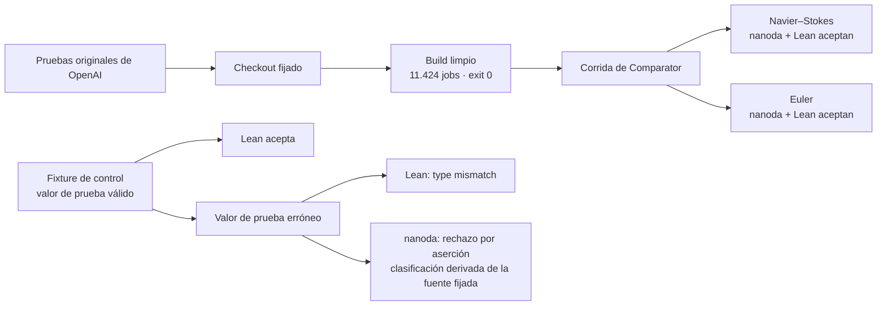

Comparator comprueba que la solución enviada demuestre exactamente el teorema enunciado en el archivo del desafío, usando solo los axiomas permitidos (`propext`, `Quot.sound`, `Classical.choice`). Cada desafío se corrió una vez después del build. Las transcripciones depuradas, los tiempos y los hashes de los originales están en [`evidence/formal/comparator/`](evidence/formal/comparator/README.md). El fixture de prueba errónea y sus clasificaciones están en [`evidence/formal/kernel-mutation/`](evidence/formal/kernel-mutation/). La tabla de correspondencia con Clay está en [`evidence/formal/clay-lean-fidelity.md`](evidence/formal/clay-lean-fidelity.md).


### Revalidación de (C) y (D), 2026-10-21

Se hizo una segunda pasada para cerrar las brechas de [Limitaciones conocidas](#limitaciones-conocidas). Terminaron las 18 pruebas: ninguna dio un resultado inesperado y una no pudo correr. Cada animación muestra una sola idea a velocidad real, con un subtítulo explicativo (en inglés).

| Animación | Qué muestra |
| --- | --- |
| <a href="animations/rerun.html"></a><br><a href="docs/media/rerun.mp4">▶ MP4 1080p</a> | **1. Recompilar y volver a verificar.** Comparator aceptó Navier–Stokes (C, D) y Euler sobre tres compilaciones distintas: el registro del 2026-10-20 (B1), la compilación de auditoría cuyo Mathlib vino de la caché precompilada (B2) y una compilación nueva del 2026-10-21 (B3). B3 compiló Mathlib y el proyecto en la máquina: 11.030 módulos en 1 h 27 min, exit 0. **Corrección:** Lake también descargó 7 dependencias pequeñas como archivos precompilados de [Reservoir](https://reservoir.lean-lang.org) sin registrarlo en el log, así que la afirmación anterior de "0 descargas de caché" era incorrecta. Después, la compilación completa con `lake --no-cache build` (B4) compiló todo localmente, dependencias incluidas: exit 0, 11.424 jobs, sin archivos precompilados. La corrida 4 sobre B4 aceptó Navier–Stokes y Euler. Se reutilizaron la toolchain de Lean y los binarios de los verificadores. |
| <a href="animations/mutants.html">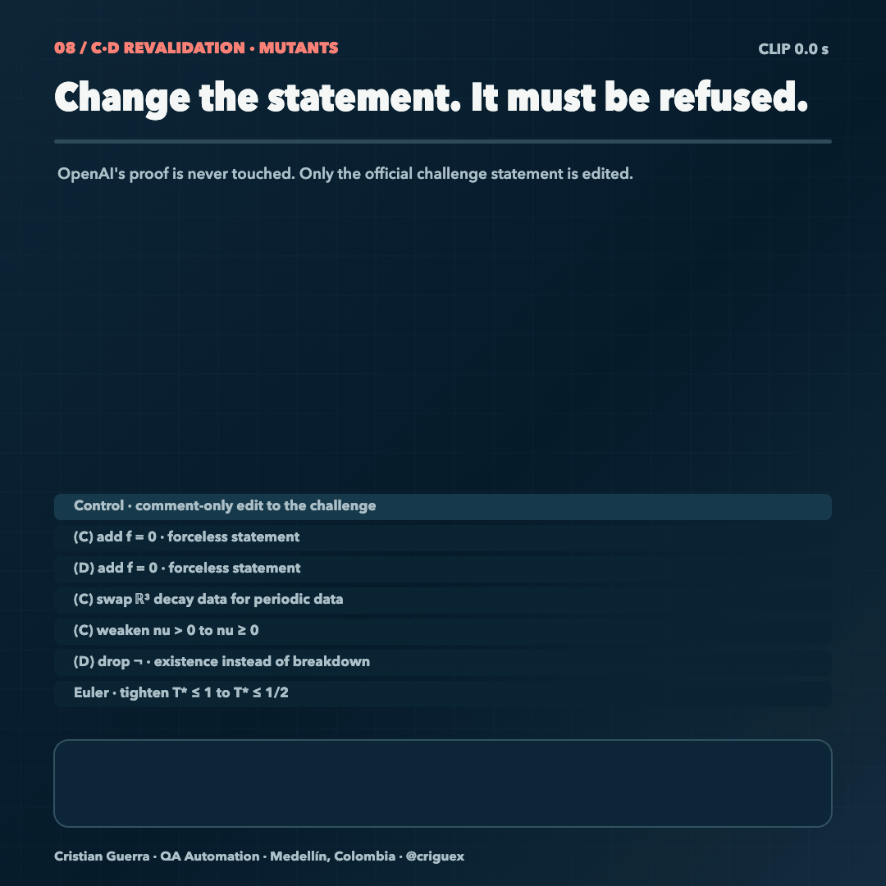</a><br><a href="docs/media/mutants.mp4">▶ MP4 1080p</a> | **2. Cambiar el enunciado: debe ser rechazado.** La prueba de OpenAI nunca se toca. Seis cambios de un símbolo en el desafío oficial fueron rechazados con `Challenge and solution theorem statement do not match`: `f = 0` en (C) y en (D), datos con decaimiento en ℝ³ cambiados por datos periódicos, `nu > 0` debilitado a `nu ≥ 0`, la negación quitada en (D) y el `T* ≤ 1` de Euler endurecido a `T* ≤ 1/2`. Un control que solo agrega un comentario fue aceptado, así que los rechazos vienen del enunciado cambiado. |
| <a href="animations/replay.html">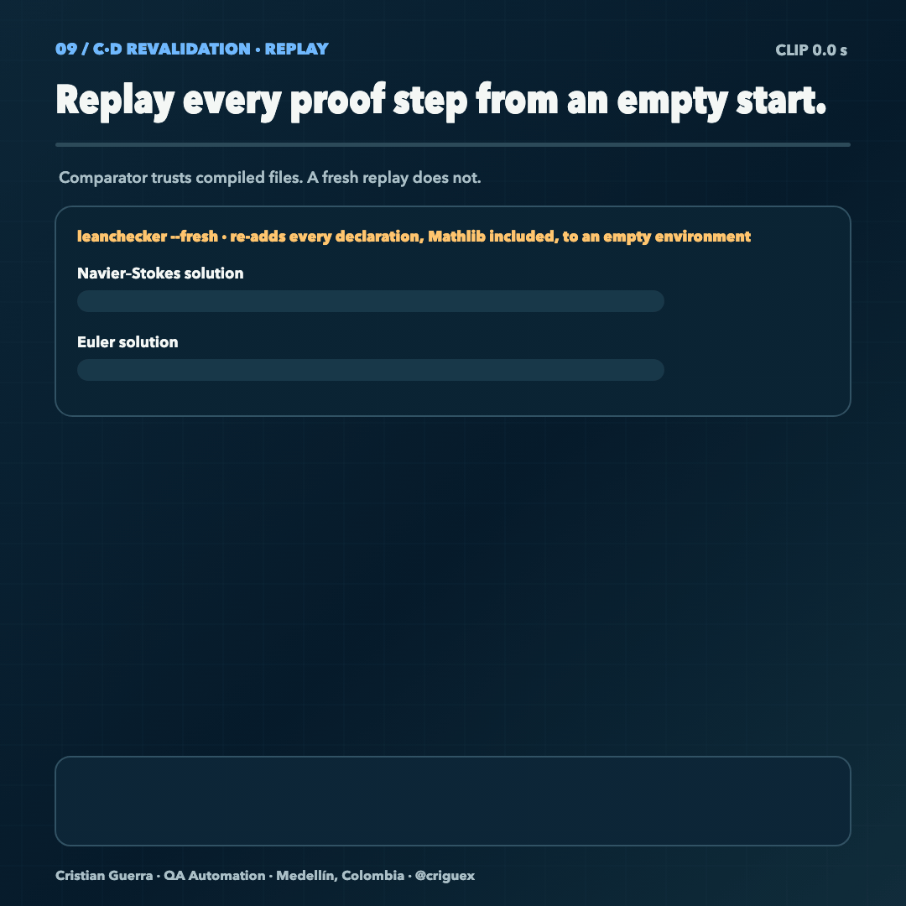</a><br><a href="docs/media/replay.mp4">▶ MP4 1080p</a> | **3. Revisar cada paso desde un entorno vacío.** `leanchecker --fresh` volvió a cargar cada declaración, Mathlib incluido, en un entorno vacío y aceptó las dos soluciones (19,6 y 22,5 minutos). Usa el kernel de Lean, así que es una revisión desde cero y no una tercera implementación. `lean4lean` no compiló en Lean 4.34 (falla su dependencia Batteries), así que nunca revisó las pruebas: es una brecha de herramientas, no un veredicto. |

Que un mutante sea rechazado no dice si el enunciado mutado es verdadero o falso. Los mutantes con `f = 0` no son evidencia sobre las alternativas sin fuerza (A) y (B). Los veredictos, los logs depurados y el diff de cada mutante están en [`evidence/formal/cd-validation/`](evidence/formal/cd-validation/README.md) (en inglés).

### De dónde viene el enunciado y cómo se compara con Clay

<a href="animations/provenance.html">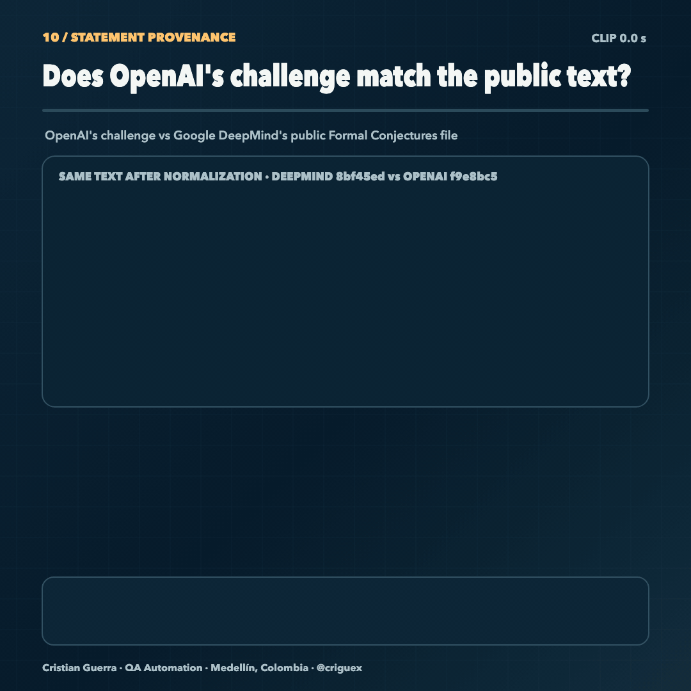</a><br><a href="docs/media/provenance.mp4">▶ MP4 1080p</a>

- **El texto del desafío de OpenAI coincide con el enunciado público.** Las 18 declaraciones coinciden tras normalización textual; la resolución de nombres no se verificó. Frente al archivo de Formal Conjectures de Google DeepMind en `8bf45ed`, las 18 declaraciones con nombre, incluidos los teoremas (C) y (D), son textualmente iguales. Las diferencias restantes son el import, el namespace, notación copiada con la misma definición y (A)/(B) excluidos. [Método, hashes y un script para reproducirlo](evidence/formal/statement-provenance/README.md) (en inglés).
- **Revisión de riesgos cláusula por cláusula contra el texto de Clay.** (C) y (D) dicen "existen datos para los que no existe solución", así que la versión formal solo podría ser más fácil si permitiera datos que Clay prohíbe o si exigiera a las soluciones más que Clay. De 16 cláusulas, 6 coinciden directamente, 9 coinciden por hechos estándar de análisis que se nombran pero aún no se formalizan, y **1 necesita una decisión humana**: la errata de Clay pide presión periódica "en la Ec. (8)", que es la lista de datos, mientras que la formalización la exige a las soluciones en (D). Es la única lectura que restringe algo, pero hace que la (D) formal sea un enunciado sobre el problema corregido. [Revisión completa](evidence/formal/clay-lean-risk.md) (en inglés). Es una revisión de lectura, no revisada por un matemático.

## Pista 2: pruebas de mutación numéricas

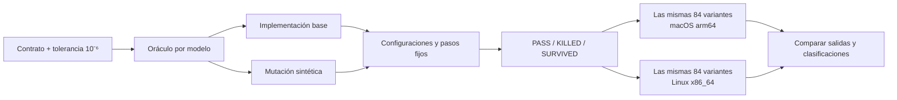

Las pruebas de mutación preguntan si una suite nota cuando el código se rompe a propósito. El contrato y su tolerancia se congelaron antes de cualquier corrida ([`CONTRACT.md`](evidence/numerical/source/CONTRACT.md), en inglés). Cada modelo tiene un oráculo independiente que no comparte código de solver con la implementación bajo prueba. Los nueve modelos son: circuito RC, enfriamiento de Newton, cinética química de segundo orden, atenuación de Beer–Lambert, respuesta logística, refracción de Snell, lente delgada, interfaz acústica y respuesta de Fechner.

Cada máquina registró **27 PASS, 54 KILLED y 3 SURVIVED** sobre las mismas **84 variantes pareadas**, no 168 distintas. La comparación cubrió 738 valores finitos y 18 no finitos (guardados como null). Los tres sobrevivientes son la mutación RC deliberadamente diminuta, que se deja visible a propósito. Todos los modelos y entradas son sintéticos; nada de esto es una medición empírica.

## Método: qué aporta este estudio

**Pregunta de investigación.** ¿Pueden las técnicas habituales de QA de software (un contrato congelado, un oráculo independiente, mutaciones deliberadas y corridas repetidas) darle a un lector externo una confianza verificable en una prueba verificada por máquina y en código científico, sin confiar en el montaje de los autores originales?

**Qué diseñó el autor.** Un solo protocolo aplicado en dos niveles. El autor eligió las preguntas, congeló los contratos, decidió qué cuenta como evidencia y dirigió el trabajo, con asistencia de IA según [AUTHORSHIP.md](AUTHORSHIP.md).

| Elemento | Código numérico | Cadena de verificación formal |
| --- | --- | --- |
| Contrato, congelado primero | [`CONTRACT.md`](evidence/numerical/source/CONTRACT.md), tolerancia 10⁻⁶ | El enunciado oficial del desafío y los axiomas permitidos |
| Oráculo independiente | Una solución analítica, por bisección o por sistema lineal, programada aparte para cada modelo | Comparator con dos kernels (nanoda, Lean) y una revisión con `leanchecker --fresh` |
| Mutación deliberada | Dos errores conocidos por modelo y un cambio de RC cerca del umbral | Un valor de prueba erróneo, que el verificador debe rechazar, y seis mutantes del enunciado con un control de solo comentario, que Comparator debe rechazar o aceptar |
| Repetición | Las mismas 84 variantes en dos máquinas | Comparator sobre cuatro compilaciones, la última sin nada precompilado |
| Revisión de la especificación | El propio contrato | [Procedencia del enunciado](evidence/formal/statement-provenance/README.md) y la [revisión de riesgos frente a Clay](evidence/formal/clay-lean-risk.md) |

**Qué respaldan los resultados.** En lo numérico, todos los mutantes gruesos fueron eliminados y el diminuto sobrevivió donde se esperaba, con clasificaciones idénticas en las dos máquinas. En lo formal, el valor de prueba erróneo fue rechazado, los seis mutantes del enunciado fueron rechazados mientras el control pasaba, la aceptación se repitió entre compilaciones y las 18 declaraciones del desafío coinciden con el enunciado público de DeepMind tras normalización textual (la resolución de nombres no se verificó).

**Técnicas previas en las que se apoya.** Análisis de mutación (DeMillo, Lipton y Sayward, 1978); oráculos de prueba independientes y pruebas diferenciales entre plataformas; el criterio de De Bruijn de verificadores de pruebas pequeños e independientes (nanoda, leanchecker, lean4lean); [Comparator](https://github.com/leanprover/comparator) para verificar el enunciado exacto; y [Formal Conjectures](https://github.com/google-deepmind/formal-conjectures) de Google DeepMind para el enunciado. Lo que aporta este estudio es la combinación y su aplicación: análisis de mutación dirigido a la propia cadena de verificación, al verificador y a la especificación, además del código bajo prueba, con cada paso publicado con hashes para que la auditoría también se pueda auditar. Una [búsqueda bibliográfica dirigida](RELATED_WORK.md) (en inglés) encontró trabajos previos cercanos, en particular mCoq (análisis de mutación de proyectos de verificación en Coq, 2019), la mutación de especificaciones (1985, 2000) y el análisis de mutación de verificadores de benchmarks (2026), así que **no se afirma novedad metodológica**. La pregunta que este estudio sí puede responder es qué detectó el protocolo que el procedimiento documentado antes no muestra: [FINDINGS.md](FINDINGS.md) (en inglés) lista ocho hallazgos de ese tipo en este caso. Después, un experimento a ciegas y prerregistrado sobre 21 casos controlados lo confirmó: el protocolo detectó cuatro clases de fallo que el procedimiento base no detectó (3/3 cada una frente a 0/3), sin falsas alarmas ([resultados](experiments/blind-faults/RESULTS.md), en inglés).

**Límites del método.** Los mutantes del enunciado prueban que el enunciado se compara exactamente, no que la prueba fallaría si estuviera mal. Todas las corridas formales usaron una sola máquina. La comparación con Clay es de lectura. Los mutantes numéricos son gruesos y todos los modelos son sintéticos.

## Animaciones

Abre la [galería offline](animations/index.html) o lee la [guía de animaciones](animations/README.md) (en inglés) con ecuaciones, parámetros, resultados y trazas de fuente.

| Modelos numéricos | Verificaciones formales |
| --- | --- |
| <a href="animations/rc.html">RC · constante de tiempo duplicada</a> · <a href="docs/media/rc.mp4">▶ MP4 1080p</a><br>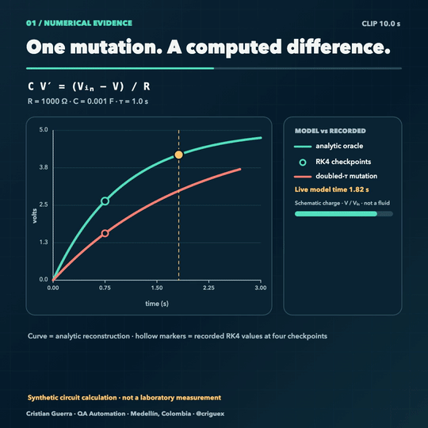 | <a href="animations/formal.html">Formal · control de tipado del valor de prueba</a> · <a href="docs/media/formal.mp4">▶ MP4 1080p</a><br>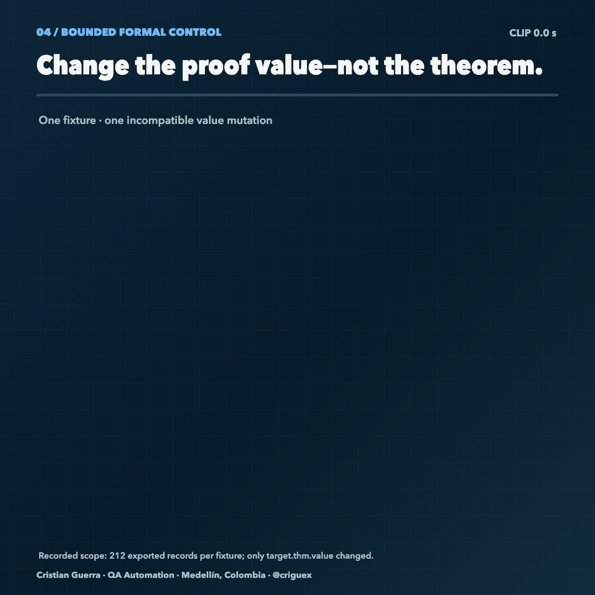 |
| <a href="animations/chemistry.html">Química · tasa de reacción duplicada</a> · <a href="docs/media/chemistry.mp4">▶ MP4 1080p</a><br>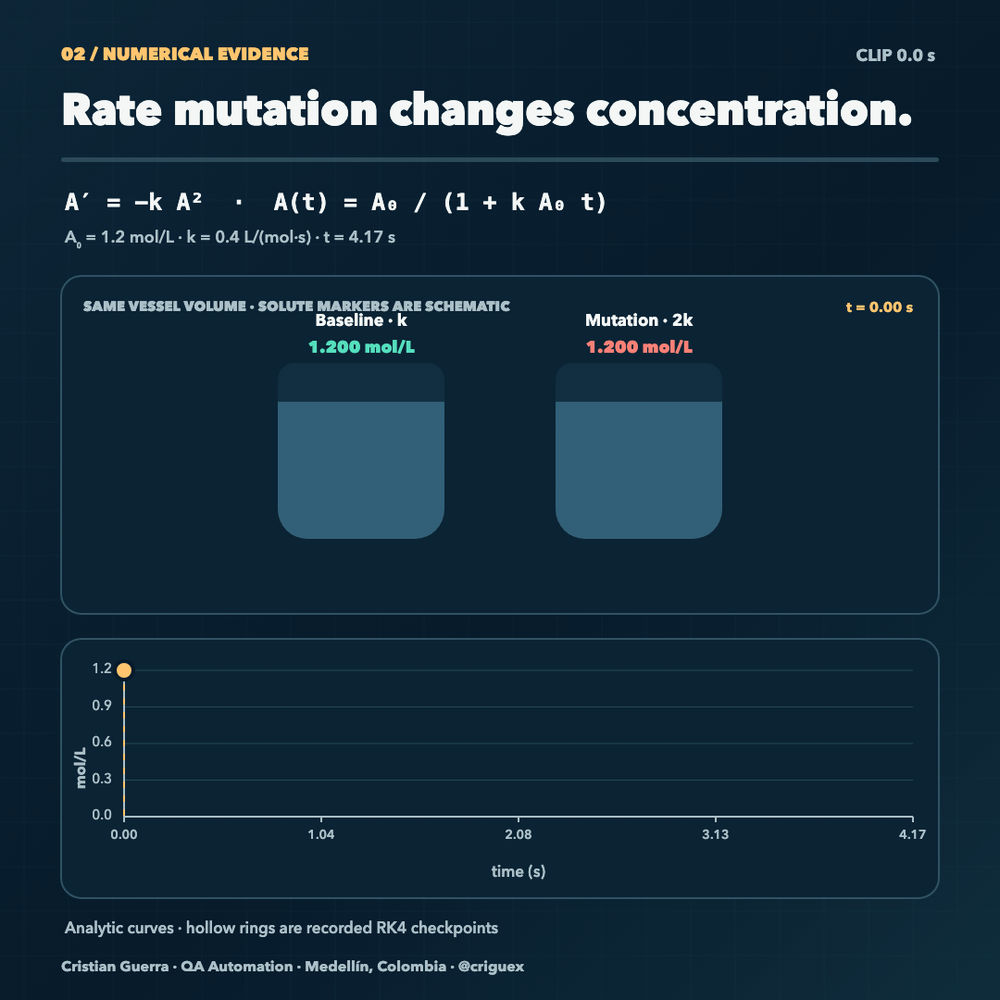 | <a href="animations/rerun.html">C/D · compilar desde cero y verificar</a> · <a href="docs/media/rerun.mp4">▶ MP4 1080p</a><br> |
| <a href="animations/cooling.html">Enfriamiento · constante a la mitad</a> · <a href="docs/media/cooling.mp4">▶ MP4 1080p</a><br>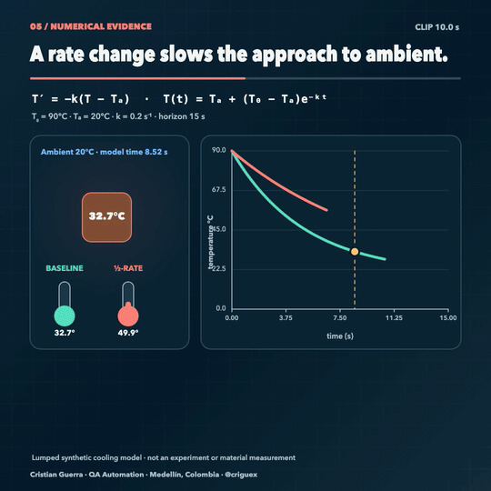 | <a href="animations/mutants.html">C/D · mutantes del enunciado</a> · <a href="docs/media/mutants.mp4">▶ MP4 1080p</a><br> |
| <a href="animations/snell.html">Snell · índices de refracción intercambiados</a> · <a href="docs/media/snell.mp4">▶ MP4 1080p</a><br>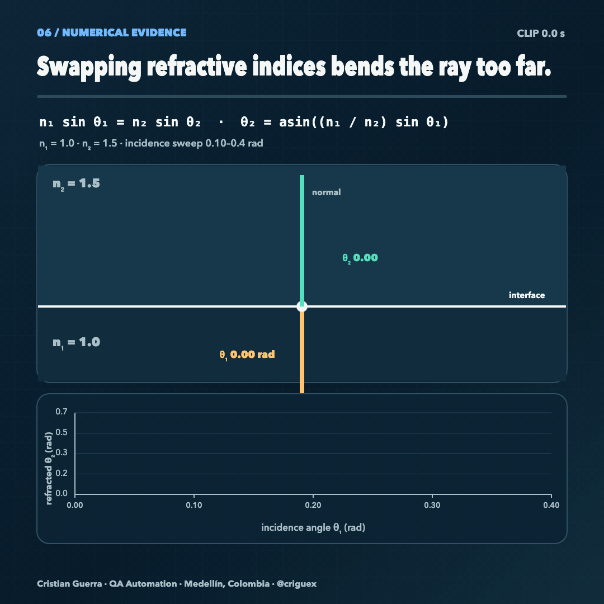 | <a href="animations/replay.html">C/D · revisión del kernel desde cero</a> · <a href="docs/media/replay.mp4">▶ MP4 1080p</a><br> |
| <a href="animations/campaign.html">Campaña · clasificaciones pareadas</a> · <a href="docs/media/campaign.mp4">▶ MP4 1080p</a><br>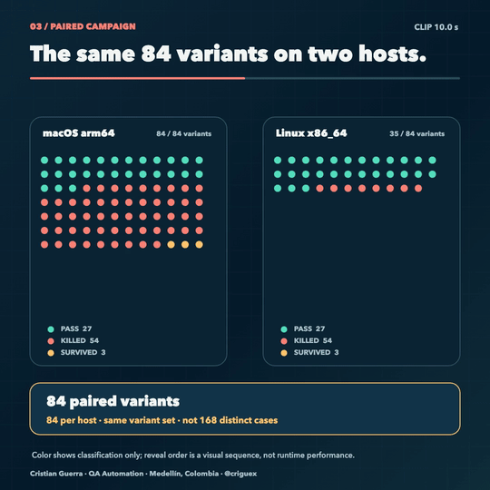 | <a href="animations/provenance.html">Procedencia del enunciado · OpenAI vs DeepMind</a> · <a href="docs/media/provenance.mp4">▶ MP4 1080p</a><br> |

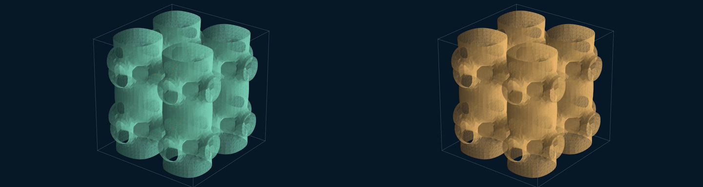

El clip de flujo 3D es solo contexto visual. No es dato de la campaña, ni evidencia de explosión, ni una construcción formal; su procedencia está en [SOURCE_PROVENANCE.md](evidence/SOURCE_PROVENANCE.md).

## Limitaciones conocidas

Un informe de QA solo sirve si dice lo que no probó.

- **Alcance del bootstrap.** B4 (`lake --no-cache build`, 2026-10-21) compiló localmente Mathlib, todas sus dependencias y el proyecto de OpenAI: no se encontró ningún archivo precompilado y todos los `.olean` son posteriores al inicio de la compilación. La compilación anterior B3 había tomado 7 dependencias pequeñas (399 módulos) como archivos precompilados de Reservoir. Todas las compilaciones reutilizaron la toolchain de Lean instalada y los binarios ya compilados de Comparator, lean4export, nanoda y landrun, cuyos hashes están [registrados](evidence/formal/cd-validation/README.md#reused-tools).
- **Corridas repetidas, una sola máquina.** Comparator corrió cuatro veces por desafío, cada vez sobre una compilación distinta: B1 (el registro del 2026-10-20), B2 (Mathlib de la caché precompilada), B3 (compilación nueva) y B4 (compilación sin caché). Los mutantes y la revisión con leanchecker usaron B2. Todas las corridas usaron una sola máquina Linux. Las transcripciones originales no se distribuyen; sí las copias depuradas y los hashes de los originales ([procedencia](evidence/formal/cd-validation/PROVENANCE.md)).
- **No se prueba la correspondencia con el artículo de OpenAI.** Este estudio comprueba que los teoremas formales son aceptados, no que la prueba en Lean siga el argumento del artículo en lenguaje natural de OpenAI. [arXiv:2610.08144](https://arxiv.org/abs/2610.08144) (Bastounis, Circelli y Hansen, 2026) sostiene que no lo sigue; su resumen no afirma que algún teorema de Lean sea falso ni que el enunciado final difiera del de Clay. Ver [RELATED_WORK.md](RELATED_WORK.md#where-this-study-sits).
- **Solo bugs de kernel conocidos.** El código del kernel de Lean usado coincide con v4.34.1 e incluye todas las correcciones de solidez del kernel publicadas en 2026, y nanoda es posterior a su corrección de julio ([vigencia del kernel](evidence/formal/kernel-currency.md)). En julio de 2026 un bug de Lean y otro bug distinto de nanoda dejaron pasar la misma prueba falsa, así que el acuerdo entre dos kernels no dice nada sobre bugs desconocidos.
- **Dos implementaciones de kernel.** Hasta ahora solo el kernel de Lean y nanoda han aceptado las pruebas. `leanchecker --fresh` revisó las dos soluciones desde un entorno vacío sin errores; usa el mismo kernel de Lean, así que es una revisión desde cero y no una tercera implementación. [lean4lean](https://github.com/digama0/lean4lean) no compiló en Lean 4.34 (su dependencia Batteries falla), así que ninguna tercera implementación de kernel ha revisado las pruebas.
- **Comparator standalone.** La corrida usó la herramienta independiente fijada en `19e111e`. Comparator ya se integró al núcleo de Lean como `lake comparator` y `lake check` (Lean v4.35.0); el resultado no se ha repetido con esas herramientas.
- **Un solo fixture de prueba errónea.** El control formal muestra que los verificadores rechazan un valor de prueba erróneo. No es una campaña de mutación sobre las pruebas de OpenAI. Los mutantes del enunciado del 2026-10-21 prueban el lado del desafío: muestran que Comparator rechaza un enunciado cambiado, no que la prueba fallaría si estuviera rota.
- **La comparación con Clay es de lectura.** La [revisión de riesgos](evidence/formal/clay-lean-risk.md) ubica cada brecha cláusula por cláusula, pero los puentes de hechos estándar no están formalizados y ningún matemático la ha revisado. Un punto, la presión periódica en (D), depende de cómo se lea la errata de Clay.
- **54 KILLED cuenta casos, no comportamientos distintos.** En el modelo acústico, `pressure_boundary_sign` e `impedance_swap` producen salidas idénticas en las tres configuraciones, así que hay 51 comportamientos eliminados distintos.
- **Las mutaciones son gruesas.** La mutación eliminada más pequeña tiene un error normalizado de 0,12, unas 120.000 veces la tolerancia de 10⁻⁶. La única mutación cercana al umbral (RC `tau_tiny`, un cambio relativo de 5 × 10⁻⁸) sobrevive entre 56 y 68 veces por debajo de la tolerancia. No se muestrearon tamaños intermedios, así que la campaña no ubica dónde empieza la detección.
- **Modelos y oráculos sintéticos.** Aquí no se valida ningún dato de laboratorio, sistema real ni resultado científico.
- **El verificador es un chequeo de integridad.** `verify_numerical.py` compara los registros guardados contra sus hashes originales y entre máquinas; el recálculo es el paso aparte con `runner.py`.

Cada afirmación, su redacción exacta y su archivo de evidencia están mapeados en [CLAIMS.md](CLAIMS.md) (en inglés).

## Cómo se usó la IA

El trabajo fue asistido por IA y dirigido por una persona. OpenAI Codex fue el agente principal de código: bajo la dirección del autor preparó código, corrió builds y renders y redactó borradores. Claude Code, de Anthropic, hizo los cambios posteriores de documentación y limpieza. Cada commit nombra al agente que participó en un trailer `Co-Authored-By`. Otros asistentes de IA ayudaron con análisis, traducción y revisión. Cristian Guerra eligió las preguntas, congeló el contrato, decidió qué cuenta como evidencia, volvió a correr los verificadores y responde por cada afirmación. Los detalles están en [AUTHORSHIP.md](AUTHORSHIP.md).

## Mapa del repositorio

```text
evidence/
  formal/
    cd-validation/          revalidación del 2026-10-21: compilaciones, recibos, logs, procedencia
    statement-provenance/   desafío de OpenAI comparado con el enunciado de DeepMind
    clay-lean-risk.md       revisión de riesgos cláusula por cláusula frente al texto de Clay
    kernel-currency.md      versiones de Lean y nanoda frente a las correcciones de solidez de 2026
    …                       build limpio, logs de Comparator, fixture de prueba errónea, tabla Clay–Lean
  numerical/           contrato congelado, fuente y tests del runner, corridas de 84 casos en macOS y Linux
  verify_numerical.py  chequeo de integridad y entre máquinas de las corridas guardadas
  SHA256SUMS.txt       checksums de cada archivo curado
animations/            diez escenas HTML offline, scripts de build y de exportación de GIF, tests
.github/workflows/     CI que corre todas las comprobaciones en cada push
docs/assets/           GIFs de vista previa usados en este README
CLAIMS.md              afirmación → evidencia → resultado → limitación
REPRODUCE.md           pasos, versiones, qué se recalcula y qué se verifica por hash
RELATED_WORK.md        trabajos previos, dónde se ubica este estudio, evaluación de novedad
FINDINGS.md            qué encontró el protocolo que el procedimiento documentado no muestra
AUTHORSHIP.md          autoría y declaración de uso de IA
CONTRIBUTING.md        reglas para modificar la evidencia
```

## Créditos, derechos y estado

- **Pruebas originales:** sus autores en OpenAI. **Enunciado del desafío:** Formal Conjectures de Google DeepMind. **Herramientas:** Lean 4, mathlib, Comparator, nanoda.
- **Este estudio de QA:** Cristian Guerra. Para citarlo, usa [CITATION.cff](CITATION.cff).
- **Derechos:** la publicación está autorizada, pero no se otorga licencia de código abierto. Ver [LICENSE_STATUS.md](LICENSE_STATUS.md).
- **Estado:** en [X](https://x.com/criguex/status/2112679712157753441) está publicado un hilo introductorio con vistas previas de las animaciones.

No se reclama descubrimiento de teoremas, certificación científica, validación empírica ni prueba sobre un sistema del mundo real.
