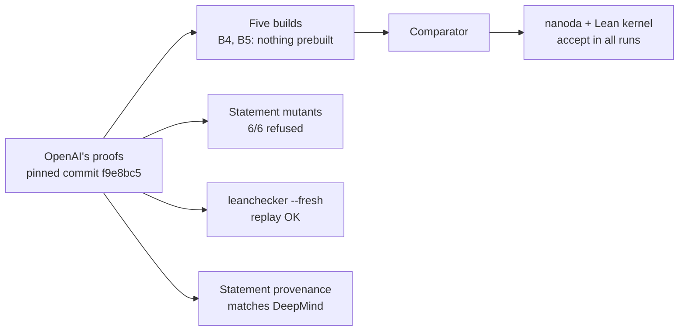
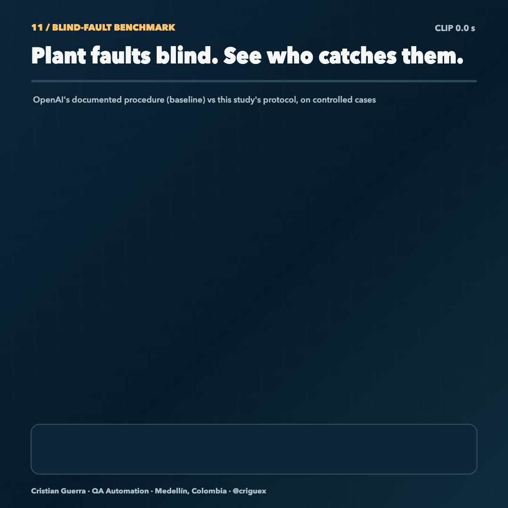
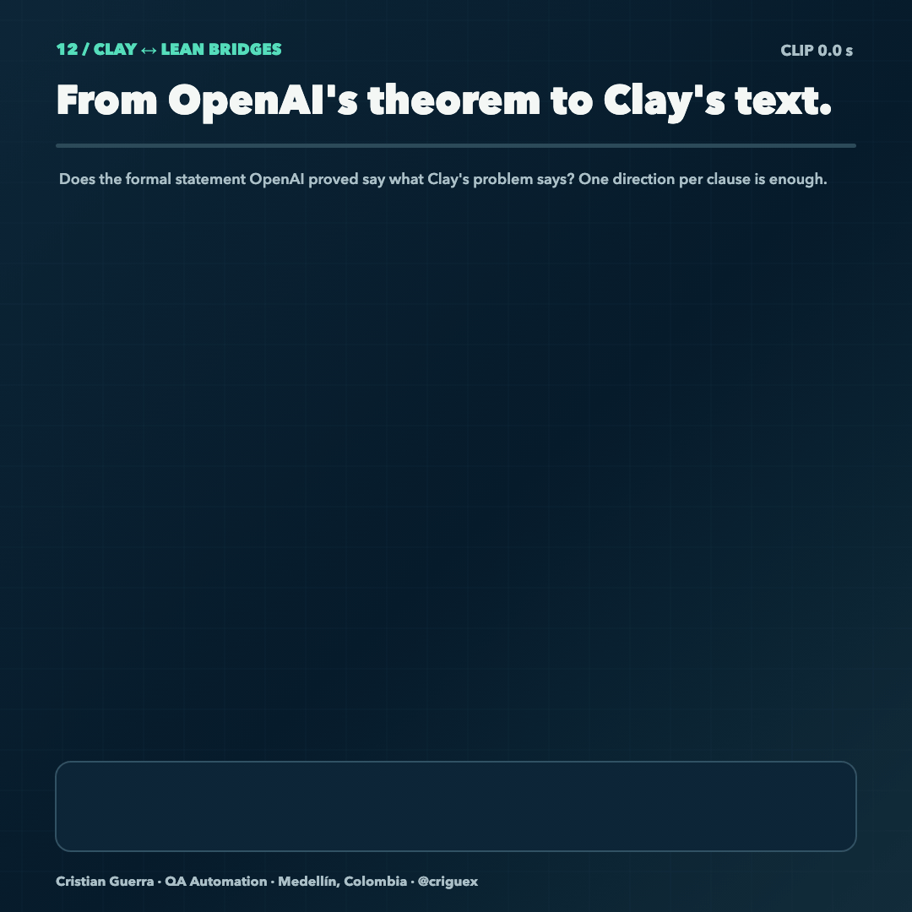

# Scientific QA Evidence

This repository contains an independent QA audit of the Lean 4 formalizations in [openai/NavierStokesAndEuler](https://github.com/openai/NavierStokesAndEuler), which accompany “[Finite time blowup for Navier–Stokes](https://cdn.openai.com/pdf/32d9f210-8b73-45e0-91bc-82a30aef8a9a/navier-stokes.pdf)” and “[Finite time blowup for the Euler equation](https://cdn.openai.com/pdf/315b36cd-ec98-4023-8342-93345194ece1/euler.pdf)” by OpenAI, plus a mutation-testing campaign on nine numerical models. The proofs belong to OpenAI. This repository proves nothing new, claims no Millennium Prize result and is not a mathematical review: it rebuilds the published artifacts, rechecks them with independent checkers, tests whether the checking pipeline catches errors, and publishes every step with hashes.

- [Read the five-page summary (PDF)](docs/report/scientific-qa-evidence-report-v1.3.0.pdf)
- [Read every claim with its evidence and limits](CLAIMS.md)
- [Watch the thirteen evidence scenes](animations/index.html)
- [Leer en español](README.es.md)

By **Cristian Guerra**, QA Automation, Medellín, Colombia ([@criguex](https://github.com/criguex)).

## Navier–Stokes and Euler

For OpenAI's proofs at commit `f9e8bc5`, we checked:

- **They check from scratch:** Comparator, with the nanoda and Lean kernels, accepted Navier–Stokes (C), (D) and Euler on five builds, the last two compiled entirely from source with nothing prebuilt. A fresh `leanchecker` replay agreed, and the kernel includes every known 2026 soundness fix.
- **The statement is the exact one:** Comparator refused all six one-symbol changes to the challenge and accepted a comment-only control. The challenge's 18 declarations match Google DeepMind's public statement after textual normalization (name resolution not verified).
- **Not covered:** whether the Lean proof follows OpenAI's paper, which [arXiv:2610.08144](https://arxiv.org/abs/2610.08144) (Bastounis, Circelli and Hansen) disputes without claiming any Lean theorem is false.

## Clay's problem statement

OpenAI's formal theorems are written in DeepMind's style. Clay's [official problem description](https://www.claymath.org/wp-content/uploads/2022/06/navierstokes.pdf) is a text. We wrote Clay's equations (1)–(11), alternatives **(C)** and **(D)** and the erratum literally in Lean, and proved:

- **OpenAI's theorems imply Clay's (C) and (D) as written here,** for every viscosity ν > 0, with no hypotheses and only the standard axioms, under both readings of smoothness at t = 0 (`k1_C`, `k1_D`, `k1_C_oneSided`, `k1_D_oneSided` in [`bridges/`](bridges/README.md)).
- **Open:** nobody independent has yet checked the literal rendering against Clay's PDF ([14 review points](bridges/K0_REVIEW.md)), and (D) reads Clay's erratum on periodic pressure as a condition on solutions; (C) does not use it. No mathematician has reviewed the bridges.

## The checking pipeline

- **A refusal is not a refutation:** on three theorems Mathlib already proves, Comparator refused all eight changed statements, even a definitionally equal one. A second route in Lean, guarded against using the theorem under test, classified each as equivalent, weaker or false, all as pre-registered ([Mathlib controls](experiments/mathlib-controls/RESULTS.md)).
- **Planted faults:** in a pre-registered benchmark with a committed seed, the protocol flagged four fault classes that OpenAI's documented procedure passes; four review rounds found 17 issues in the experiment itself ([benchmark](experiments/blind-faults/v2/README.md)).
- **What this case adds:** eight findings the documented verification procedure does not show, three of them corrected defects in this study's own work ([FINDINGS.md](FINDINGS.md)). Methodological novelty is not claimed ([RELATED_WORK.md](RELATED_WORK.md)).

## Results at a glance

| Question | Result | Record |
| --- | --- | --- |
| Does it build from source? | Yes. Five builds; the last two (B4 and B5, `lake --no-cache build`) exit 0, 11,424 jobs, 1 h 29 min and 1 h 16 min, every dependency compiled locally. | [builds](evidence/formal/cd-validation/README.md#builds-used-by-each-run), [B5](evidence/formal/b5/README.md) |
| Do independent kernels accept it? | Yes. Comparator with nanoda and the Lean kernel accepted Navier–Stokes (C, D) and Euler in all five runs, one per build. | [revalidation](evidence/formal/cd-validation/README.md) |
| Does Comparator check the exact statement? | Yes. 6 of 6 statement mutants refused; comment-only control accepted. | [mutants](evidence/formal/cd-validation/mutants/) |
| Is the challenge the public statement? | The 18 declarations match after textual normalization; name resolution was not verified. | [provenance](evidence/formal/statement-provenance/README.md) |
| Are the checkers current? | The kernel source includes every 2026 kernel soundness fix; nanoda postdates its fix. | [kernel currency](evidence/formal/kernel-currency.md) |
| Do the checkers reject a wrong proof? | Yes. Lean reports a type mismatch; nanoda stops with an assertion rejection. | [kernel mutation](evidence/formal/kernel-mutation/) |
| Does the formal statement match Clay's text? | Of 16 clauses, 6 match directly, 9 match through standard facts, 1 needs a human decision. In Lean, OpenAI's theorems imply a literal rendering of Clay's (C) and (D); that rendering is not yet independently reviewed. | [risk review](evidence/formal/clay-lean-risk.md), [bridges](bridges/README.md) |
| Do the numerical tests catch bugs? | 27 PASS · 54 KILLED · 3 SURVIVED per host, identical on macOS arm64 and Linux x86_64. | [numerical](evidence/README.md) |
| Does the protocol catch what the baseline misses? | On planted faults, yes: four fault classes flagged by the protocol and passed by the baseline. | [benchmark](experiments/blind-faults/v2/README.md) |
| Does a refusal mean the theorem is false? | No. On three Mathlib theorems, Comparator refused all 8 changed statements, including 3 equivalent ones; a separate Lean route classified each one as equivalent, weaker or false, all as pre-registered. | [Mathlib controls](experiments/mathlib-controls/RESULTS.md) |

Every claim with its evidence, result and limitation is in [CLAIMS.md](CLAIMS.md).

## Verify it yourself

Python 3.9 or newer, no dependencies, about a minute:

```sh
git clone https://github.com/criguex/scientific-qa-evidence.git
cd scientific-qa-evidence
shasum -a 256 -c evidence/SHA256SUMS.txt                           # every curated file is the published one
python3 evidence/verify_numerical.py                               # saved runs intact and identical across hosts
(cd evidence/numerical/source && python3 -m unittest test_runner)  # reruns all 84 numerical variants
python3 evidence/test_consistency.py                               # README, CLAIMS and records agree
python3 experiments/mathlib-controls/verify.py                     # check Mathlib-control receipts, recompute classes
```

The same checks, and the tests of every other script, run in [GitHub Actions](.github/workflows/verify.yml) on Ubuntu and macOS on every push. [REPRODUCE.md](REPRODUCE.md) gives the versions, the steps from a clean checkout, and which results are recomputed versus only verified by hash. The Lean builds need OpenAI's repository and a Linux host; their records are verified by hash here. A complete run from a fresh clone is recorded in [FROM_ZERO.md](evidence/FROM_ZERO.md).

## Part A · Formal audit of (C), (D) and Euler



Comparator checks that the submitted solution proves exactly the theorem stated in the challenge file, using only the permitted axioms (`propext`, `Quot.sound`, `Classical.choice`). The first run (2026-10-20) is in [`evidence/formal/comparator/`](evidence/formal/comparator/README.md). The revalidation of 2026-10-21 added three more runs, statement mutants and a fresh replay. All 18 checks finished: none produced an unexpected result, and one could not run. A fifth build, B5, repeated the full build from source for release v1.3.0, and Comparator accepted both challenges again ([B5 record](evidence/formal/b5/README.md)).

| Animation | What it shows |
| --- | --- |
| <a href="animations/rerun.html"></a><br><a href="docs/media/rerun.mp4">▶ MP4 1080p</a> | **Rebuild, check again.** Four builds: the 2026-10-20 record (B1), an audit build whose Mathlib came from the prebuilt cache (B2), a fresh build (B3), and a full `lake --no-cache build` (B4) with every dependency compiled locally. Comparator accepted both challenges on each. B3 had silently received 7 small dependencies as prebuilt [Reservoir](https://reservoir.lean-lang.org) archives, which is why B4 exists. The Lean toolchain and checker binaries were reused. |
| <a href="animations/mutants.html"></a><br><a href="docs/media/mutants.mp4">▶ MP4 1080p</a> | **Change the statement; it must be refused.** OpenAI's proof is never touched. Six one-symbol edits to the challenge were all refused with `Challenge and solution theorem statement do not match`; a comment-only control was accepted. A refused mutant says nothing about whether the mutated statement is true, and the `f = 0` mutants say nothing about (A) or (B). |
| <a href="animations/replay.html"></a><br><a href="docs/media/replay.mp4">▶ MP4 1080p</a> | **Replay every step from an empty start.** `leanchecker --fresh` accepted both solutions. It reuses Lean's kernel, so it is not a third implementation. `lean4lean` could not be built for Lean 4.34 and never examined the proofs. |
| <a href="animations/provenance.html"></a><br><a href="docs/media/provenance.mp4">▶ MP4 1080p</a> | **Where the statement comes from.** The 18 declarations match after textual normalization; name resolution was not verified. The remaining differences with Google DeepMind's Formal Conjectures file are the import, the namespace, notation copied in with the same definition, and (A)/(B) left out. |

**Against Clay's text.** (C) and (D) say "there exist data for which no solution exists", so the formal version could only be easier if it allowed data Clay forbids or demanded more of solutions than Clay does. Of 16 clauses, 6 match directly, 9 match through standard analysis facts, and 1 needs a human decision: Clay's erratum asks for periodic pressure "in Eqn (8)", the data list, while the formalization requires it of solutions in (D). See the [risk review](evidence/formal/clay-lean-risk.md) and Part D.

## Part B · Numerical mutation testing

Mutation testing asks whether a test suite notices when the code is deliberately broken. The contract and its tolerance (10⁻⁶) were frozen before any run ([`CONTRACT.md`](evidence/numerical/source/CONTRACT.md)), and every model has an independent oracle that shares no solver code with the implementation under test. The nine models are RC circuit, Newton cooling, second-order chemical kinetics, Beer–Lambert attenuation, logistic response, Snell refraction, thin lens, acoustic interface and Fechner response.

Each host recorded **27 PASS, 54 KILLED and 3 SURVIVED** over the same **84 paired variants**, not 168 distinct ones; the maximum scaled difference between hosts is 1.11 × 10⁻¹⁶. The 54 KILLED are cases, not behaviors: two acoustic mutants give identical outputs, leaving 51 distinct killed behaviors. The three survivors are a deliberately tiny RC change, kept visible on purpose. All models and inputs are synthetic; none of this is an empirical measurement.

## Part C · What the protocol adds

**Research question.** Can ordinary software-QA techniques (a frozen contract, an independent oracle, deliberate mutations and repeated runs) give an outside reader verifiable confidence in a machine-checked proof and in scientific code, without trusting the original authors' setup?

| Element | Numerical code | Formal proof pipeline |
| --- | --- | --- |
| Contract, frozen first | [`CONTRACT.md`](evidence/numerical/source/CONTRACT.md), tolerance 10⁻⁶ | The official challenge statement and the permitted axioms |
| Independent oracle | A separately coded solution per model | Comparator with two kernels, plus a `leanchecker --fresh` replay |
| Deliberate mutation | Two known bugs per model, plus one near-threshold change | A wrong proof value and six statement mutants with a control |
| Repetition | The same 84 variants on two hosts | Comparator on five builds |
| Specification check | The contract itself | Statement provenance, the Clay risk review and the Lean bridges (Part D) |

### Findings in this case

Compared with the verification procedure in OpenAI's README, the protocol produced eight findings that procedure does not show, three of them corrected defects in this study's own work ([FINDINGS.md](FINDINGS.md)).

### Blind-fault benchmark

A pre-registered experiment planted faults in controlled cases, assigned by a committed seed. With the corrected evaluator, the protocol's checks flag four fault classes the baseline passes, both flag the positive control, and the clean case passes both. The first run is kept with errata, and four review rounds found 17 issues in the experiment itself ([results and errata](experiments/blind-faults/RESULTS.md), [corrected benchmark](experiments/blind-faults/v2/README.md)).

<a href="animations/experiment.html"></a><br><a href="docs/media/experiment.mp4">▶ MP4 1080p</a>

### Mathlib controls: "the statement changed" is not "the theorem is false"

A statement checker answers one question: is the submitted theorem exactly the challenge? To see what its answers mean, three theorems Mathlib already proves were each given the correct statement, equivalent reformulations and deliberate errors, with the expected outcome registered before any run. Every refused case then got a **second route** in plain Lean: an equivalence proof, a proof that it is weaker (both directions), or a refutation.

| Theorem | Statement tried | Comparator | Second route in Lean | Class |
| --- | --- | --- | --- | --- |
| Primes | `∀ n, ∃ p, n < p ∧ p.Prime` | ✅ accepted | — | accepted by the checker |
| | `n + 1 ≤ p` instead of `n < p` | ❌ refused | `Iff.rfl`: the same definition | equivalent |
| | `n ≤ p` instead of `n < p` | ❌ refused | equivalence for every predicate `P`, not just primes | equivalent |
| | `∀ n ≤ 100, …` (checking examples) | ❌ refused | full ⇒ bounded; bounded ⇏ full (take `P p := p = 101`) | weaker |
| | `∃ p, ∀ n, n < p ∧ p.Prime` (quantifiers swapped) | ❌ refused | refuted: take n = p | false |
| Cauchy–Schwarz | `abs ⟪x, y⟫ ≤ ‖x‖ * ‖y‖` | ✅ accepted | — | accepted by the checker |
| | `⟪x, y⟫ ^ 2 ≤ ‖x‖ ^ 2 * ‖y‖ ^ 2` | ❌ refused | `abs a ≤ bc ↔ a² ≤ b²c²` when b, c ≥ 0 | equivalent |
| | `<` instead of `≤` | ❌ refused | refuted with x = y = 1 | false |
| Dominated convergence | Mathlib's hypotheses | ✅ accepted | — | accepted by the checker |
| | `Integrable bound` as "measurable and ∫⁻ ofReal bound < ∞" | ❌ refused | equivalent only because domination forces bound ≥ 0 | equivalent |
| | domination removed | ❌ refused | refuted: (n+1) on (0, 1/(n+1)) tends to 0, every integral is 1 | false |

**What it shows.** A refusal only means "the statement changed": Comparator refused all eight changes, even `n + 1 ≤ p`, which Lean treats as identical to `n < p` by definition. An acceptance is equality as Comparator checks it, not a proof of anything else. Telling equivalent, weaker and false apart took a separate proof each time.

**The guard.** Any two true statements are trivially "equivalent", so an equivalence counts only if its proof does not use the theorem under test. A Lean command walks every transitive dependency of the proof:

```text
guard: QAControls.SecondRoute.primes_reform_equiv uses none of the theorems under test (1485 constants checked)
error: guard: QAControls.SecondRoute.primes_reform_equiv_cheat depends on Nat.exists_infinite_primes
```

<a href="animations/controls.html"></a><br><a href="docs/media/controls.mp4">▶ MP4 1080p</a>

The second line is a deliberately cheating proof, rejected as registered. All 11 cases and both controls came out as pre-registered. Every step has a receipt (command, input hashes, output hashes, exit code), and `python3 experiments/mathlib-controls/verify.py` checks the records against them and recomputes every class; that checks the records, it does not rerun Lean ([design](experiments/mathlib-controls/DESIGN.md), [results](experiments/mathlib-controls/RESULTS.md)). Cases prepared by someone else are still needed ([how to contribute](experiments/mathlib-controls/HOLDOUT.md)).

### Prior work

Mutation analysis (DeMillo, Lipton and Sayward, 1978), specification mutation (1985, 2000), mutation analysis of Coq verification projects (mCoq, 2019), mutation analysis of benchmark checkers (2026), the de Bruijn criterion, [Comparator](https://github.com/leanprover/comparator) and Google DeepMind's [Formal Conjectures](https://github.com/google-deepmind/formal-conjectures). The contribution is the combination and its application to the verification pipeline itself; methodological novelty is not claimed ([RELATED_WORK.md](RELATED_WORK.md)).

## Part D · From OpenAI's theorem to Clay's text

OpenAI proves a formal statement written in Google DeepMind's style. Does it say what Clay's text says? To get Clay's (C) and (D) from it, one direction per clause is enough: OpenAI's data must satisfy Clay's conditions, and any Clay solution must be a formal solution. Then, if a Clay solution existed, it would be a formal one, which OpenAI's theorem rules out.

### What is proved

Clay's equations (1)–(11), (C), (D) and the erratum are written literally in Lean, in coordinates and with one-sided time derivatives, in [`bridges/ClayLiteral.lean`](bridges/ClayLiteral.lean). Then [`bridges/Bridges.lean`](bridges/Bridges.lean) proves, from OpenAI's theorems, with no hypotheses:

```lean
theorem k1_C          (ν : ℝ) (hν : 0 < ν) : ClayLiteral.AltC ν               -- Clay's (C)
theorem k1_D          (ν : ℝ) (hν : 0 < ν) : ClayLiteral.AltD_withErratum ν   -- Clay's (D)
theorem k1_C_oneSided (ν : ℝ) (hν : 0 < ν) : ClayLiteral.AltC_oneSided ν      -- (C), other reading of C^∞ at t = 0
theorem k1_D_oneSided (ν : ℝ) (hν : 0 < ν) : ClayLiteral.AltD_withErratum_oneSided ν
```

All four use only `propext`, `Classical.choice` and `Quot.sound`. A control proves that the zero solution meets every Clay solution condition, so "no solution exists" is not vacuously true.

<a href="animations/bridges.html"></a><br><a href="docs/media/bridges.mp4">▶ MP4 1080p</a>

### How each clause is bridged

| Clay's text (as in `ClayLiteral`) | OpenAI's formal version | Lean bridge |
| --- | --- | --- |
| u° smooth, `div u° = 0`, decay (4) | OpenAI's witness has u₀ = 0 | `d1_zero`, `d2_zero`, `d3_zero` |
| f smooth on ℝ³ × [0, ∞), in either reading at t = 0 | OpenAI's force is smooth on all of ℝ × ℝ³, so it is its own extension | `witness_C`, `witness_D` |
| decay (5) and (9) of every mixed partial ∂x^α ∂t^m f | a bound on the norm of the m-th derivative | `d5`, `d7`: a partial is that derivative applied to unit vectors (`clay_bound`) |
| equation (1) in coordinates, with Σⱼ uⱼ∂ⱼuᵢ and Σₖ ∂ₖ² | the vector equation with Mathlib's `Δ` and `gradient` | `s1` |
| (2): Σᵢ ∂uᵢ/∂xᵢ = 0 | trace of the Jacobian = 0 | `s2` |
| (3) initial condition | the same | `s3` |
| (6), (11): u, p ∈ C^∞(ℝ³ × [0, ∞)) | `ContDiffOn` on the closed half-space | `s4` |
| (7): Lebesgue ∫ abs(u)² dx < C | `MemLp 2` and a bound on the Bochner integral | `s5` |
| (8), (10), erratum: periodicity | `IsOnePeriodic` | `d6`, `s6`, `s7_formal_side` |

Every row with its status is in [clay-lean-bridges.md](evidence/formal/clay-lean-bridges.md); the build receipt is in [`bridges/README.md`](bridges/README.md).

### What remains

- **Fidelity of `ClayLiteral`.** The result is only as faithful as the literal rendering, which nobody independent has reviewed against the PDF. In particular, `SmoothOneSided` is defined directly as Mathlib's `ContDiffOn` on the closed half-space; its name does not show that this is the smoothness Clay means, and that correspondence is itself a review point. The 14 points to check, smoothness at t = 0 first, are in [`bridges/K0_REVIEW.md`](bridges/K0_REVIEW.md).
- **Periodic pressure, (D) only.** K1 for (D) reads Clay's erratum as a condition on solutions; (C) does not use it. A question was sent to the Clay Mathematics Institute on 2026-10-21; answers will be recorded here.
- **No mathematician has reviewed any of this.**

## Animations

Thirteen offline scenes, each as an interactive HTML page, a GIF preview and a 1080p MP4. Open the [gallery](animations/index.html), or read the [animation guide](animations/README.md) for equations, parameters and source traces.

| Numerical models | Formal checks |
| --- | --- |
| <a href="animations/rc.html">RC · doubled time constant</a> · <a href="docs/media/rc.mp4">▶ MP4</a><br> | <a href="animations/formal.html">Formal · proof-value typecheck control</a> · <a href="docs/media/formal.mp4">▶ MP4</a><br> |
| <a href="animations/chemistry.html">Chemistry · doubled reaction rate</a> · <a href="docs/media/chemistry.mp4">▶ MP4</a><br> | <a href="animations/rerun.html">C/D · rebuild and recheck</a> · <a href="docs/media/rerun.mp4">▶ MP4</a><br> |
| <a href="animations/cooling.html">Cooling · halved rate constant</a> · <a href="docs/media/cooling.mp4">▶ MP4</a><br> | <a href="animations/mutants.html">C/D · statement mutants</a> · <a href="docs/media/mutants.mp4">▶ MP4</a><br> |
| <a href="animations/snell.html">Snell · swapped refractive indices</a> · <a href="docs/media/snell.mp4">▶ MP4</a><br> | <a href="animations/replay.html">C/D · fresh kernel replay</a> · <a href="docs/media/replay.mp4">▶ MP4</a><br> |
| <a href="animations/campaign.html">Campaign · paired classifications</a> · <a href="docs/media/campaign.mp4">▶ MP4</a><br> | <a href="animations/provenance.html">Statement provenance · OpenAI vs DeepMind</a> · <a href="docs/media/provenance.mp4">▶ MP4</a><br> |
| | <a href="animations/bridges.html">Clay ↔ Lean bridges · K1</a> · <a href="docs/media/bridges.mp4">▶ MP4</a><br> |
| | <a href="animations/controls.html">Mathlib controls · refusal is not refutation</a> · <a href="docs/media/controls.mp4">▶ MP4</a><br> |
| | <a href="animations/experiment.html">Blind-fault benchmark</a> · <a href="docs/media/experiment.mp4">▶ MP4</a><br> |


The 3D flow clip is visual context only, not campaign data, evidence of blowup or a formal construction; its provenance is in [SOURCE_PROVENANCE.md](evidence/SOURCE_PROVENANCE.md).

## Known limitations

A QA report is only useful if it says what it did not test.

- **One host, reused tools.** All formal runs used one Linux host. Every build reused the installed Lean toolchain and the prebuilt Comparator, lean4export, nanoda and landrun binaries, whose hashes are [recorded](evidence/formal/cd-validation/README.md#reused-tools).
- **Two kernel implementations.** Only the Lean kernel and nanoda have examined the proofs. `leanchecker` reuses the Lean kernel, and `lean4lean` could not be built for Lean 4.34.
- **Known kernel bugs only.** The checkers are current with the known 2026 fixes, but in July 2026 a Lean bug and a separate nanoda bug let the same false proof through, so agreement between two kernels says nothing about unknown bugs.
- **Standalone Comparator.** The runs used the tool pinned at `19e111e`, not the later `lake check` of Lean v4.35.0.
- **Proof correspondence not tested.** Whether the Lean proof follows OpenAI's paper is out of scope; [arXiv:2610.08144](https://arxiv.org/abs/2610.08144) argues it does not, without claiming any Lean theorem is false.
- **The Clay comparison is not reviewed.** The Lean implication is relative to this repository's literal rendering of Clay's text, which no independent person has checked, and it leaves (D) without the erratum on solutions open.
- **Statement mutants test statement equality**, not whether the proof would fail if it were wrong. There is one wrong-proof fixture, not a mutation campaign over OpenAI's proofs.
- **Numerical limits.** The 54 KILLED count cases, not 51 distinct killed behaviors; the mutants are coarse, so the detection threshold is not measured; all models are synthetic.
- **The benchmark uses planted faults** over recorded artifacts, not live Lean, and gives no real-world detection rate.
- **The Mathlib controls are small and author-designed:** 11 cases on three theorems, no held-out cases from someone else yet.

## How AI was used

The work was AI-assisted and human-directed. OpenAI Codex was the main coding agent at first, and Anthropic's Claude Code made the later audit, documentation and experiment changes. Each commit names the agent in a `Co-Authored-By` trailer. Cristian Guerra chose the questions, froze the contracts, decided what counts as evidence and is responsible for every claim. Details, including a mid-session change of the assistant's reported model, are in [AUTHORSHIP.md](AUTHORSHIP.md).

## Repository map

```text
README.md, README.es.md   this overview, in English and Spanish
CLAIMS.md                 every claim → evidence → result → limitation
FINDINGS.md               what the protocol found that the documented procedure does not show
RELATED_WORK.md           prior work and novelty assessment
REPRODUCE.md              versions, steps, recomputed vs hash-verified
AUTHORSHIP.md             authorship and AI disclosure
evidence/
  formal/                 builds, Comparator runs, mutants, replays, provenance, kernel currency,
                          Clay risk review and bridge plan (cd-validation/ holds the 2026-10-21 records)
  numerical/              frozen contract, source and tests, 84-case runs for macOS and Linux
  SHA256SUMS.txt          checksums for every curated file
experiments/blind-faults/ pre-registered benchmark: seed, frozen design, cases, results, errata, v2 evaluator
experiments/mathlib-controls/ statement changed vs theorem false, on three Mathlib theorems
bridges/                  Clay's text in Lean and the proof that OpenAI's theorems imply it
animations/               thirteen offline scenes, build and export scripts, tests
docs/                     GIF previews, MP4 videos, PDF summary
.github/workflows/        CI that runs every check on each push
```

## Credit, rights and status

- **Original proofs:** OpenAI, [openai/NavierStokesAndEuler](https://github.com/openai/NavierStokesAndEuler) at `f9e8bc5` (Apache-2.0), with the papers [Finite time blowup for Navier–Stokes](https://cdn.openai.com/pdf/32d9f210-8b73-45e0-91bc-82a30aef8a9a/navier-stokes.pdf) and [for the Euler equation](https://cdn.openai.com/pdf/315b36cd-ec98-4023-8342-93345194ece1/euler.pdf).
- **Problem statement:** C. L. Fefferman, [Existence and smoothness of the Navier–Stokes equation](https://www.claymath.org/wp-content/uploads/2022/06/navierstokes.pdf), Clay Mathematics Institute. **Challenge statement:** Google DeepMind, [Formal Conjectures](https://github.com/google-deepmind/formal-conjectures) at `8bf45ed` (Apache-2.0).
- **Tools, at the revisions used:** [Lean 4](https://github.com/leanprover/lean4) v4.34.0-rc2 (`6a10ac8`), [Mathlib](https://github.com/leanprover-community/mathlib4) (`85e3a25`), [Comparator](https://github.com/leanprover/comparator) (`19e111e`), [lean4export](https://github.com/leanprover/lean4export) (`cacf989`), [nanoda](https://github.com/ammkrn/nanoda_lib) (`9d6964f`), all Apache-2.0, and [landrun](https://github.com/Zouuup/landrun) (`ec104f6`, MIT). Each revision is checked to exist in its repository; binary hashes are in [`receipts/`](evidence/formal/cd-validation/receipts/).
- **Related analysis:** Bastounis, Circelli and Hansen, [arXiv:2610.08144](https://arxiv.org/abs/2610.08144); the rest of the prior work is in [RELATED_WORK.md](RELATED_WORK.md).
- **This QA study:** Cristian Guerra. To cite it, use [CITATION.cff](CITATION.cff).
- **Rights:** publication is authorized, but no open-source license is granted. See [LICENSE_STATUS.md](LICENSE_STATUS.md).
- **Status:** latest release [v1.3.0](https://github.com/criguex/scientific-qa-evidence/releases/tag/v1.3.0), which adds the Lean bridges to Clay's text, the Mathlib controls and build B5.

No theorem discovery, scientific certification, empirical validation or proof about a real-world system is claimed.
