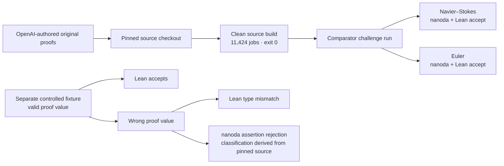
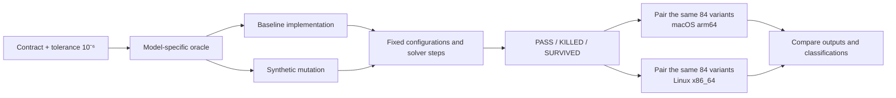

# Scientific QA Evidence

**A reproducible numerical mutation campaign, alongside bounded formal-tool controls.** This package keeps those two kinds of evidence separate: finite numerical tests are not theorem proofs, and the formal examples do not certify scientific models.

## Two evidence tracks

### 1. Formal reproduction and controls



The clean build reused cached dependencies and toolchain artifacts; it was not a full bootstrap. The later Comparator run is a bounded recorded check of the configured challenges, not a general proof of correctness. The deliberately wrong fixture changes the exported proof value while retaining its declared type and dependencies. See the [formal evidence map](CLAIMS.md) and [Comparator records](evidence/formal/comparator/README.md).

### 2. Numerical mutation QA



Each host recorded **27 PASS, 54 KILLED, and 3 SURVIVED** across the same **84 paired variants**—not 168 distinct variants. The paired comparison covered **738 finite values and 18 non-finite values** (represented as null); the maximum reported cross-host scaled delta was **1.11 × 10⁻¹⁶**. Survivors remain visible and are not proof of equivalence. All models and mutation inputs are synthetic fixtures, not empirical measurements.

## Explore and reproduce

- [Open the offline animation gallery](animations/index.html) or read the full [animation guide](animations/README.md) for equations, parameters, mutation outcomes, oracle scope, and source traces.

### Six data-backed animation scenes

| Numerical models | Campaign and formal controls |
| --- | --- |
| <a href="animations/rc.html">RC · doubled time constant</a><br> | <a href="animations/campaign.html">Campaign · paired classifications</a><br> |
| <a href="animations/chemistry.html">Chemistry · doubled reaction rate</a><br> | <a href="animations/formal.html">Formal · proof-value typecheck control</a><br> |
| <a href="animations/cooling.html">Cooling · halved rate constant</a><br> | <a href="animations/snell.html">Snell · swapped refractive indices</a><br> |

The standalone HTML scenes retain play and seek controls. The table previews are motion exports for quick scanning; they are not the narration-synced long video or its five shorts.

### Separate 3D flow context


This cropped visual is context only—not campaign data, evidence of blow-up, or a formal solution. Its source and crop provenance are documented in [SOURCE_PROVENANCE.md](evidence/SOURCE_PROVENANCE.md).

- [Read the evidence map](CLAIMS.md), [source provenance](evidence/SOURCE_PROVENANCE.md), and [curated evidence guide](evidence/README.md).
- [Review the narrated V2 plan](video/src/visual-v2/publication.json). The rejected static-text V1 must not be uploaded.
- Spanish V2 script, generated audio, provider-aligned captions and media manifest are ready: [`production/narration.es.json`](production/narration.es.json), [`video/public/spanish/`](video/public/spanish/) and [`video/src/generatedSpanishMedia.json`](video/src/generatedSpanishMedia.json). The five Spanish chapters each have a long-form track and an aligned short opening.

```sh
python3 production/synthesize.py --dry-run --language es --out /tmp/adv050-es-review
```

The command above only inspects the request plan and makes no network calls. Paid regeneration is not needed: the processed Spanish audio and captions already exist. Do not run synthesis without explicit need and authorization. Raw provider responses remain outside the repository. English exports have 1.20× and Spanish exports 1.25× offline speed baked into their audio; play both at normal 1×. The Spanish narration, captions, story panels and major diagram labels are localized, while some labels inside the shared plot artwork remain English; final media review is pending.

Verify the saved numerical evidence and bundled files:

```sh
shasum -a 256 -c evidence/SHA256SUMS.txt
python3 evidence/verify_numerical.py
python3 -m unittest discover -s animations -p 'test_*.py'
```

To rerun the synthetic suite in a new, nonexistent output directory:

```sh
cd evidence/numerical/source
python3 runner.py --out /tmp/adv050-multidomain-rerun
```

This reruns the numerical suite only; it does not rebuild the formal source or rerun Comparator. The clean-source build instructions and limits are documented in [`evidence/formal/clean-build/`](evidence/formal/clean-build/). Saved evidence checks do not imply a fresh run.

## Credit and status

Created by **Cristian Guerra**, QA Automation, from **Medellín, Colombia** ([`@criguex`](https://github.com/criguex)). Original proofs are credited to their OpenAI authors; see [Authorship and AI disclosure](AUTHORSHIP.md) for attribution and tool-assistance details. Lean, mathlib, and Comparator are identified in the [dependency and fidelity records](evidence/formal/clay-lean-fidelity.md).

Six interactive HTML scenes and six matching preview loops are available for review, with a separate 3D illustrative flow clip. V2 source defines one long video and five narrated shorts in each language; final exports are pending. An introductory X thread and six GIF replies have been posted; YouTube and TikTok uploads have not. The author has authorized the publication workflow; final rendered-media review and third-party rights checks remain separate readiness items. See [publication status](PUBLICATION_STATUS.md).

No theorem discovery, scientific certification, empirical validation, or proof of a real-world system is claimed.
