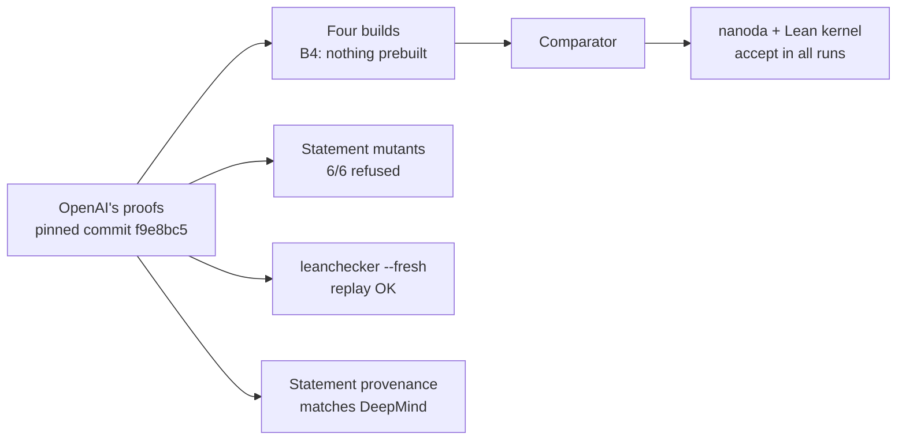

# Scientific QA Evidence

**An independent QA audit of OpenAI's Lean proofs of finite-time blowup for Navier–Stokes and Euler, plus a mutation-testing campaign on nine numerical models.**

By **Cristian Guerra**, QA Automation, Medellín, Colombia ([@criguex](https://github.com/criguex)) · [Leer en español](README.es.md) · [Five-page PDF summary](docs/report/scientific-qa-evidence-report-v1.2.0.pdf)

> **Read this first.** The proofs belong to OpenAI ([openai/NavierStokesAndEuler](https://github.com/openai/NavierStokesAndEuler)). This repository proves nothing new, claims no Millennium Prize result, and is not a mathematical review. It is a software-QA study: rebuild the published artifacts, recheck them with independent checkers, test whether the checking pipeline itself catches errors, and publish every step with hashes so anyone can audit it.

## Conclusions

1. **OpenAI's (C), (D) and Euler proofs check, repeatedly and from scratch.** Comparator, with nanoda and the Lean kernel, accepted both challenges on four different builds, the last compiled entirely from source with nothing prebuilt. A fresh `leanchecker` replay agreed, and the kernel used includes every known 2026 soundness fix.
2. **Comparator checks the exact statement.** It refused all six one-symbol changes to the challenge and accepted a comment-only control. The challenge's 18 declarations match DeepMind's public statement after textual normalization (name resolution not verified).
3. **Formal statement versus Clay's text.** A Lean proof (Part D) shows that OpenAI's theorems imply Clay's (C) and (D) as written literally in Lean in this repository, with no hypotheses. Two things remain open: an independent review of that literal rendering against Clay's PDF, and one reading, periodic pressure in (D), that needs a mathematician. Whether the Lean proof follows OpenAI's paper is out of scope and disputed by [arXiv:2610.08144](https://arxiv.org/abs/2610.08144).
4. **What the protocol adds.** In this case it surfaced evidence the documented procedure does not produce ([FINDINGS.md](FINDINGS.md)), and in a pre-registered benchmark its checks flagged four planted fault classes the baseline passes ([results](experiments/blind-faults/RESULTS.md)). Four review rounds found 17 issues in that experiment itself, all corrected and kept in the record.
5. **What is not claimed.** Methodological novelty ([RELATED_WORK.md](RELATED_WORK.md)), a real-world detection rate, or any part of the mathematical proof, which belongs to OpenAI.

## Results at a glance

| Question | Result | Record |
| --- | --- | --- |
| Does it build from source? | Yes. Four builds; the last (B4, `lake --no-cache build`) exit 0, 11,424 jobs, 1 h 29 min, every dependency compiled locally. | [builds](evidence/formal/cd-validation/README.md#builds-used-by-each-run) |
| Do independent kernels accept it? | Yes. Comparator with nanoda and the Lean kernel accepted Navier–Stokes (C, D) and Euler in all four runs, one per build. | [revalidation](evidence/formal/cd-validation/README.md) |
| Does Comparator check the exact statement? | Yes. 6 of 6 statement mutants refused; comment-only control accepted. | [mutants](evidence/formal/cd-validation/mutants/) |
| Is the challenge the public statement? | The 18 declarations match after textual normalization; name resolution was not verified. | [provenance](evidence/formal/statement-provenance/README.md) |
| Are the checkers current? | The kernel source includes every 2026 kernel soundness fix; nanoda postdates its fix. | [kernel currency](evidence/formal/kernel-currency.md) |
| Do the checkers reject a wrong proof? | Yes. Lean reports a type mismatch; nanoda stops with an assertion rejection. | [kernel mutation](evidence/formal/kernel-mutation/) |
| Does the formal statement match Clay's text? | Of 16 clauses, 6 match directly, 9 match through standard facts, 1 needs a human decision. In Lean, OpenAI's theorems imply a literal rendering of Clay's (C) and (D); that rendering is not yet independently reviewed. | [risk review](evidence/formal/clay-lean-risk.md), [bridges](bridges/README.md) |
| Do the numerical tests catch bugs? | 27 PASS · 54 KILLED · 3 SURVIVED per host, identical on macOS arm64 and Linux x86_64. | [numerical](evidence/README.md) |
| Does the protocol catch what the baseline misses? | On planted faults, yes: four fault classes flagged by the protocol and passed by the baseline. | [benchmark](experiments/blind-faults/v2/README.md) |

Every claim with its evidence, result and limitation is in [CLAIMS.md](CLAIMS.md).

## Verify it yourself

Python 3.9 or newer, no dependencies, about a minute:

```sh
git clone https://github.com/criguex/scientific-qa-evidence.git
cd scientific-qa-evidence
shasum -a 256 -c evidence/SHA256SUMS.txt                           # every curated file is the published one
python3 evidence/verify_numerical.py                               # saved runs intact and identical across hosts
(cd evidence/numerical/source && python3 -m unittest test_runner)  # reruns all 84 numerical variants
python3 evidence/test_consistency.py                               # README, CLAIMS and records agree
```

The same checks, and the tests of every other script, run in [GitHub Actions](.github/workflows/verify.yml) on Ubuntu and macOS on every push. [REPRODUCE.md](REPRODUCE.md) gives the versions, the steps from a clean checkout, and which results are recomputed versus only verified by hash. The Lean builds need OpenAI's repository and a Linux host; their records are verified by hash here.

## Part A · Formal audit of (C), (D) and Euler



Comparator checks that the submitted solution proves exactly the theorem stated in the challenge file, using only the permitted axioms (`propext`, `Quot.sound`, `Classical.choice`). The first run (2026-10-20) is in [`evidence/formal/comparator/`](evidence/formal/comparator/README.md). The revalidation of 2026-10-21 added three more runs, statement mutants and a fresh replay. All 18 checks finished: none produced an unexpected result, and one could not run.

| Animation | What it shows |
| --- | --- |
| <a href="animations/rerun.html"></a><br><a href="docs/media/rerun.mp4">▶ MP4 1080p</a> | **Rebuild, check again.** Four builds: the 2026-10-20 record (B1), an audit build whose Mathlib came from the prebuilt cache (B2), a fresh build (B3), and a full `lake --no-cache build` (B4) with every dependency compiled locally. Comparator accepted both challenges on each. B3 had silently received 7 small dependencies as prebuilt [Reservoir](https://reservoir.lean-lang.org) archives, which is why B4 exists. The Lean toolchain and checker binaries were reused. |
| <a href="animations/mutants.html"></a><br><a href="docs/media/mutants.mp4">▶ MP4 1080p</a> | **Change the statement; it must be refused.** OpenAI's proof is never touched. Six one-symbol edits to the challenge were all refused with `Challenge and solution theorem statement do not match`; a comment-only control was accepted. A refused mutant says nothing about whether the mutated statement is true, and the `f = 0` mutants say nothing about (A) or (B). |
| <a href="animations/replay.html"></a><br><a href="docs/media/replay.mp4">▶ MP4 1080p</a> | **Replay every step from an empty start.** `leanchecker --fresh` accepted both solutions. It reuses Lean's kernel, so it is not a third implementation. `lean4lean` could not be built for Lean 4.34 and never examined the proofs. |
| <a href="animations/provenance.html"></a><br><a href="docs/media/provenance.mp4">▶ MP4 1080p</a> | **Where the statement comes from.** The 18 declarations match after textual normalization; name resolution was not verified. The remaining differences with Google DeepMind's Formal Conjectures file are the import, the namespace, notation copied in with the same definition, and (A)/(B) left out. |

**Against Clay's text.** (C) and (D) say "there exist data for which no solution exists", so the formal version could only be easier if it allowed data Clay forbids or demanded more of solutions than Clay does. Of 16 clauses, 6 match directly, 9 match through standard analysis facts, and 1 needs a human decision: Clay's erratum asks for periodic pressure "in Eqn (8)", the data list, while the formalization requires it of solutions in (D). See the [risk review](evidence/formal/clay-lean-risk.md) and Part D.

## Part B · Numerical mutation testing

Mutation testing asks whether a test suite notices when the code is deliberately broken. The contract and its tolerance (10⁻⁶) were frozen before any run ([`CONTRACT.md`](evidence/numerical/source/CONTRACT.md)), and every model has an independent oracle that shares no solver code with the implementation under test. The nine models are RC circuit, Newton cooling, second-order chemical kinetics, Beer–Lambert attenuation, logistic response, Snell refraction, thin lens, acoustic interface and Fechner response.

Each host recorded **27 PASS, 54 KILLED and 3 SURVIVED** over the same **84 paired variants**, not 168 distinct ones; the maximum scaled difference between hosts is 1.11 × 10⁻¹⁶. The 54 KILLED are cases, not behaviors: two acoustic mutants give identical outputs, leaving 51 distinct killed behaviors. The three survivors are a deliberately tiny RC change, kept visible on purpose. All models and inputs are synthetic; none of this is an empirical measurement.

## Part C · What the protocol adds

**Research question.** Can ordinary software-QA techniques (a frozen contract, an independent oracle, deliberate mutations and repeated runs) give an outside reader verifiable confidence in a machine-checked proof and in scientific code, without trusting the original authors' setup?

| Element | Numerical code | Formal proof pipeline |
| --- | --- | --- |
| Contract, frozen first | [`CONTRACT.md`](evidence/numerical/source/CONTRACT.md), tolerance 10⁻⁶ | The official challenge statement and the permitted axioms |
| Independent oracle | A separately coded solution per model | Comparator with two kernels, plus a `leanchecker --fresh` replay |
| Deliberate mutation | Two known bugs per model, plus one near-threshold change | A wrong proof value and six statement mutants with a control |
| Repetition | The same 84 variants on two hosts | Comparator on four builds |
| Specification check | The contract itself | Statement provenance and the Clay risk review |

**Findings in this case.** Compared with the verification procedure in OpenAI's README, the protocol produced eight findings that procedure does not show, three of them corrected defects in this study's own work ([FINDINGS.md](FINDINGS.md)).

**Benchmark.** A pre-registered experiment planted faults in controlled cases, assigned by a committed seed. With the corrected evaluator, the protocol's checks flag four fault classes the baseline passes, both flag the positive control, and the clean case passes both. The first run is kept with errata, and four review rounds found 17 issues in the experiment itself ([results and errata](experiments/blind-faults/RESULTS.md), [corrected benchmark](experiments/blind-faults/v2/README.md)).

<a href="animations/experiment.html"></a><br><a href="docs/media/experiment.mp4">▶ MP4 1080p</a>

**Prior work.** Mutation analysis (DeMillo, Lipton and Sayward, 1978), specification mutation (1985, 2000), mutation analysis of Coq verification projects (mCoq, 2019), mutation analysis of benchmark checkers (2026), the de Bruijn criterion, [Comparator](https://github.com/leanprover/comparator) and Google DeepMind's [Formal Conjectures](https://github.com/google-deepmind/formal-conjectures). The contribution is the combination and its application to the verification pipeline itself; methodological novelty is not claimed ([RELATED_WORK.md](RELATED_WORK.md)).

## Part D · From OpenAI's theorem to Clay's text

To conclude that the formal (C) and (D) imply Clay's, one direction per clause is enough: formal data imply Clay data, and Clay solutions imply formal solutions. The plan is in [clay-lean-bridges.md](evidence/formal/clay-lean-bridges.md), as a table of claim → lemma → proof → review → pending.

- Clay's equations (1)–(11), (C), (D) and the erratum are written literally in Lean in [`bridges/ClayLiteral.lean`](bridges/ClayLiteral.lean), independent of DeepMind's style, and typecheck against the same Lean and Mathlib as the audit. It awaits review against the PDF.
- **K1 is proved in Lean with no hypotheses:** for every ν > 0, OpenAI's proved theorems imply `AltC ν` and `AltD_withErratum ν`, Clay's (C) and (D) as written in `ClayLiteral` ([`bridges/`](bridges/README.md)). It uses only the three standard axioms, and a control checks that Clay's solution conditions are satisfiable, so the result is not vacuous. **None of it has been reviewed by a mathematician.**
- **Smoothness at t = 0 does not decide it:** K1 is proved under both readings of C^∞(ℝ³ × [0, ∞)), as a restriction of a C^∞ function and as derivatives continuous up to t = 0. **(C) does not use Clay's erratum;** the periodic-pressure question affects (D) only.
- The result is only as faithful as `ClayLiteral`, whose fidelity to the PDF still needs independent review; the 14 points to check are in [`bridges/K0_REVIEW.md`](bridges/K0_REVIEW.md). The data side used OpenAI's concrete witness: u₀ = 0 and a force smooth on all of ℝ × ℝ³, which is its own smooth extension (D4).
- Two points need a human decision: the meaning of C^∞ on a closed set (S4) and periodic pressure in (D) (S7). A question on S7 was sent to the Clay Mathematics Institute on 2026-10-21; answers will be recorded here.

## Animations

Eleven offline scenes, each as an interactive HTML page, a GIF preview and a 1080p MP4. Open the [gallery](animations/index.html), or read the [animation guide](animations/README.md) for equations, parameters and source traces.

| Numerical models | Formal checks |
| --- | --- |
| <a href="animations/rc.html">RC · doubled time constant</a> · <a href="docs/media/rc.mp4">▶ MP4</a><br> | <a href="animations/formal.html">Formal · proof-value typecheck control</a> · <a href="docs/media/formal.mp4">▶ MP4</a><br> |
| <a href="animations/chemistry.html">Chemistry · doubled reaction rate</a> · <a href="docs/media/chemistry.mp4">▶ MP4</a><br> | <a href="animations/rerun.html">C/D · rebuild and recheck</a> · <a href="docs/media/rerun.mp4">▶ MP4</a><br> |
| <a href="animations/cooling.html">Cooling · halved rate constant</a> · <a href="docs/media/cooling.mp4">▶ MP4</a><br> | <a href="animations/mutants.html">C/D · statement mutants</a> · <a href="docs/media/mutants.mp4">▶ MP4</a><br> |
| <a href="animations/snell.html">Snell · swapped refractive indices</a> · <a href="docs/media/snell.mp4">▶ MP4</a><br> | <a href="animations/replay.html">C/D · fresh kernel replay</a> · <a href="docs/media/replay.mp4">▶ MP4</a><br> |
| <a href="animations/campaign.html">Campaign · paired classifications</a> · <a href="docs/media/campaign.mp4">▶ MP4</a><br> | <a href="animations/provenance.html">Statement provenance · OpenAI vs DeepMind</a> · <a href="docs/media/provenance.mp4">▶ MP4</a><br> |
| | <a href="animations/experiment.html">Blind-fault benchmark</a> · <a href="docs/media/experiment.mp4">▶ MP4</a><br> |


The 3D flow clip is visual context only, not campaign data, evidence of blowup or a formal construction; its provenance is in [SOURCE_PROVENANCE.md](evidence/SOURCE_PROVENANCE.md).

## Known limitations

A QA report is only useful if it says what it did not test.

- **One host, reused tools.** All formal runs used one Linux host. Every build reused the installed Lean toolchain and the prebuilt Comparator, lean4export, nanoda and landrun binaries, whose hashes are [recorded](evidence/formal/cd-validation/README.md#reused-tools).
- **Two kernel implementations.** Only the Lean kernel and nanoda have examined the proofs. `leanchecker` reuses the Lean kernel, and `lean4lean` could not be built for Lean 4.34.
- **Known kernel bugs only.** The checkers are current with the known 2026 fixes, but in July 2026 a Lean bug and a separate nanoda bug let the same false proof through, so agreement between two kernels says nothing about unknown bugs.
- **Standalone Comparator.** The runs used the tool pinned at `19e111e`, not the later `lake check` of Lean v4.35.0.
- **Proof correspondence not tested.** Whether the Lean proof follows OpenAI's paper is out of scope; [arXiv:2610.08144](https://arxiv.org/abs/2610.08144) argues it does not, without claiming any Lean theorem is false.
- **The Clay comparison is not reviewed.** The Lean implication is relative to this repository's literal rendering of Clay's text, which no independent person has checked, and it leaves (D) without the erratum on solutions open.
- **Statement mutants test statement equality**, not whether the proof would fail if it were wrong. There is one wrong-proof fixture, not a mutation campaign over OpenAI's proofs.
- **Numerical limits.** The 54 KILLED count cases, not 51 distinct killed behaviors; the mutants are coarse, so the detection threshold is not measured; all models are synthetic.
- **The benchmark uses planted faults** over recorded artifacts, not live Lean, and gives no real-world detection rate.

## How AI was used

The work was AI-assisted and human-directed. OpenAI Codex was the main coding agent at first, and Anthropic's Claude Code made the later audit, documentation and experiment changes. Each commit names the agent in a `Co-Authored-By` trailer. Cristian Guerra chose the questions, froze the contracts, decided what counts as evidence and is responsible for every claim. Details, including a mid-session change of the assistant's reported model, are in [AUTHORSHIP.md](AUTHORSHIP.md).

## Repository map

```text
README.md, README.es.md   this overview, in English and Spanish
CLAIMS.md                 every claim → evidence → result → limitation
FINDINGS.md               what the protocol found that the documented procedure does not show
RELATED_WORK.md           prior work and novelty assessment
REPRODUCE.md              versions, steps, recomputed vs hash-verified
AUTHORSHIP.md             authorship and AI disclosure
evidence/
  formal/                 builds, Comparator runs, mutants, replays, provenance, kernel currency,
                          Clay risk review and bridge plan (cd-validation/ holds the 2026-10-21 records)
  numerical/              frozen contract, source and tests, 84-case runs for macOS and Linux
  SHA256SUMS.txt          checksums for every curated file
experiments/blind-faults/ pre-registered benchmark: seed, frozen design, cases, results, errata, v2 evaluator
bridges/                  Clay's text in Lean and the proof that OpenAI's theorems imply it
animations/               eleven offline scenes, build and export scripts, tests
docs/                     GIF previews, MP4 videos, PDF summary
.github/workflows/        CI that runs every check on each push
```

## Credit, rights and status

- **Original proofs:** their OpenAI authors. **Challenge statement:** Google DeepMind Formal Conjectures. **Tools:** Lean 4, Mathlib, Comparator, nanoda.
- **This QA study:** Cristian Guerra. To cite it, use [CITATION.cff](CITATION.cff).
- **Rights:** publication is authorized, but no open-source license is granted. See [LICENSE_STATUS.md](LICENSE_STATUS.md).
- **Status:** latest release [v1.2.0](https://github.com/criguex/scientific-qa-evidence/releases/tag/v1.2.0); the semantic work of Part D continues on `main`.

No theorem discovery, scientific certification, empirical validation or proof about a real-world system is claimed.
