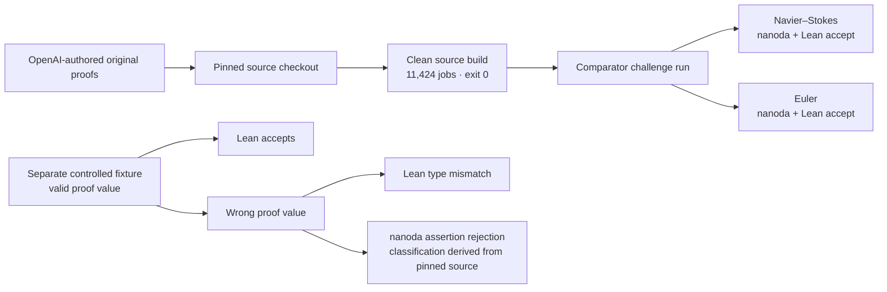
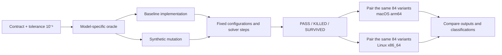

# Scientific QA Evidence

**A reproducible numerical mutation campaign, alongside bounded formal-tool controls.** This package keeps those two kinds of evidence separate: finite numerical tests are not theorem proofs, and the formal examples do not certify scientific models.


*Illustrative reconstruction from the recorded RC fixture. The dots are recorded RK4 checkpoints; the curves are analytic reconstructions. Parameters and source hashes are in [`animations/manifest.json`](animations/manifest.json).*

## Two evidence tracks

### 1. Formal reproduction and controls



The clean build reused cached dependencies and toolchain artifacts; it was not a full bootstrap. The later Comparator run is a bounded recorded check of the configured challenges, not a general proof of correctness. The deliberately wrong fixture changes the exported proof value while retaining its declared type and dependencies. See the [formal evidence map](CLAIMS.md) and [Comparator records](evidence/formal/comparator/README.md).

### 2. Numerical mutation QA



Each host recorded **27 PASS, 54 KILLED, and 3 SURVIVED** across the same **84 paired variants**—not 168 distinct variants. The paired comparison covered **738 finite values and 18 non-finite values** (represented as null); the maximum reported cross-host scaled delta was **1.11 × 10⁻¹⁶**. Survivors remain visible and are not proof of equivalence. All models and mutation inputs are synthetic fixtures, not empirical measurements.

## Explore and reproduce

- [Open the offline animation gallery](animations/index.html) or read the full [animation guide](animations/README.md) for equations, parameters, mutation outcomes, oracle scope, and source traces.

| Scene | What changes | Open the standalone animation |
| --- | --- | --- |
| RC circuit | Time constant doubled; voltage response compared | [RC](animations/rc.html) |
| Second-order chemistry | Reaction rate doubled; concentration changes at fixed volume | [Chemistry](animations/chemistry.html) |
| Newton cooling | Cooling rate halved; invariant passes while oracle error fails | [Cooling](animations/cooling.html) |
| Snell refraction | Refractive indices swapped during an incidence-angle sweep | [Refraction](animations/snell.html) |
| Mutation campaign | Same 84 synthetic variants summarized per host | [Campaign](animations/campaign.html) |
| Formal typecheck | A valid proof value compared with a deliberately wrong type | [Formal control](animations/formal.html) |

- [Read the evidence map](CLAIMS.md), [source provenance](evidence/SOURCE_PROVENANCE.md), and [curated evidence guide](evidence/README.md).
- [Review the narrated V2 plan](video/src/visual-v2/publication.json). The rejected static-text V1 must not be uploaded.
- Spanish script source: [`production/narration.es.json`](production/narration.es.json). It is based on the current English narration, fits the five-request/11,000-character plan, and has a no-network dry run; no Spanish audio has been generated.

```sh
python3 production/synthesize.py --dry-run --language es --out /tmp/adv050-es-review
```

Spanish audio, if generated after script review, stays in a separate private output tree. Its 1.25× offline tempo, audio and aligned captions are kept separate from the English 1.20× manifest; caption timing is derived from the new Spanish provider alignment.

Verify the saved numerical evidence and bundled files:

```sh
shasum -a 256 -c evidence/SHA256SUMS.txt
python3 evidence/verify_numerical.py
python3 -m unittest discover -s animations -p 'test_*.py'
```

To rerun the synthetic suite in a new, nonexistent output directory:

```sh
cd evidence/numerical/source
python3 runner.py --out /tmp/adv050-multidomain-rerun
```

This reruns the numerical suite only; it does not rebuild the formal source or rerun Comparator. The clean-source build instructions and limits are documented in [`evidence/formal/clean-build/`](evidence/formal/clean-build/). Saved evidence checks do not imply a fresh run.

## Credit and status

Created by **Cristian Guerra**, QA Automation, from **Medellín, Colombia** ([`@criguex`](https://github.com/criguex)). Original proofs are credited to their OpenAI authors; see [Authorship and AI disclosure](AUTHORSHIP.md) for attribution and tool-assistance details. Lean, mathlib, and Comparator are identified in the [dependency and fidelity records](evidence/formal/clay-lean-fidelity.md).

Six interactive HTML scenes and an RC preview loop are available for review. The narration-synced V2 source defines one long video and five shorts; their final exports are still pending. An introductory X thread has been posted; YouTube and TikTok uploads have not. The author has authorized the publication workflow; final rendered-media review and third-party rights checks remain separate readiness items. See [publication status](PUBLICATION_STATUS.md).

No theorem discovery, scientific certification, empirical validation, or proof of a real-world system is claimed.
