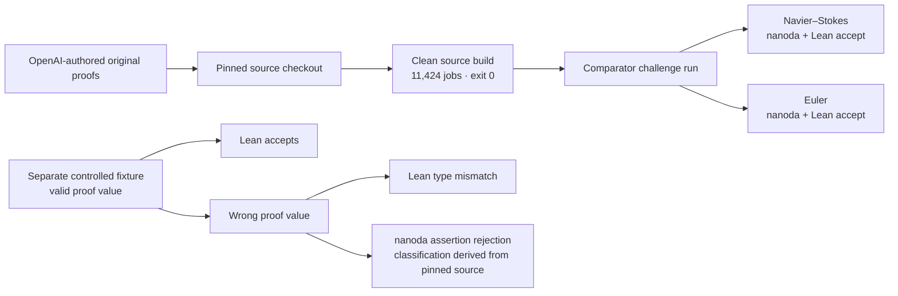
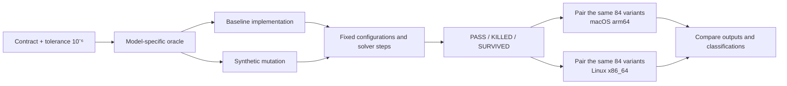

# Scientific QA Evidence

**An independent QA reproduction of OpenAI's Lean proofs of finite-time blowup for Navier–Stokes and Euler, plus a mutation-testing campaign on nine numerical models.**

By **Cristian Guerra**, QA Automation, Medellín, Colombia ([@criguex](https://github.com/criguex)) · [Leer en español](README.es.md)

> **Read this first.** The proofs belong to OpenAI ([openai/NavierStokesAndEuler](https://github.com/openai/NavierStokesAndEuler)). This repository proves nothing new, claims no Millennium Prize result, and is not a mathematical review. It is a software-QA exercise: rebuild the published artifacts from pinned sources, recheck them with two independent proof checkers, confirm that a checker rejects a deliberately wrong proof, and publish every result with hashes so anyone can audit it.

## Why this exists

In September 2026 OpenAI published Lean 4 formalizations for alternatives (C) and (D) of the Clay Navier–Stokes problem (breakdown with forcing on ℝ³ and on the periodic torus), and a separate finite-time singularity result for the 3D Euler equation ([blog post](https://openai.com/index/navier-stokes-solution/)). A machine-checked proof can only be trusted as far as the build, the statement and the checker behind it. Those are testing questions:

1. Does it build from a pinned, clean checkout?
2. Do independent kernels accept it against the official challenge statement?
3. Would the checkers notice if a proof were wrong?
4. Does the testing method itself catch mistakes? This is the numerical mutation campaign.

## Results at a glance

| Question | What was done | Result |
| --- | --- | --- |
| Does it build from pinned source? | Builds of OpenAI commit `f9e8bc5`, Lean 4.34.0-rc2 ([builds and receipts](evidence/formal/cd-validation/README.md#builds-used-by-each-run)) | 2026-10-20 (B1): exit 0, 11,424 jobs, dependency caches reused. 2026-10-21 (B3): exit 0, 11,432 jobs; Mathlib and the project compiled locally (11,030 modules), but 7 smaller dependencies arrived as prebuilt Reservoir archives. 2026-10-21 (B4, `lake --no-cache build`): exit 0, 11,424 jobs in 1 h 29 min, with Mathlib, every dependency and the project compiled locally: no prebuilt archives were found and every `.olean` is newer than the build start. |
| Do independent checkers accept it? | [Comparator](https://github.com/leanprover/comparator) with the Lean kernel and [nanoda](https://github.com/ammkrn/nanoda_lib) on the configured challenges | Navier–Stokes and Euler: both kernels accept (`Your solution is okay!`, exit 0) in every run so far: runs 1–3 on builds B1, B2 and B3, and run 4 on the no-cache build B4 for Navier–Stokes; Euler on B4 is running |
| Does the statement match the Clay text? | Clause-by-clause table against the Clay PDF and the DeepMind [Formal Conjectures](https://github.com/google-deepmind/formal-conjectures) statement at `8bf45ed` | Correspondence mapped and a [clause-by-clause risk review](evidence/formal/clay-lean-risk.md): 6 direct, 9 via standard facts, 1 needing a human decision (periodic pressure in D). Reading-based, not an expert equivalence proof. |
| Does OpenAI's challenge text match the public statement? | Declaration-by-declaration comparison with DeepMind's Formal Conjectures file at `8bf45ed` ([provenance](evidence/formal/statement-provenance/README.md)) | The 18 declarations match after textual normalization; name resolution was not verified. Includes (C) and (D). Semantic identity was not checked. |
| Does Comparator check the exact statement? | Statement mutants of the challenge file, OpenAI's proof unchanged, plus a comment-only control ([revalidation](evidence/formal/cd-validation/README.md)) | 6 of 6 mutants refused as statement mismatches; comment-only control accepted |
| Do the checkers reject a wrong proof? | A fixture whose proof value is wrong but keeps the declared type | Lean reports a type mismatch; nanoda stops with an assertion rejection |
| Do the numerical tests catch bugs? | 9 synthetic models × 3 configurations, each baseline plus known mutations: 84 variants | 27 PASS · 54 KILLED · 3 SURVIVED per host |
| Is it reproducible across machines? | The same 84 variants on macOS arm64 and Linux x86_64 | Identical classifications; maximum scaled difference 1.11 × 10⁻¹⁶ |

## Verify it yourself

Python 3 only, no dependencies, about a minute:

```sh
git clone https://github.com/criguex/scientific-qa-evidence.git
cd scientific-qa-evidence
shasum -a 256 -c evidence/SHA256SUMS.txt     # on Linux: sha256sum -c
python3 evidence/verify_numerical.py
python3 -m unittest discover -s animations -p 'test_*.py'
(cd evidence/numerical/source && python3 -m unittest test_runner)   # reruns all 84 variants
```

The same checks, plus the tests of the log sanitizer and the statement comparator, run in [GitHub Actions](.github/workflows/verify.yml) on every push. [REPRODUCE.md](REPRODUCE.md) lists the versions needed, the steps from a clean checkout, and which results are recomputed versus only verified by hash.

The numerical verifier should print:

```text
PASS: 2 summaries, 168 case records, 2 x 756 observation rows, 738 finite pairs, 18 null pairs; max scaled delta 1.1102230246251565e-16.
```

Those commands check the integrity and consistency of the saved evidence; they do not recompute it. To recompute the whole numerical campaign from scratch (under a second), pass an output directory that does not exist yet:

```sh
cd evidence/numerical/source
python3 runner.py --out /tmp/sqe-rerun
```

It should report 84 variants with `KILLED: 54, PASS: 27, SURVIVED: 3`. Rebuilding the Lean project and rerunning Comparator needs the OpenAI repository and a Lean toolchain; the pins and the recorded procedure are in [`evidence/formal/clean-build/`](evidence/formal/clean-build/README.md).

## Track 1: formal reproduction and controls



Comparator checks that the submitted solution proves exactly the theorem stated in the challenge file, using only the permitted axioms (`propext`, `Quot.sound`, `Classical.choice`). Each challenge was run once after the source build; the 2026-10-21 revalidation below adds a second run. Sanitized transcripts, timings and the hashes of the raw originals are in [`evidence/formal/comparator/`](evidence/formal/comparator/README.md). The wrong-proof fixture and the raw and derived classifications are in [`evidence/formal/kernel-mutation/`](evidence/formal/kernel-mutation/). The Clay correspondence table is [`evidence/formal/clay-lean-fidelity.md`](evidence/formal/clay-lean-fidelity.md).

### Revalidation of (C) and (D), 2026-10-21

A second pass was run to close the gaps under [Known limitations](#known-limitations). 17 of 18 checks have finished: none produced an unexpected result, and one could not run. Comparator run 4 on Euler is in progress. Each animation plays one idea in real time, with a plain-language caption.

| Animation | What it shows |
| --- | --- |
| <a href="animations/rerun.html"></a><br><a href="docs/media/rerun.mp4">▶ MP4 1080p</a> | **1. Rebuild, check again.** Comparator accepted Navier–Stokes (C, D) and Euler on three different builds: the 2026-10-20 record (B1), the audit build whose Mathlib came from the prebuilt cache (B2), and a fresh 2026-10-21 build (B3). B3 compiled Mathlib and the project on the machine, 11,030 modules in 1 h 27 min with exit 0. **Correction:** Lake also fetched 7 smaller dependencies as prebuilt [Reservoir](https://reservoir.lean-lang.org) archives without logging them, so an earlier "0 cache downloads" claim was wrong. The full `lake --no-cache build` (B4) then compiled everything locally, dependencies included: exit 0, 11,424 jobs, no prebuilt archives. Run 4 on B4 accepted Navier–Stokes; Euler is in progress. The Lean toolchain and checker binaries were reused. |
| <a href="animations/mutants.html"></a><br><a href="docs/media/mutants.mp4">▶ MP4 1080p</a> | **2. Change the statement; it must be refused.** OpenAI's proof is never touched. Six one-symbol edits to the official challenge were all refused with `Challenge and solution theorem statement do not match`: `f = 0` in (C) and in (D), ℝ³ decay data swapped for periodic data, `nu > 0` weakened to `nu ≥ 0`, the negation dropped from (D), and Euler's `T* ≤ 1` tightened to `T* ≤ 1/2`. A comment-only control was accepted, so the refusals come from the changed statement. |
| <a href="animations/replay.html"></a><br><a href="docs/media/replay.mp4">▶ MP4 1080p</a> | **3. Replay every step from an empty start.** `leanchecker --fresh` re-added every declaration, Mathlib included, to an empty environment and accepted both solutions (19.6 and 22.5 minutes). It reuses Lean's kernel, so it is a from-scratch replay, not a third implementation. `lean4lean` could not be built on Lean 4.34 (its Batteries dependency fails), so it never examined the proofs: a tooling gap, not a verdict. |

A refused mutant says nothing about whether the mutated statement is true. The `f = 0` mutants are not evidence about the forceless alternatives (A) and (B). Verdicts, sanitized logs and every mutant diff are in [`evidence/formal/cd-validation/`](evidence/formal/cd-validation/README.md).

### Where the statement comes from, and how it compares with Clay

<a href="animations/provenance.html"></a><br><a href="docs/media/provenance.mp4">▶ MP4 1080p</a>

- **OpenAI's challenge text matches the public statement.** The 18 declarations match after textual normalization; name resolution was not verified. Compared with Google DeepMind's Formal Conjectures file at `8bf45ed`, all 18 named declarations, including the theorems (C) and (D), are textually the same. The remaining differences are the import, the namespace, notation copied in with the same definition, and (A)/(B) left out. [Method, hashes and a script to reproduce it](evidence/formal/statement-provenance/README.md).
- **Clause-by-clause risk review against Clay's text.** (C) and (D) say "there exist data for which no solution exists", so the formal version could only be easier if it allowed data Clay forbids or demanded more of solutions than Clay does. Of 16 clauses, 6 match directly, 9 match through standard analysis facts that are named but not yet formalized, and **1 needs a human decision**: Clay's erratum asks for periodic pressure "in Eqn (8)", the data list, while the formalization requires it of solutions in (D). That reading is the only one that constrains anything, but it makes the formal (D) a statement about the amended problem. [Full review](evidence/formal/clay-lean-risk.md). It is reading-based and not reviewed by a mathematician.

## Track 2: numerical mutation testing



Mutation testing asks whether a test suite notices when the code is deliberately broken. The contract and its tolerance were frozen before any run ([`CONTRACT.md`](evidence/numerical/source/CONTRACT.md)). Every model has an independent oracle that does not share solver code with the implementation under test. The nine models are RC circuit, Newton cooling, second-order chemical kinetics, Beer–Lambert attenuation, logistic response, Snell refraction, thin lens, acoustic interface and Fechner response.

Each host recorded **27 PASS, 54 KILLED and 3 SURVIVED** over the same **84 paired variants**, not 168 distinct ones. The comparison covered 738 finite values and 18 non-finite values (stored as null). The three survivors are the deliberately tiny RC mutation, kept visible on purpose. All models and inputs are synthetic; none of this is an empirical measurement.

## Method: what this study adds

**Research question.** Can ordinary software-QA techniques (a frozen contract, an independent oracle, deliberate mutations and repeated runs) give an outside reader verifiable confidence in a machine-checked proof and in scientific code, without trusting the original authors' setup?

**What the author designed.** One protocol, applied at two levels. The author chose the questions, froze the contracts, decided what counts as evidence and directed the work, with AI assistance as disclosed in [AUTHORSHIP.md](AUTHORSHIP.md).

| Element | Numerical code | Formal proof pipeline |
| --- | --- | --- |
| Contract, frozen first | [`CONTRACT.md`](evidence/numerical/source/CONTRACT.md), tolerance 10⁻⁶ | The official challenge statement and the permitted axioms |
| Independent oracle | A separately coded analytic, bisection or linear-system solution per model | Comparator with two kernels (nanoda, Lean), plus a `leanchecker --fresh` replay |
| Deliberate mutation | Two known bugs per model, plus one near-threshold RC change | A wrong proof value, which the checker must reject, and six statement mutants with a comment-only control, which Comparator must refuse or accept |
| Repetition | The same 84 variants on two hosts | Comparator on three builds so far, a fourth running |
| Specification check | The contract itself | [Statement provenance](evidence/formal/statement-provenance/README.md) and the [Clay risk review](evidence/formal/clay-lean-risk.md) |

**What the results support.** Numerically, every coarse mutant was killed and the deliberately tiny one survived where expected, with identical classifications on both hosts. Formally, the wrong proof value was rejected, all six statement mutants were refused while the control passed, the acceptance repeated across builds, and the challenge's 18 declarations match DeepMind's public statement after textual normalization (name resolution not verified).

**Prior techniques it builds on.** Mutation analysis (DeMillo, Lipton and Sayward, 1978); independent test oracles and cross-platform differential testing; the de Bruijn criterion of small, independent proof checkers (nanoda, leanchecker, lean4lean); [Comparator](https://github.com/leanprover/comparator) for statement-exact checking; and Google DeepMind's [Formal Conjectures](https://github.com/google-deepmind/formal-conjectures) for the statement. The combination is what this study contributes: it applies mutation analysis to the verification pipeline itself, the checker and the specification, not only to the code under test, and publishes every step with hashes so the audit can be audited. No literature review was done to establish that the combination is new.

**Limits of the method.** Statement mutants test that the statement is compared exactly, not whether the proof would fail if it were wrong. All formal runs used one host. The Clay comparison is reading-based. The numerical mutants are coarse and all models are synthetic.

## Animations

Open the [offline gallery](animations/index.html), or read the [animation guide](animations/README.md) for equations, parameters, outcomes and source traces.

| Numerical models | Formal checks |
| --- | --- |
| <a href="animations/rc.html">RC · doubled time constant</a> · <a href="docs/media/rc.mp4">▶ MP4 1080p</a><br> | <a href="animations/formal.html">Formal · proof-value typecheck control</a> · <a href="docs/media/formal.mp4">▶ MP4 1080p</a><br> |
| <a href="animations/chemistry.html">Chemistry · doubled reaction rate</a> · <a href="docs/media/chemistry.mp4">▶ MP4 1080p</a><br> | <a href="animations/rerun.html">C/D · rebuild from zero and recheck</a> · <a href="docs/media/rerun.mp4">▶ MP4 1080p</a><br> |
| <a href="animations/cooling.html">Cooling · halved rate constant</a> · <a href="docs/media/cooling.mp4">▶ MP4 1080p</a><br> | <a href="animations/mutants.html">C/D · statement mutants</a> · <a href="docs/media/mutants.mp4">▶ MP4 1080p</a><br> |
| <a href="animations/snell.html">Snell · swapped refractive indices</a> · <a href="docs/media/snell.mp4">▶ MP4 1080p</a><br> | <a href="animations/replay.html">C/D · fresh kernel replay</a> · <a href="docs/media/replay.mp4">▶ MP4 1080p</a><br> |
| <a href="animations/campaign.html">Campaign · paired classifications</a> · <a href="docs/media/campaign.mp4">▶ MP4 1080p</a><br> | <a href="animations/provenance.html">Statement provenance · OpenAI vs DeepMind</a> · <a href="docs/media/provenance.mp4">▶ MP4 1080p</a><br> |


The 3D flow clip is visual context only. It is not campaign data, evidence of blowup, or a formal construction; its provenance is in [SOURCE_PROVENANCE.md](evidence/SOURCE_PROVENANCE.md).

## Known limitations

A QA report is only useful if it says what it did not test.

- **Bootstrap scope.** B4 (`lake --no-cache build`, 2026-10-21) compiled Mathlib, all its dependencies and OpenAI's project locally: no prebuilt archives were found and every `.olean` is newer than the build start. The earlier B3 had taken 7 smaller dependencies (399 modules) as prebuilt Reservoir archives. Every build reused the installed Lean toolchain and the prebuilt Comparator, lean4export, nanoda and landrun binaries, whose hashes are [recorded](evidence/formal/cd-validation/README.md#reused-tools).
- **Repeated runs, one host.** Comparator has run three times per challenge, each time on a different build: B1 (the 2026-10-20 record), B2 (Mathlib from the prebuilt cache) and B3 (fresh build). The mutants and the leanchecker replay used B2. All runs used one Linux host. Raw transcripts are not distributed; sanitized copies and the hashes of the originals are ([provenance](evidence/formal/cd-validation/PROVENANCE.md)).
- **Two kernel implementations.** Only the Lean kernel and nanoda have accepted the proofs so far. `leanchecker --fresh` replayed both solutions from an empty environment without errors; it reuses the Lean kernel, so it is a from-scratch replay, not a third implementation. [lean4lean](https://github.com/digama0/lean4lean) failed to build on Lean 4.34 (its Batteries dependency does not compile), so no third kernel implementation has checked the proofs.
- **Standalone Comparator.** The run used the standalone tool pinned at `19e111e`. Comparator has since been merged into Lean core as `lake comparator` and `lake check` (Lean v4.35.0); the result has not been repeated with those.
- **A single wrong-proof fixture.** The formal control shows that the checkers reject one wrong proof value. It is not a mutation campaign over the OpenAI proofs. The 2026-10-21 statement mutants test the challenge side instead: they show that Comparator refuses a changed statement, not that the proof would fail if it were broken.
- **The Clay comparison is reading-based.** The [risk review](evidence/formal/clay-lean-risk.md) locates every gap clause by clause, but the standard-fact bridges are not formalized and no mathematician has reviewed it. One point, periodic pressure in (D), depends on how Clay's erratum is read.
- **54 KILLED counts cases, not distinct behaviors.** In the acoustic model, `pressure_boundary_sign` and `impedance_swap` produce identical outputs in all three configurations, so there are 51 distinct killed behaviors.
- **The mutants are coarse.** The smallest killed mutant has a normalized error of 0.12, about 120,000 times the 10⁻⁶ tolerance. The only near-threshold mutant (RC `tau_tiny`, a relative change of 5 × 10⁻⁸) survives roughly 56 to 68 times below tolerance. Sizes in between were not sampled, so the campaign does not locate where detection starts.
- **Synthetic models and oracles.** No laboratory data, real system or scientific result is validated here.
- **The verifier is an integrity check.** `verify_numerical.py` compares saved records against their original hashes and across hosts; recomputation is the separate `runner.py` step above.

Each claim, its exact wording and its evidence file are mapped in [CLAIMS.md](CLAIMS.md).

## How AI was used

The work was AI-assisted and human-directed. OpenAI Codex was the main coding agent: under the author's direction it prepared code, ran builds and renders and drafted documents. Anthropic's Claude Code made the later documentation and cleanup changes. Each commit names the agent involved in a `Co-Authored-By` trailer. AI assistants also helped with analysis, translation and review. Cristian Guerra chose the questions, froze the contract, decided what counts as evidence, reran the verifiers and is responsible for every claim. Details are in [AUTHORSHIP.md](AUTHORSHIP.md).

## Repository map

```text
evidence/
  formal/
    cd-validation/          2026-10-21 revalidation: builds, receipts, logs, provenance
    statement-provenance/   OpenAI's challenge compared with DeepMind's statement
    clay-lean-risk.md       clause-by-clause risk review against Clay's text
    …                       clean build, Comparator logs, wrong-proof fixture, Clay–Lean table
  numerical/           frozen contract, source and runner tests, 84-case runs for macOS and Linux
  verify_numerical.py  integrity and cross-host check of the saved runs
  SHA256SUMS.txt       checksums for every curated file
animations/            ten offline HTML scenes, build and GIF export scripts, tests
.github/workflows/     CI that runs every check on each push
docs/assets/           GIF previews used in this README
CLAIMS.md              claim → evidence → result → limitation
REPRODUCE.md           steps, versions, recomputed vs hash-verified
AUTHORSHIP.md          authorship and AI disclosure
CONTRIBUTING.md        rules for changing the evidence
```

## Credit, rights and status

- **Original proofs:** their OpenAI authors. **Challenge statement:** Google DeepMind Formal Conjectures. **Tools:** Lean 4, mathlib, Comparator, nanoda.
- **This QA study:** Cristian Guerra. To cite it, use [CITATION.cff](CITATION.cff).
- **Rights:** publication is authorized, but no open-source license is granted. See [LICENSE_STATUS.md](LICENSE_STATUS.md).
- **Status:** an introductory thread with animation previews is posted on [X](https://x.com/criguex/status/2112679712157753441).

No theorem discovery, scientific certification, empirical validation or proof about a real-world system is claimed.
