> Traducción al español de [Animation guide](README.md). Si hay alguna diferencia, vale el original.

# Guía de animaciones

Las catorce escenas HTML independientes (trece escenas de evidencia y una escena ilustrativa) están en este directorio; sus vistas previas en GIF están en `docs/assets/` y sus versiones en MP4 en `docs/media/`. Las escenas son offline, interactivas, y leen el mismo manifiesto derivado de la evidencia ([`manifest.json`](manifest.json)). Abre [`index.html`](index.html) para la galería, o abre una escena individual directamente. Cada página tiene controles de reproducción/avance, un resumen de texto accesible, y sus datos incrustados. El HTML y las curvas graficadas son explicaciones visuales; la evidencia sigue siendo los fixtures guardados y los registros de caso enlazados más abajo.

## Escenas numéricas

Las tres escenas de ODE —RC, química y enfriamiento— usan la tolerancia de error normalizado `1e-6` de la suite sintética y comparan una implementación RK4 con un oráculo analítico codificado aparte. Las curvas sólidas son reconstrucciones analíticas; los puntos huecos son salidas RK4 de 256 pasos registradas en puntos de control a cuartos de intervalo. Los modelos son pruebas de software ilustrativas, no mediciones físicas. Snell es algebraico, no un ODE: su oráculo independiente usa bisección, y su comparación usa la misma tolerancia `1e-6`.

### 1. Circuito RC — una mutación, una diferencia calculada

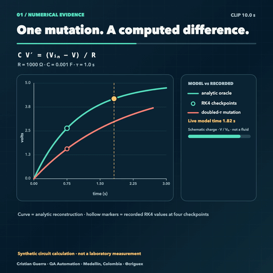

- **Modelo:** `C dV/dt = (Vin − V)/R`; oráculo `V(t) = Vin + (V0 − Vin)e^(−t/RC)`.
- **Parámetros y barrido:** `Vin=5 V`, `V0=0 V`, `R=1,000 Ω`, `C=0.001 F`; `τ=RC=1 s`; puntos de control en `t=0.75, 1.50, 2.25, 3.00 s`.
- **Comparación:** el valor final registrado de la línea base es **4,751 V**. La mutación sintética `tau_double` usa `τ=2 s` y termina en **3,884 V**. Los dos valores son salidas RK4 registradas, redondeadas para mostrarse; la curva analítica se reconstruye a partir de la ecuación. El relleno visual del capacitor denota carga normalizada, no agua.
- **Qué prueba:** el contrato numérico detecta un cambio en la constante de tiempo en esta configuración. Calibraciones de constante de tiempo separadas y mínimas de `5e-8` pueden legítimamente sobrevivir la tolerancia; ese resultado de sobreviviente se conserva en la campaña más amplia.
- **Rastro:** [escena](rc.html) · [fixture de línea base](../evidence/numerical/fixtures/rc-baseline.json) · [fixture de mutación](../evidence/numerical/fixtures/rc-tau-double.json) · [oráculo independiente](../evidence/numerical/source/oracles.py) · hashes de fuente y datos en [`manifest.json`](manifest.json).

### 2. Química de segundo orden — la concentración cambia, el volumen no

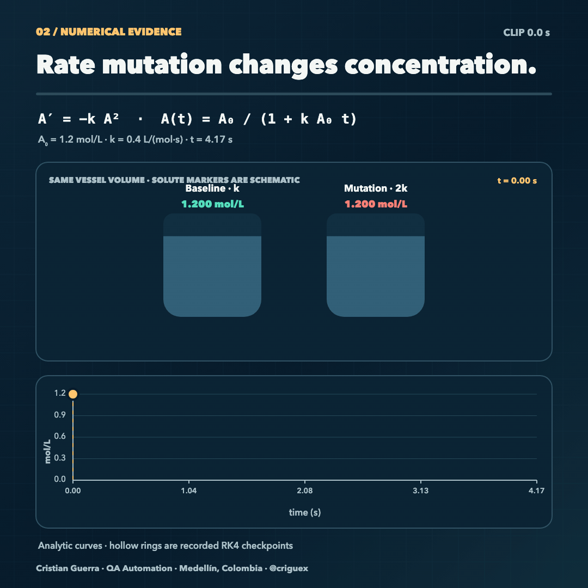

- **Modelo:** `dA/dt = −kA²`; oráculo `A(t)=A₀/(1+kA₀t)`.
- **Parámetros y barrido:** `A₀=1.2 mol/L`, `k=0.4 L/(mol·s)`, horizonte `4.1667 s`; puntos de control en aproximadamente `1.0417, 2.0833, 3.1250, 4.1667 s`.
- **Comparación:** la línea base termina en **0,400 mol/L**; la mutación sintética `rate_double` usa `k=0.8 L/(mol·s)` y termina en **0,240 mol/L**. En el primer punto de control las salidas registradas son **0,800** y **0,600 mol/L**, respectivamente. El llenado del recipiente se mantiene fijo; la concentración se codifica con marcas de soluto/color, no con volumen de líquido.
- **Qué prueba:** la sensibilidad a una mutación de la constante de tasa, bajo un invariante de concentración positivo y no creciente, y el oráculo analítico independiente.
- **Rastro:** [escena](chemistry.html) · [caso 022 de línea base](../evidence/numerical/paired/macos-arm64/case_022.json) · [caso 024 de mutación](../evidence/numerical/paired/macos-arm64/case_024.json) · oráculo y hashes en [`manifest.json`](manifest.json).

### 3. Enfriamiento de Newton — un invariante puede pasar mientras el oráculo falla

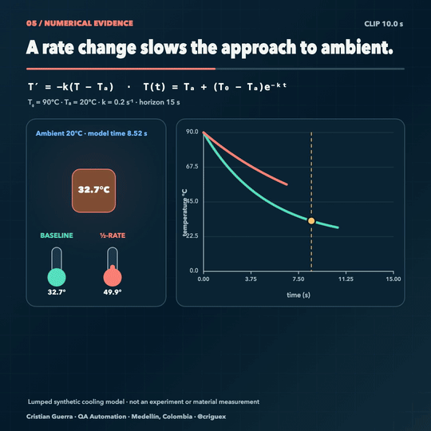

- **Modelo:** `dT/dt = −k(T−Tₐ)`; oráculo `T(t)=Tₐ+(T₀−Tₐ)e^(−kt)`.
- **Parámetros y barrido:** `T₀=90 °C`, ambiente `Tₐ=20 °C`, `k=0.2 s⁻¹`, horizonte `15 s`; puntos de control en `3.75, 7.50, 11.25, 15 s`.
- **Comparación:** la línea base termina en **23,49 °C**. La mutación sintética `rate_half` usa `k=0.1 s⁻¹` y termina en **35,62 °C**. El mutante sigue cumpliendo el invariante de temperatura, pero su error de oráculo normalizado registrado es **0,249236**, por encima de `1e-6`; por tanto queda **KILLED** por la comparación con el oráculo, no por el invariante.
- **Qué prueba:** que pasar un invariante amplio no basta cuando la tasa realmente modelada está equivocada.
- **Rastro:** [escena](cooling.html) · [caso 013 de línea base](../evidence/numerical/paired/macos-arm64/case_013.json) · [caso 015 de mutación](../evidence/numerical/paired/macos-arm64/case_015.json) · [`manifest.json`](manifest.json).

### 4. Refracción de Snell — un barrido de ángulo, no un eje de tiempo

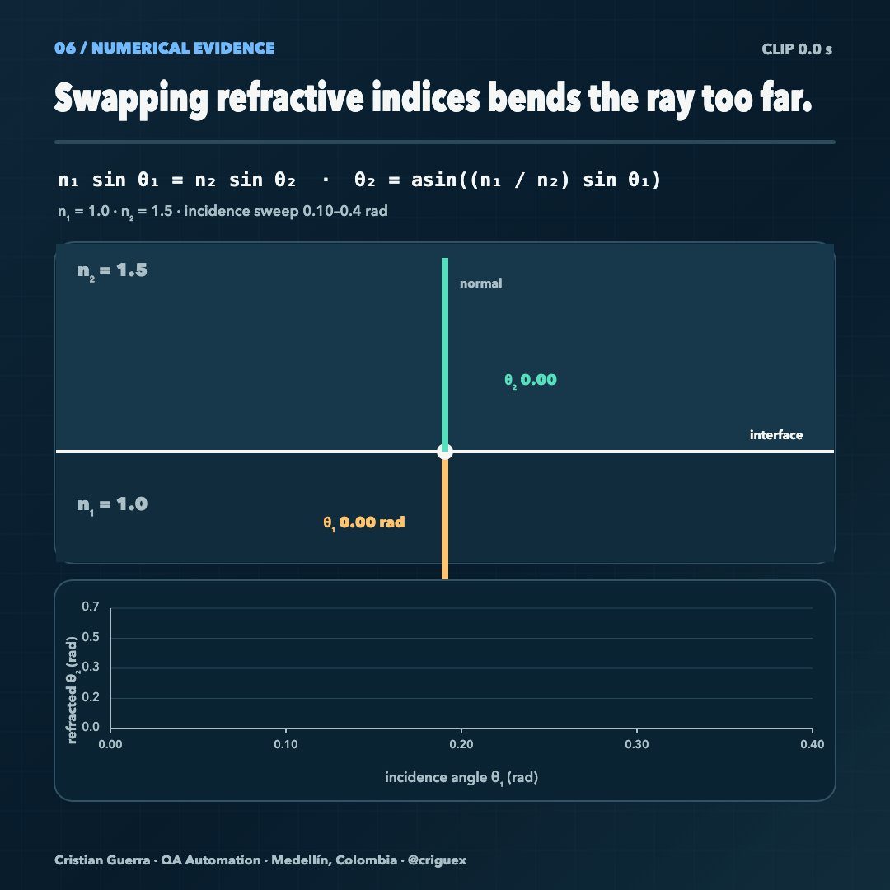

- **Modelo:** `n₁ sin(θ₁) = n₂ sin(θ₂)`; el oráculo resuelve `θ₂` por bisección. Los ángulos en el diagrama se miden desde la normal.
- **Parámetros y barrido:** `n₁=1`, `n₂=1.5`; el ángulo de incidencia aumenta de `0` a `0.4 rad`. Los cuatro puntos de control registrados están en `θ₁=0.1, 0.2, 0.3, 0.4 rad`.
- **Comparación:** en `θ₁=0.4 rad`, el `θ₂` registrado de la línea base es **0,262621 rad**. El mutante sintético `index_swap` intercambia los índices y registra **0,623805 rad**. El error de oráculo normalizado del mutante es **0,361184**, por encima de `1e-6`; todos los ángulos muestreados se mantienen por debajo del límite de reflexión interna total.
- **Qué prueba:** una mutación conocida de orden de parámetros, frente al oráculo independiente de bisección. El dibujo de rayos es un esquema analítico, no una simulación de óptica ondulatoria.
- **Rastro:** [escena](snell.html) · [caso 040 de línea base](../evidence/numerical/paired/macos-arm64/case_040.json) · [caso 041 de mutación](../evidence/numerical/paired/macos-arm64/case_041.json) · [`manifest.json`](manifest.json).

## Escenas de campaña y de controles formales

### 5. Campaña de mutación pareada — conteos, no un benchmark

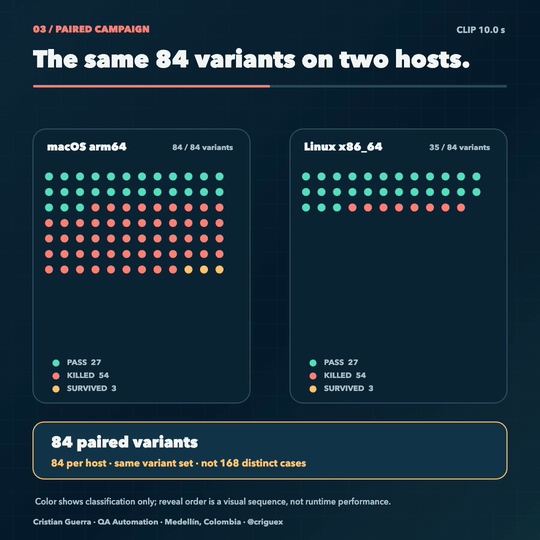

- **Datos visualizados:** cada máquina corrió las mismas 84 variantes pareadas: **27 PASS, 54 KILLED, 3 SURVIVED por máquina** en macOS arm64 y Linux x86_64. Son 84 variantes pareadas por máquina, no 168 variantes distintas.
- **Método:** nueve modelos sintéticos con tres configuraciones fijas cada uno, dos mutaciones sintéticas conocidas por modelo, más tres variantes de calibración RC. Las salidas de ODE usan 64/128/256 pasos; los casos algebraicos/integrales se evalúan una vez, en vez de recibir pasos artificiales de refinamiento. Una línea base pasa solo cuando las salidas son finitas, los invariantes se cumplen y el error normalizado es como máximo `1e-6`. Un mutante queda KILLED solo si su línea base pasa y el mutante no es finito, viola un invariante o excede la tolerancia. De lo contrario, una mutación puede SURVIVE.
- **Comprobaciones de comparación:** los registros pareados contienen 738 pares de valores finitos y 18 pares no finitos exportados como null. El delta escalado máximo entre máquinas es **1,11 × 10⁻¹⁶**. La secuencia de revelado de la animación no es dato de tiempos ni de rendimiento.
- **Qué prueba:** la repetibilidad de estos casos sintéticos fijos y la consistencia de las clasificaciones/salidas guardadas entre las dos máquinas registradas. No establece el comportamiento fuera de estos fixtures ni mide sistemas científicos.
- **Rastro:** [escena](campaign.html) · [JSON/CSV de casos pareados y resúmenes](../evidence/numerical/paired/) · [comparación derivada](../evidence/numerical/multidomain_derived.json) · [contrato de la suite](../evidence/numerical/source/CONTRACT.md) · [`manifest.json`](manifest.json).

### 6. Control de comprobación de tipos formal — un valor de prueba deliberadamente discordante

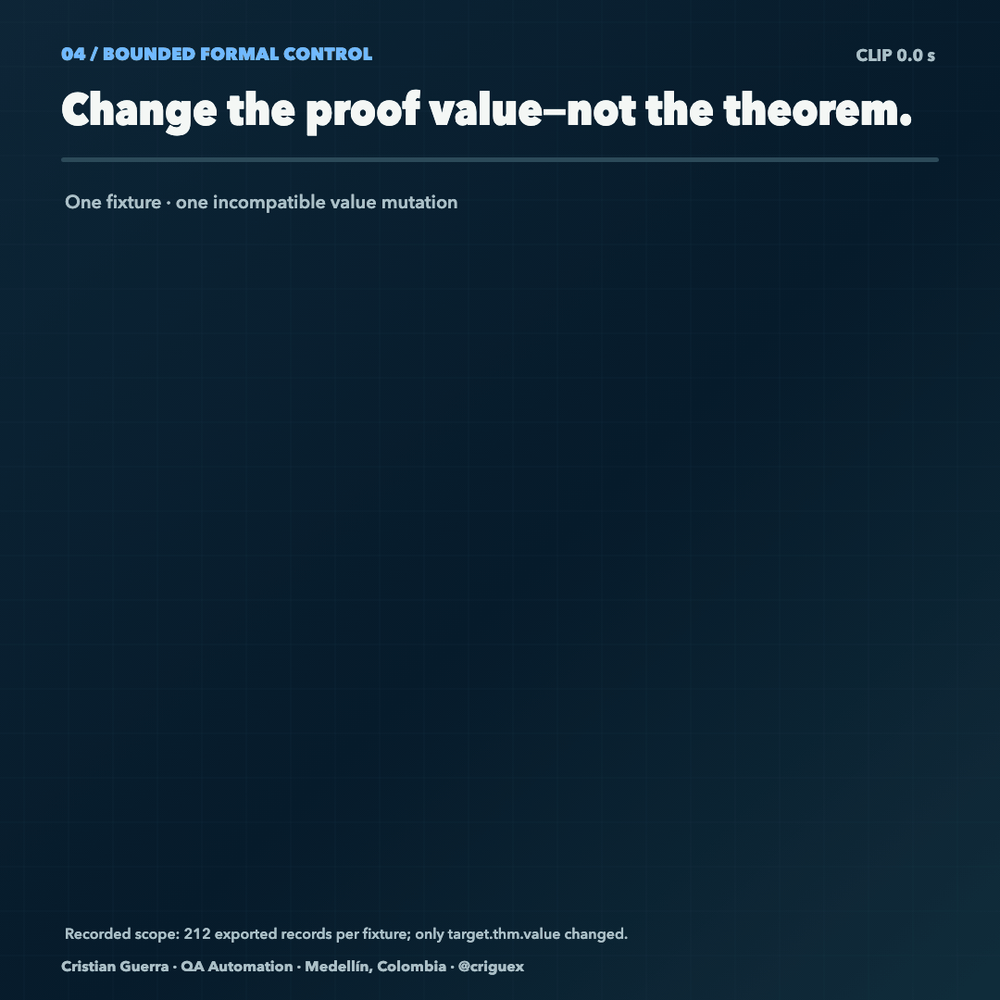

- **Fixture:** línea base `theorem target : 0 = 0 := rfl`; el control cambia solo el valor de prueba exportado a `True.intro`, conservando el tipo esperado `0 = 0` y las dependencias.
- **Resultado registrado:** Lean acepta la línea base y rechaza la mutación con un error de tipos (`True` entregado, `0 = 0` esperado). nanoda acepta la línea base. El mutante de nanoda se deriva como `TYPECHECK_ASSERTION_REJECT_DERIVED` a partir de la inspección de la fuente fijada del verificador de tipos; su resumen bruto permanece como `COLLECTED_PENDING_CLASSIFICATION`, y la salida binaria no es una categoría de rechazo estructurada.
- **Qué prueba:** el control acotado de tipo erróneo de este fixture. No es una corrida de kernel desde cero, un resultado de descubrimiento de teoremas, una afirmación general de corrección del kernel, ni una verificación de la matemática de Navier–Stokes/Euler.
- **Rastro:** [escena](formal.html) · [fixture](../evidence/formal/fixtures/KernelFixture.lean) · [registros brutos y derivados](../evidence/formal/kernel-mutation/) · [`manifest.json`](manifest.json).

## Escenas de revalidación de C/D y del enunciado

Estas cuatro escenas se reproducen en tiempo real (20 segundos) con un cuadro de subtítulos que explica cada paso en lenguaje sencillo. Todos los valores vienen de [`evidence/formal/cd-validation/results.json`](../evidence/formal/cd-validation/results.json), el [registro de Comparator del 2026-10-20](../evidence/formal/comparator/README.md), la [comparación del enunciado](../evidence/formal/statement-provenance/result.json) y la [revisión de riesgos de Clay](../evidence/formal/clay-lean-risk.md).

### 7. Recompilar desde cero, verificar otra vez

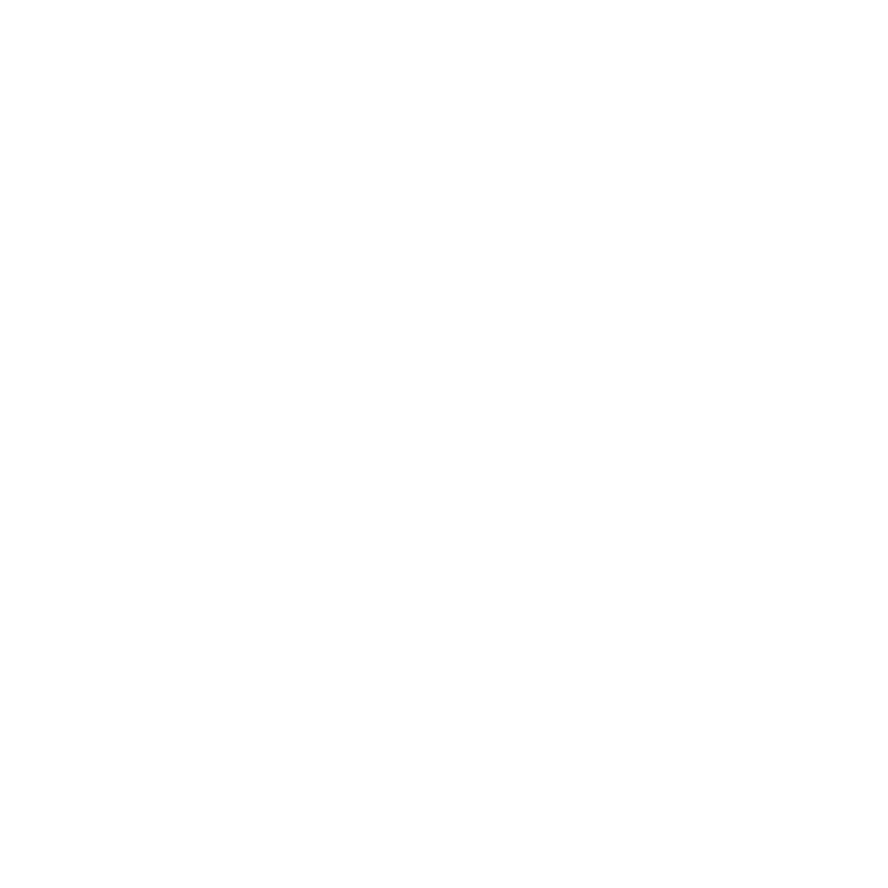

- **Muestra:** fuente → compilación desde cero (módulos de Mathlib compilados, descargas de caché, jobs, tiempo) → las tres comprobaciones de Comparator, luego una cuadrícula de las cuatro corridas de Comparator (compilaciones B1-B4) para Navier–Stokes (C, D) y Euler con los tiempos registrados. La compilación B5, hecha después, no está en esta escena ([registro de B5](../evidence/formal/b5/README.md)).
- **No muestra:** que el enunciado formal coincida con el texto de Clay, ni nada sobre (A) y (B).
- **Rastro:** [escena](rerun.html) · [resultados](../evidence/formal/cd-validation/README.md).

### 8. Mutantes del enunciado

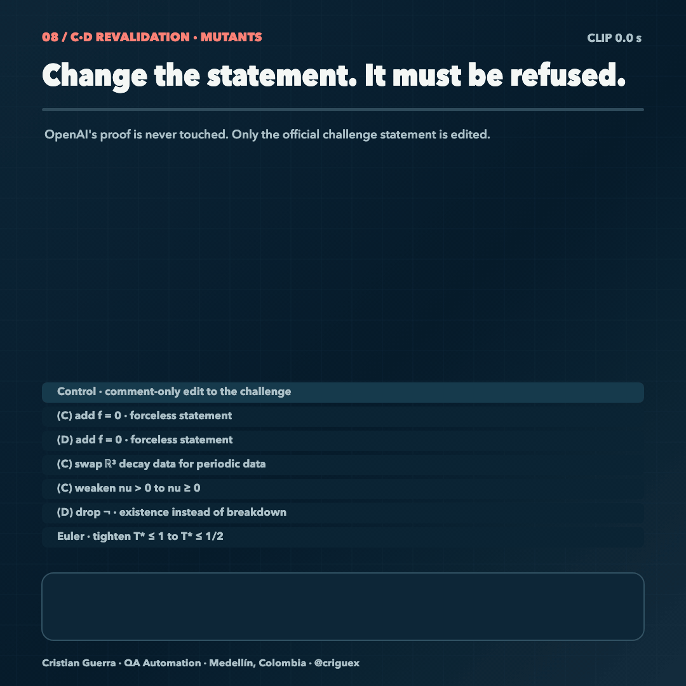

- **Muestra:** cada caso por turno, con la línea original del desafío, la línea mutada con el tramo cambiado resaltado, y la decisión de Comparator. La lista de abajo acumula los siete veredictos.
- **No muestra:** que un enunciado mutado sea falso. Los casos `f = 0` no son evidencia sobre (A) o (B).
- **Rastro:** [escena](mutants.html) · [diffs de los mutantes](../evidence/formal/cd-validation/mutants/).

### 9. Revisión del kernel desde cero

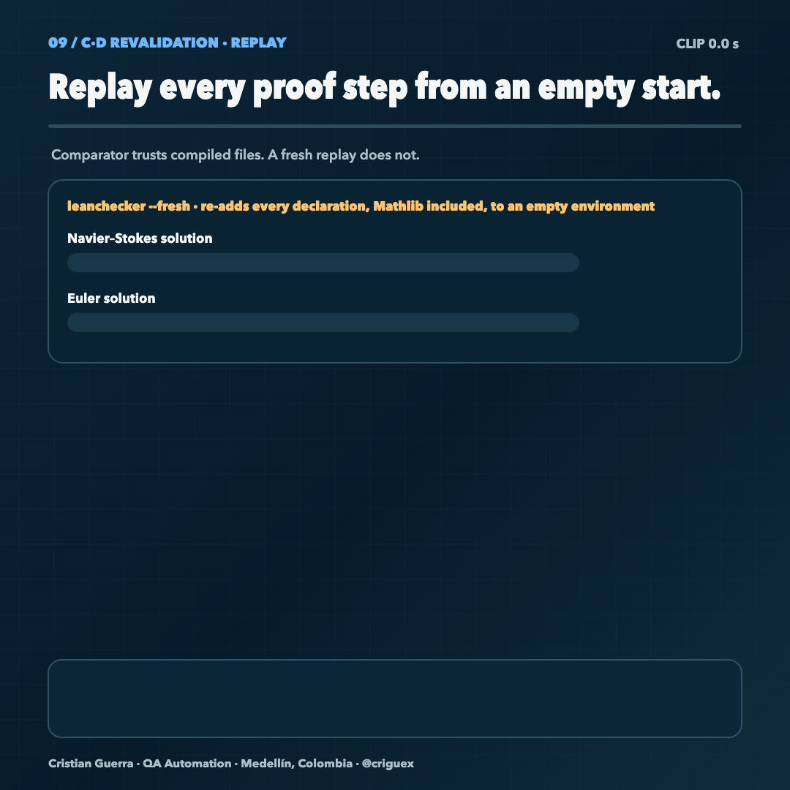

- **Muestra:** los tiempos de revisión de `leanchecker --fresh` para las dos soluciones, y luego qué implementaciones de kernel revisaron realmente las pruebas: nanoda y el kernel de Lean sí; lean4lean no pudo compilarse para Lean 4.34.
- **No muestra:** un tercer kernel independiente.
- **Rastro:** [escena](replay.html) · [logs](../evidence/formal/cd-validation/logs/).

### 10. Procedencia del enunciado

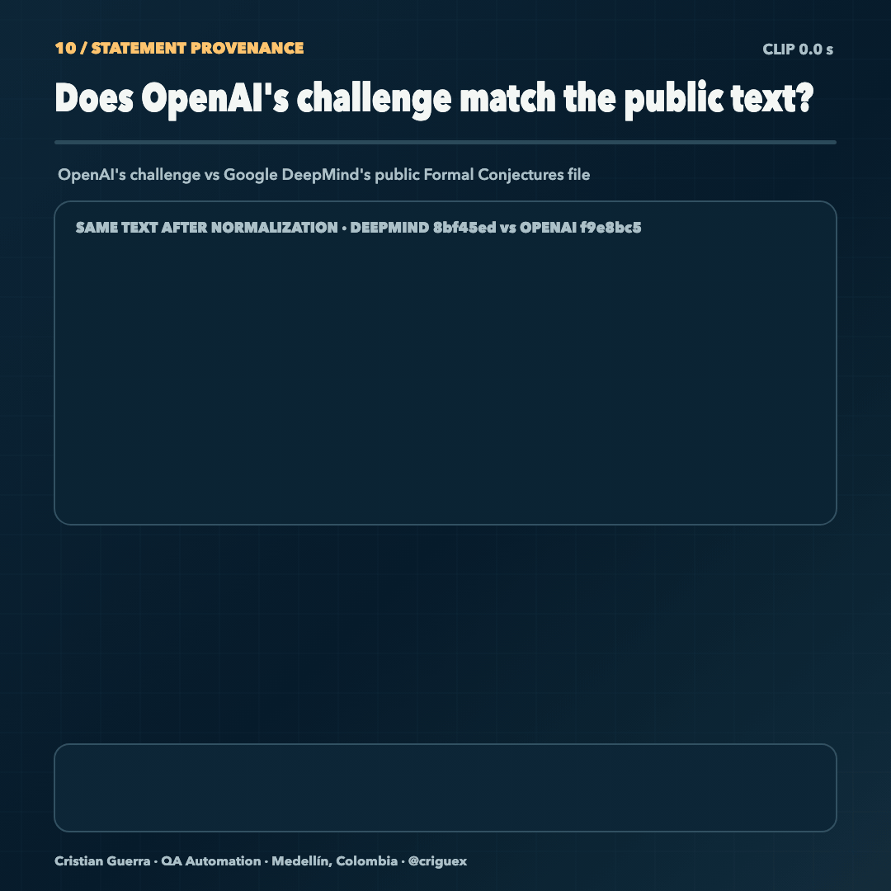

- **Muestra:** las 18 declaraciones nombradas que coinciden tras la normalización textual en el `8bf45ed` de DeepMind y el `f9e8bc5` de OpenAI (la resolución de nombres no se verificó), las diferencias de empaquetado, y los conteos de la revisión de riesgos de Clay.
- **No muestra:** una prueba experta de equivalencia con el texto de Clay.
- **Rastro:** [escena](provenance.html) · [comparación](../evidence/formal/statement-provenance/README.md) · [revisión de riesgos](../evidence/formal/clay-lean-risk.md).

### 11. Benchmark de fallos a ciegas

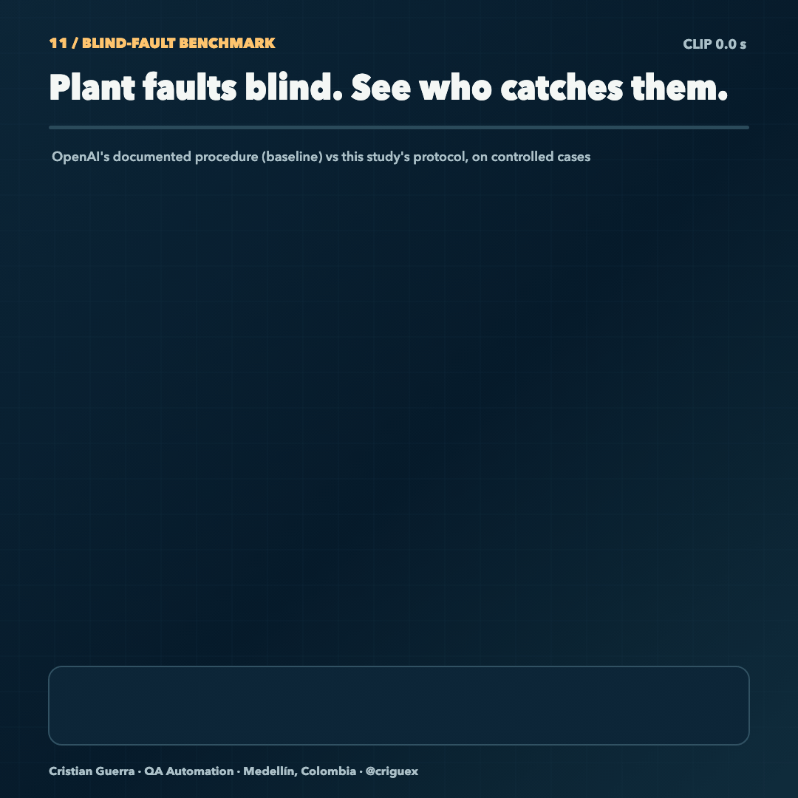

- **Muestra:** la cadena que hace la corrida auditable (semilla comprometida → diseño congelado → casos sorteados → resultados a ciegas → clave → semilla reproducida), qué procedimiento marca cada clase de fallo sembrada bajo el evaluador v2.2 corregido, y qué encontró cada una de las cuatro rondas de revisión.
- **No muestra:** una tasa de detección del mundo real; los fallos se siembran en artefactos registrados, no en Lean en vivo.
- **Rastro:** [escena](experiment.html) · [resultados con fe de erratas](../experiments/blind-faults/RESULTS.md) · [benchmark v2](../experiments/blind-faults/v2/README.md) · [datos de las rondas de revisión](../experiments/blind-faults/review_rounds.json).

## Escenas de Clay y del significado del verificador

### 12. Del teorema de OpenAI al texto de Clay

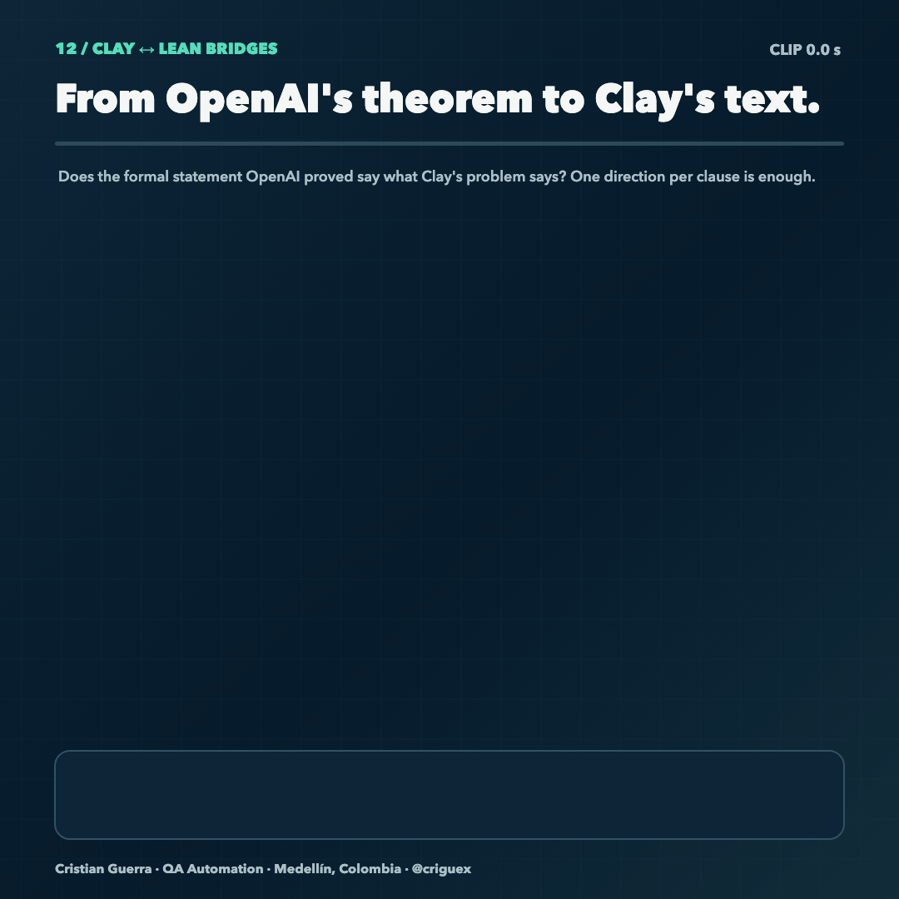

- **Muestra:** las tres capas (el teorema formal de OpenAI, los puentes en Lean, el texto de Clay escrito literalmente en Lean), cada fila puente coloreada según el estado registrado en la tabla de puentes, y los cuatro teoremas K1 con sus axiomas.
- **No muestra:** que la transcripción literal sea fiel al PDF de Clay, lo cual todavía no tiene revisión independiente, ni ninguna revisión de un matemático. S7, presión periódica, afecta solo a (D).
- **Rastro:** [escena](bridges.html) · [tabla de puentes](../evidence/formal/clay-lean-bridges.md) · [archivos de Lean y recibo](../bridges/README.md) · [hoja de revisión](../bridges/K0_REVIEW.md).

### 13. Controles con Mathlib: un rechazo no es una refutación

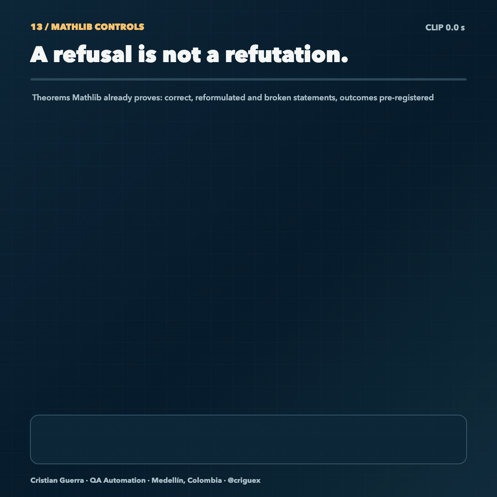

- **Muestra:** cada caso registrado antes de correrlo, el veredicto de Comparator a partir de su recibo, la clase recalculada por `verify.py` a partir de los logs publicados, y las dos líneas de guarda copiadas de los logs reales.
- **No muestra:** una tasa de detección; los casos los diseñó el autor, y todavía faltan casos reservados para otros.
- **Rastro:** [escena](controls.html) · [diseño](../experiments/mathlib-controls/DESIGN.md) · [resultados](../experiments/mathlib-controls/RESULTS.md) · [recibos](../experiments/mathlib-controls/results/receipts.jsonl).

## Escena de contexto ilustrativo

### 14. Flujo de Taylor–Green (no es evidencia)

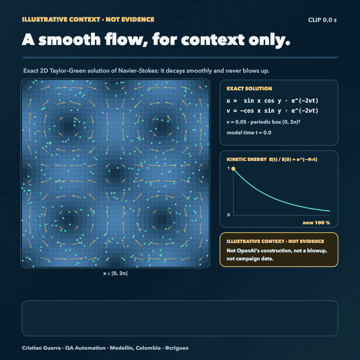

- **Muestra:** partículas moviéndose en la solución 2D exacta de Taylor–Green de Navier–Stokes, u = sin x cos y e^(−2νt), v = −cos x sin y e^(−2νt), con ν = 0,05 en la caja periódica [0, 2π]²; el fondo muestra la rapidez, las flechas la velocidad, y la gráfica el decaimiento exacto de energía e^(−4νt).
- **No muestra:** nada de la evidencia. No es dato de campaña, ni evidencia de explosión, ni la construcción de OpenAI; no lee ningún archivo de evidencia. El fondo y las flechas se actualizan en pasos de 1,2 unidades de tiempo del modelo para que el GIF se mantenga pequeño; la curva de energía y las partículas son continuas.
- **Rastro:** [escena](flow.html). Reemplaza, el 2026-10-22, un recorte 3D ancho que no encajaba en el layout cuadrado; ese clip sigue en el historial de git.

## Recompilar, probar y exportar

Desde la raíz del repositorio, regenera los archivos HTML independientes y el manifiesto derivado de los datos, y luego corre las pruebas deterministas:

```sh
python3 animations/build.py
python3 -m unittest discover -s animations -p 'test_*.py'
```

Las vistas previas del README en `docs/assets/` se exportan de estas mismas escenas HTML a resolución completa 1080 × 1080: 120 cuadros muestreados de forma pareja a lo largo de la escena de 20 segundos y reproducidos a 15 fps como un loop de 8 segundos, con una paleta global de 256 colores. Las cuatro escenas C/D con subtítulos, en cambio, se exportan en tiempo real, 200 cuadros a 10 fps, para que los subtítulos se mantengan legibles. Exportar necesita Python Playwright con Chromium y FFmpeg:

```sh
python3 animations/export_gifs.py              # all scenes
python3 animations/export_gifs.py mutants      # one scene
```

Las exportaciones en GIF no conservan los controles de avance del HTML.

Las versiones en MP4 de calidad completa de las catorce escenas (1080 × 1080, 30 fps, H.264, 20 segundos cada una) están en [`docs/media/`](../docs/media/), exportadas cuadro por cuadro de las mismas escenas HTML:

```sh
python3 animations/export_mp4.py              # all scenes
python3 animations/export_mp4.py mutants      # one scene
``` Las dimensiones de exportación no son garantía de aceptación en toda plataforma; comprueba los requisitos actuales de la plataforma antes de adaptar o subir. Estas instrucciones de fuente y renderizado no implican ninguna subida de animaciones.

Atribución: **Cristian Guerra · QA Automation · Medellín, Colombia · @criguex**.
